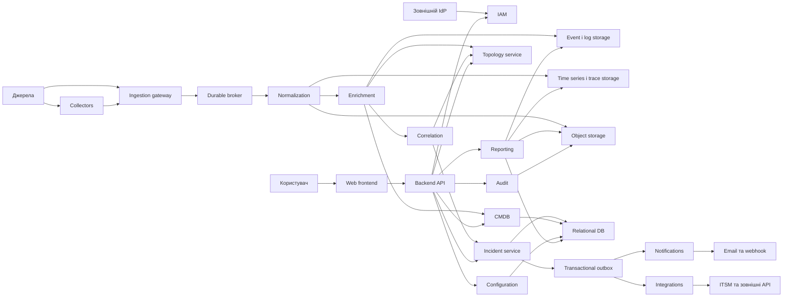
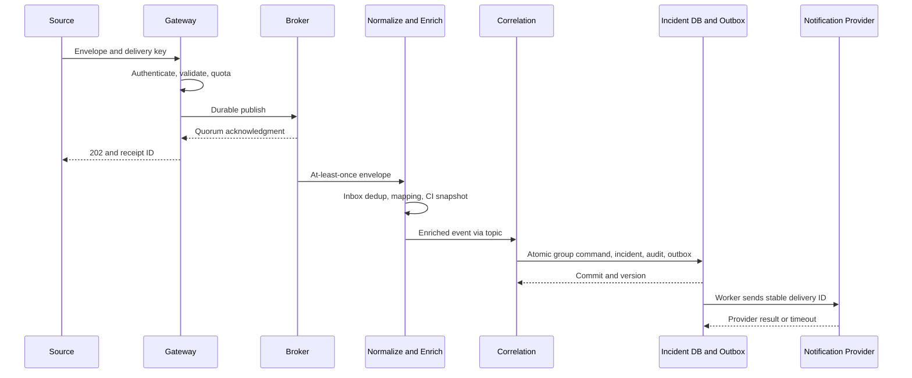
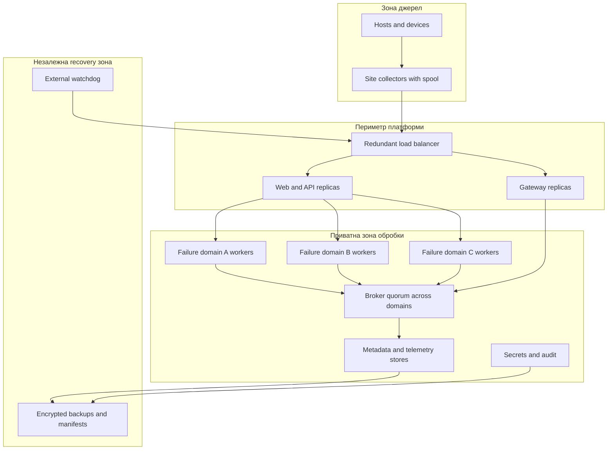
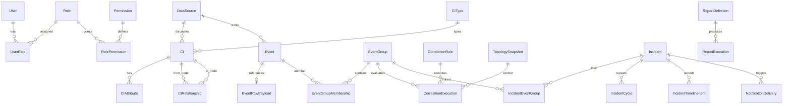

# 1. Загальні відомості

**Повне найменування:** «Розробка програмної платформи моніторингу ІТ-інфраструктури з кореляцією подій та аналізом залежностей компонентів».

**Скорочене найменування:** IOMP — Infrastructure Observability and Monitoring Platform. **Версія ТЗ:** 1.0, 24.09.2026. **Статус:** проєкт для погодження. Замовник, виконавець, власник продукту та уповноважені підписанти визначаються в `OPEN-QUESTION-001`; документ не засвідчує їхнього погодження.

Призначення платформи — приймати телеметрію та інвентаризаційні дані, вести реєстр CI і граф залежностей, нормалізувати події, формувати пояснювані групи подій та інциденти, обчислювати ймовірні першопричини й потенційну зону впливу, забезпечувати роботу операторів через web та API.

Цільові користувачі: NOC, SRE/DevOps, експлуатація серверів, мереж і БД, власники застосунків та бізнес-сервісів, incident management, інформаційна безпека, аудитори. Повна рольова модель наведена в розділі 9.

Передумови проєкту: розподілені джерела спостереження, повторні та каскадні сповіщення, відсутність спільного ідентифікатора компонентів, неповні залежності між сервісами та інфраструктурою. Це постановка задачі, а не підтверджений аудит середовища замовника (`ASSUMPTION-001`).

Очікуваний ефект перевіряється на погодженому наборі сценаріїв: усі контрольні події мають простежуваний шлях до джерела; каскадний сценарій утворює один incident зі збереженням усіх первинних event; оператор бачить пояснення RCA та blast radius; часові показники відповідають розділу 5. Зменшення фактичного MTTR замовника не є гарантією продукту: базова лінія та ціль визначаються після пілота (`OPEN-QUESTION-012`).

| Зацікавлена сторона | Відповідальність | Результат погодження |
|---|---|---|
| Замовник / Product Owner | Межі, бюджет, пріоритети, UAT | Baseline вимог і протокол приймання |
| Архітектор | Модель даних, інтеграції, ADR | Архітектурний опис і контракти |
| NOC / Incident Manager | Робочі сценарії, severity, SLA | Каталог сценаріїв та ескалацій |
| SRE / експлуатація | Розгортання, місткість, резервування | Runbook та DR-протокол |
| Власники інфраструктури / застосунків | CI, залежності, контрольні інциденти | Еталон CMDB і графа |
| Security Administrator | IAM, trust boundaries, секрети | Threat model та security gate |
| QA | Простежуваність і випробування | Test plan, звіт, реєстр дефектів |
| Власники зовнішніх систем | Доступи, квоти, sandbox, контракти | Integration manifest |

**Правила нормативності.** `Must` — обов'язкова вимога заявленої фази; `Should` — включається до контрактного обсягу тільки після погодження; `Could` — окрема опція. `Must / Phase 2` не є умовою приймання MVP. Весь текст, таблиці схем і алгоритми, на які посилається вимога, є її нормативною частиною. Непозначений як вимога приклад JSON або діаграма ілюструє контракт. Числа, не надані замовником, прив'язані до `ASSUMPTION-XXX`; до затвердження це проєктні значення, після затвердження — база випробувань. Зміна значення оформлюється версією baseline, оцінкою впливу і повторною перевіркою залежних тестів.

**Обмеження.** Платформа не керує технологічними процесами, не виконує автоматичне виправлення інфраструктури в MVP і не замінює SIEM, ITSM або засоби резервного копіювання. Продукт розгортається в середовищі замовника; vendor і хмарний провайдер не задані. Перелік застосовних правових, галузевих та внутрішніх вимог має надати замовник (`ASSUMPTION-005`, `OPEN-QUESTION-005`); відповідність конкретному режиму сертифікації не заявляється.

**Технічна нормативна база.** Контракт помилок спирається на [RFC 9457](https://www.rfc-editor.org/rfc/rfc9457.html); формат Syslog — на [RFC 5424](https://www.rfc-editor.org/info/rfc5424/); правила OTLP — на [специфікацію OTLP](https://opentelemetry.io/docs/specs/otlp/). OIDC є шаром автентифікації поверх OAuth 2.0 відповідно до [OpenID Connect Core](https://openid.net/specs/openid-connect-core-1_0.html); OAuth 2.0 сам по собі не задає автентифікацію користувача. Вимоги доступності UI прив'язані до [WCAG 2.2](https://www.w3.org/TR/WCAG22/). Конкретні редакції та версії реалізацій фіксуються в integration manifest до початку contract testing; посилання перевірено під час підготовки ТЗ.

# 2. Терміни, скорочення та визначення

| Термін | Визначення в межах ТЗ |
|---|---|
| CMDB | Реєстр конфігураційних одиниць, їхніх атрибутів, походження та зв'язків |
| CI | Configuration Item: компонент або логічний об'єкт із незмінним внутрішнім ідентифікатором |
| event | Незмінний факт, отриманий від джерела; повтор доставки не є новим фактом |
| alert | Стан умови, що потребує уваги; об'єднує opening, repeat і recovery events однієї умови |
| incident | Керована одиниця реагування на порушення або загрозу порушення сервісу; містить events та alerts |
| problem | Обліковий запис причини одного або кількох incident; повне problem management залишається в ITSM |
| root cause analysis / RCA | Ранжування можливих причин за спостереженнями й залежностями; результат не є доведеним причинним висновком |
| correlation | Встановлення пояснюваних зв'язків між подіями за версійованими правилами |
| topology | Граф компонентів і типізованих відношень станом на визначений час |
| dependency | Залежність споживача від постачальника ресурсу або функції |
| service map | Підграф, що показує бізнес-сервіс та його технічні залежності |
| observability | Можливість досліджувати стан системи через metrics, logs, traces та контекст змін |
| metric | Числове вимірювання з часом, одиницею, іменем і набором labels |
| log | Запис діагностичного або прикладного факту; не кожен log породжує alert |
| trace | Сукупність spans, що описують проходження операції через компоненти |
| SLA | Погоджене зобов'язання щодо сервісу або реагування з правилами вимірювання |
| SLO | Цільове значення SLI за визначене вікно |
| SLI | Формально визначена вимірювана характеристика сервісу |
| MTTA | Середній час від початку циклу incident до першого acknowledgment |
| MTTD | Середній час від відомого фактичного початку порушення до його виявлення |
| MTTR | У цьому ТЗ: середній час від початку циклу incident до відновлення сервісу; формула в 4.9 |
| RPO | Максимально допустима втрата даних у часі під час визначеного аварійного сценарію |
| RTO | Час від оголошення аварії до відновлення визначених функцій і перевірки їхньої працездатності |
| agent | Процес на контрольованому вузлі, який збирає та передає телеметрію |
| agentless monitoring | Збір через доступні протоколи/API без встановлення агента платформи на ціль |
| collector | Проміжний компонент приймання, перетворення та передачі телеметрії |
| exporter | Компонент, який надає або надсилає метрики у погодженому форматі |
| webhook | HTTP-виклик за подією між системами з контрактом доставки |
| SNMP | Протокол отримання стану мережевих пристроїв і приймання traps/informs |
| Syslog | Протокол передавання журналів із facility та severity |
| OpenTelemetry | Набір специфікацій, API, SDK і засобів збору телеметрії; не сховище |
| Prometheus | Система збору та запитів часових рядів із правилами alerting |
| Grafana | Система візуалізації та alerting, що інтегрується як зовнішній споживач/джерело |
| Zabbix | Зовнішня система моніторингу та джерело inventory, problems і recovery events |
| Kubernetes | Платформа оркестрації контейнерних workloads |
| API | Версійований програмний інтерфейс взаємодії |
| RBAC | Надання дозволів через ролі; доповнюється обмеженнями scope даних |
| SSO | Вхід до декількох систем через спільного Identity Provider |
| OIDC | OpenID Connect: протокол автентифікації та claims поверх OAuth 2.0 |
| LDAP / Active Directory | Протокол каталогів / служба каталогів; не взаємозамінні назви протоколу SSO |
| audit log | Незмінюваний журнал значущих дій, суб'єктів, об'єктів і результатів |
| fingerprint | Стабільний ключ умови alert; відрізняється від ключа ідемпотентності доставки |
| correlation key | Ключ кандидата на групування в межах scope, правила і часового вікна |
| upstream / downstream | Upstream — постачальник залежності; downstream — залежний споживач |
| blast radius | Множина потенційно зачеплених CI; окремо від підтверджено зачеплених |
| DLQ | Ізольована черга повідомлень, обробка яких не завершилася після політики retry |
| backpressure | Обмеження приймання, яке сигналізує джерелу про нестачу місткості |
| at-least-once | Доставка із можливими повторами; споживач має бути ідемпотентним |
| watermark | Межа event time, до якої завершено очікування допустимо запізнілих подій |
| scope | Область доступу: організація, середовище, команда та набір CI/сервісів |
| dry-run | Виконання правила з записом результатів без змін production incidents і повідомлень |

# 3. Межі та склад системи

`FR-ADMIN-001` і `NFR-MAINT-001` поширюють керування конфігурацією та документацією на весь нижченаведений склад. Розподіл фаз — `ASSUMPTION-001`. MVP включає промисловий захищений deployment після пілота, а не лише демонстраційний стенд.

| Область | MVP — обов'язково | Phase 2 — окремий обсяг | Phase 3 / future scope |
|---|---|---|---|
| Сутності | Усі CIType з 4.2, ручний/API/CSV облік; фізичні сервери, VM, мережеві пристрої, firewall/VPN/load balancer, БД, middleware/web, storage, queues, cloud, links, log sources, зовнішні залежності | Розширення discovery для вибраних платформ | Federated inventory між організаціями |
| Телеметрія | REST/webhook events; Prometheus-compatible metrics; OTLP metrics/logs/traces; Syslog; SNMP v3 та ізольований v2c; health-check; Windows/Linux через collector; Zabbix, Grafana/Alertmanager | Прямий Docker discovery, один погоджений cloud provider adapter, зовнішній broker adapter | Додаткові провайдери та протоколи |
| Inventory | CRUD, import, Kubernetes discovery, source reconciliation, versioning | Двобічна синхронізація з однією CMDB, Docker/cloud discovery | Федерація CMDB |
| Кореляція | Rule-based і graph-based, RCA scoring, explainability, manual merge/split, suppression, known issue mapping із файлу/CRUD | Розширені бібліотеки шаблонів, ITSM problem import | ML лише після окремого дослідження і dataset gate |
| Incidents | Життєвий цикл, assignment, SLA, timeline, maintenance; generic ITSM REST contract та один adapter до погодженої системи | Додаткові ITSM adapters | Change/problem management як окремий продукт |
| Повідомлення | Email, підписаний webhook, fallback, on-call, delivery log | Teams, Slack, Telegram, SMS gateway | Mobile push разом з окремим mobile application |
| UI / API / reports | Усі екрани 4.8, API 8, звіти 4.9, CSV/JSON | XLSX/PDF exports, розклад доставки звітів | Довільний конструктор BI |
| IAM / operations | OIDC, локальний emergency access, LDAP через IdP federation; RBAC, audit, HA, backup/restore, DR, IaC | Прямий LDAP adapter за окремим ADR | Active-active multi-region, SaaS multitenancy |

Внутрішні компоненти: gateway, API, IAM policy enforcement, normalization/enrichment, correlation, inventory/topology, incidents, notifications, integrations, reporting, audit/configuration та сховища. Логічні модулі можуть працювати в одному процесі, якщо зберігаються контракти й ізоляція фонового навантаження; список компонентів не зобов'язує створювати окремий microservice для кожного.

Зовнішні системи: джерела телеметрії; IdP/AD; CMDB/ITSM; email relay; chat/SMS providers; SIEM; сховища резервних копій замовника. Власник джерела відповідає за доступність, час, достовірність даних, дозволи і погоджені квоти. Платформа відповідає за перевірку, захищене приймання, облік втрат, збереження після durable acknowledgment, повторну обробку та пояснення результатів. Вона не гарантує доставку UDP до collector і не трактує недоступність джерела як доказ недоступності всіх його CI.

Не входять до MVP: власний універсальний агент із драйверами для всіх ОС; автоматична remediation; зберігання всіх traces без sampling; доведення причинності; автоматичне discovery всіх можливих залежностей; billing; управління правами у сторонніх продуктах; native mobile application. Custom collector означає adapter SDK і зразковий connector, а не нову ОС-службу з необмеженим набором функцій.

# 4. Функціональні вимоги

Формат таблиць: `Вхід` — прийняті дані; `Обробка → результат` — поведінка; `Доступ / межі` — дозволені ролі та обмеження. Повні назви ролей і скорочення визначені в розділі 9. Для всіх FR діє deny-by-default, scope перевіряється сервером; `SAc` отримує лише явно виданий permission. Відсутність дозволу перевіряється `TEST-021`. Усі операції зміни підпадають під `FR-AUDIT-001`. Ліміти та часові значення цього розділу — `ASSUMPTION-003`, якщо не вказано інше.

## 4.1. Збір і приймання телеметрії

| ID / назва | Пріоритет / фаза | Вхід | Обробка → результат | Доступ / межі | Критерій приймання |
|---|---|---|---|---|---|
| FR-INGEST-001 Приймання сигналів | Must / MVP | Metrics, logs, events, traces, traps, Syslog, health-check, inventory, infrastructure changes | Визначити signal type, schema, source; передати у відповідний pipeline; присвоїти receipt ID | ME налаштовує, SAc пише; лише зареєстроване джерело | TEST-001: кожен MVP adapter приймає валідний fixture і повертає/фіксує receipt; signal не губить обов'язкові поля |
| FR-INGEST-002 Ідентичність і час | Must / MVP | Source identity, timestamp, source_event_id | Перевірити credential-to-source binding; зберегти UTC event/ingestion time, original offset, clock quality | ME, SAc; чужий source ID заборонений | TEST-002: spoofed source → 403; різні offsets одного instant дають однаковий UTC; некоректний час маркований |
| FR-INGEST-003 Ідемпотентна доставка | Must / MVP | Event, delivery ID / idempotency key | Atomic inbox insert; однаковий ключ/тіло повертає перший receipt; інше тіло з тим самим ключем → 409 | SAc; вікно dedup не менше 7 діб | TEST-025: 100 повторів, зокрема після restart, дають один event і один side effect |
| FR-INGEST-004 Валідація та карантин | Must / MVP | Payload, content type, schema_version | Перевірити envelope/size/JSON schema; rejected API payload не ack; durable прийнятий, але не оброблений запис → quarantine/DLQ з reason | ME переглядає metadata; raw лише з окремим permission | TEST-024: невірні типи → 422; unsupported media → 415; надмірний payload → 413; жодної нормальної події |
| FR-INGEST-005 Буфер і backpressure | Must / MVP | Потік джерел і стан черги | Persistent spool на collector; durable broker acknowledgment; admission control; 429/503 з Retry-After; retry з jitter | PA/SY; квоти по source та signal, окрема квота critical events | TEST-016/023/026: збережені accepted events відновлюються без дублювання; переповнення дає видиму відмову |
| FR-INGEST-006 Метрики та health-check | Must / MVP | Exporter samples; HTTP/TCP probes; rule thresholds | Зберегти time series; порогова умова з duration/hysteresis породжує opening/recovery event | ME/SRE; заборонені довільні URL, redirect у закриті мережі | TEST-001: три послідовні failed probes створюють один alert, три successful — recovery; probe timeout 5 s |
| FR-INGEST-007 Стан джерела | Must / MVP | Heartbeat, checkpoint, counters | Обчислити Fresh/Stale/Unavailable за expected_interval; пропуск 3 інтервалів → Stale; повідомити про collector loss | ME/SRE/NOC читають; ME змінює interval | TEST-001: припинення heartbeat не створює host-down для кожного CI; відображається data freshness |
| FR-INGEST-008 Adapter SDK | Must / MVP | Adapter manifest, mapping, test fixtures | Надати source contract, checkpoint/inbox helpers, secrets reference, test harness; один custom REST adapter | ME, розробник; виконуваний plugin проходить release pipeline | TEST-027: зразковий adapter проходить replay, invalid, retry та schema compatibility tests |

**Доставка.** Гарантія після успішного durable acknowledgment — at-least-once transport із ідемпотентним ефектом у сховищі. HTTP `202` дозволено лише після quorum-запису envelope у broker; запис до raw object storage може відбутися пізніше із цього envelope. Частковий прийом batch: `202` містить receipt для кожного прийнятого елемента та reasons для відхилених; джерело повторює лише непідтверджені. Весь batch із невалідним envelope повертає `422`. Для OTLP застосовується власна модель full/partial success; partial success не спричиняє повтор усього batch згідно зі [специфікацією OTLP](https://opentelemetry.io/docs/specs/otlp/).

**Проєктні межі (`ASSUMPTION-003`).** Event ≤256 KiB після декомпресії; REST batch ≤500 events та ≤5 MiB; labels ≤64 пар, ключ ≤128 і значення ≤1024 символів; title ≤512, message ≤32 KiB. Request body decompression ratio ≤20:1. Метрики: ≤30 labels на series; загальна cardinality в 5.1. Spool колектора — мінімум 2 години його погодженого пікового потоку; broker retention — 24 години aggregate steady потоку. Retry для надійних telemetry protocols: exponential 1–60 s з full jitter до завершення 24-годинного retention; 4xx, крім 408/429, не повторюються без виправлення; 429 враховує Retry-After. Після вичерпання retry прийняті записи залишаються в DLQ 7 діб; перед видаленням створюється operational alert. Для UDP collector рахує отримані й локально відкинуті datagrams; недоставлені до нього пакети кількісно не гарантуються.

**Timestamp.** На вході RFC 3339 із offset або protocol-native epoch з явно вказаною одиницею. UTC зберігається без втрати доступної точності; UI показує вибрану IANA timezone та offset, CSV — UTC. Відсутній час → ingestion time + `timestamp_quality=estimated`; більше 5 min у майбутньому → quarantine; понад 24 h у минулому → історичне збереження з `late=true`, без автоматичного reopening. Джерела без timezone мають налаштовану source timezone; неоднозначний час переходу DST позначається `ambiguous`, не використовується для time-order RCA. System clocks синхронізуються з offset ≤1 s.

**Схема.** `schema_version` має major.minor; major mismatch відхиляється, невідомі minor-поля зберігаються в `extensions` за розмірним лімітом. Обов'язкові поля не змінюють тип у межах major. Режим підтримки попередньої major визначено в 8.1. Source sequence/checkpoint фіксується лише після durable receipt; network timeout після receipt без відповіді безпечно вирішується повтором.

## 4.2. Інвентаризація та CMDB

Нормативний каталог `CIType`: `host`, `virtual_machine`, `container`, `pod`, `service`, `application`, `database`, `network_device`, `firewall`, `switch`, `router`, `load_balancer`, `storage`, `cluster`, `namespace`, `queue`, `external_endpoint`, `network_segment`, `business_service`; додаткові підтипи `vpn_gateway`, `web_server`, `middleware`, `cloud_resource`, `log_source`, `communication_link`; допоміжні логічні типи `organization_unit`, `location`. Підтип успадковує поля базового типу. Фізичний сервер — `host` із `virtualization=physical`; файлова/об'єктна система — `storage` із `storage_kind=file/object`. `organization_unit` і `location` дозволяють зберігати кінці відношень власності та розташування як CI; користувачі й IAM groups залишаються окремими сутностями. Для кожного додаткового підтипу parent code фіксується у versioned CIType schema до реалізації імпорту.

| Поле CI | Обов'язковість / перевірка |
|---|---|
| id, type, name, lifecycle_status, version | Обов'язкові; UUID, каталог типів, непорожнє ім'я, Proposed/Active/Retired/Archived, optimistic version |
| owner_id, support_group_id, criticality, environment, location_id | Обов'язкові для Active; Proposed може мати `unassigned`; criticality 1–5; каталог environment/location |
| ip_addresses, dns_names, tags | Масиви/об'єкт, порожні дозволені; IPv4/IPv6; lowercase FQDN; canonical tag keys |
| data_source_id, source_object_id, last_synced_at | Для discovery/import обов'язкові; для manual source_object_id=id, last_synced_at=null |
| technical_attributes, schema_version | Типізований об'єкт за CIType; невідомі поля тільки в extensions |
| created_at, updated_at, deleted_at | UTC; deleted_at nullable; користувач не задає серверні timestamps |
| relationships, change_history | Окремі колекції за FK; не перезаписуються разом з CI |

| ID / назва | Пріоритет / фаза | Вхід | Обробка → результат | Доступ / межі | Критерій приймання |
|---|---|---|---|---|---|
| FR-INVENTORY-001 Реєстр CI | Must / MVP | CI поля, ETag | CRUD з валідацією типів/посилань; нова версія і field-level diff | ME/SRE/IO; AO лише owned scope | TEST-003: валідний CI зберігається; помилка поля → 422; stale ETag → 412 без overwrite |
| FR-INVENTORY-002 Імпорт | Must / MVP | CSV UTF-8 або JSON, mapping, import_key | Preview помилок і змін; commit валідних рядків з per-row report, invalid лишаються rejected | ME/IO; ≤50 000 CI/job | TEST-027: повтор job не створює дублів; count accepted+rejected дорівнює input; preview нічого не змінює |
| FR-INVENTORY-003 Discovery | Must / MVP | Kubernetes list/watch, host/network inventory від adapter | Upsert за immutable external ID; source checkpoint; Retired лише після відсутності CI у 3 успішних повних inventory cycles; failed/partial cycles не рахуються | ME; credentials read-only; немає discovery поза allowlist | TEST-006: pod recreate з новим UID → новий CI; пропущений watch відновлюється relist без зникнення актуальних CI; outage джерела не змінює lifecycle CI |
| FR-INVENTORY-004 Конфлікти джерел | Must / MVP | Конкурентні значення атрибута | Field ownership: manual lock → authoritative source → source priority → найновіший observed_at; tie вирішує source ID; зберегти alternatives | ME/IO; зміна source priority аудитується | TEST-003: порядок доставки не змінює фінальний результат, conflict видно у картці |
| FR-INVENTORY-005 Ідентичність і merge | Must / MVP | External IDs, resource UID, names/IP, candidate pair | Точна identity match; name/IP лише кандидати; manual merge з alias, переприв'язкою FK та журналом | ME/IO; між environment merge заборонено; split через контрольоване відновлення alias | TEST-004: однаковий IP у різних мережах не зливає CI; historical event зберігає original CI reference |
| FR-INVENTORY-006 Життєвий цикл | Must / MVP | Retire/delete/archive command і reason | Soft-delete приховує зі звичайного пошуку, зберігає historical FK; archive блокує редагування | IO/PA; CI з активним incident не hard-delete | TEST-003: archived CI доступний історичному incident; повтор delete не змінює timestamp |
| FR-INVENTORY-007 Зовнішня CMDB | Should / Phase 2 | External object version, mapping, deletion markers | Incremental sync, reconciliation report, source ownership; без циклічного перезапису | ME/IO; одна погоджена CMDB | TEST-027: локально locked owner не змінюється; недоступність показує stale та last successful sync |

Name normalization: trim і Unicode NFC для display name; hostname/DNS — lowercase, без trailing dot; display name зберігається окремо від match key. Ідентичність: `(source_id, source_object_id)` або provider resource ID/cluster UID. IP без network scope не є унікальним. Ручне merge створює canonical CI та aliases; початкові versions зберігаються. Hard-delete дозволяється лише lifecycle job за retention, без живих FK, із tombstone та audit.

## 4.3. Топологія та залежності

Вузол графа — CI. Зв'язок має `id`, `from_ci_id`, `to_ci_id`, `type`, `direction`, `weight` [0;1], `criticality` 1–5, `confidence` [0;1], `source_id`, `evidence_ref`, `status=Proposed/Confirmed/Rejected/Expired`, `valid_from`, `valid_to`, `observed_at`, `version`, `author`. Конкретні bounds є контрактом моделі, а не прогнозом продуктивності. Історія має event time validity і system time recorded_at; historical snapshot відтворює обидва виміри.

**Орієнтація.** `A depends_on B` означає, що A — споживач, B — постачальник. Пошук upstream рухається A→B; blast radius від B рухається по зворотних ребрах до A. Поняття upstream не визначається положенням вузла на екрані.

| Тип зв'язку | Семантика from → to | Участь у propagation за замовчуванням |
|---|---|---|
| depends_on | consumer → provider | Так, у зворотному напрямку |
| hosts | host → guest | Так, from → to; еквівалент runs_on, без подвоєння шляху |
| runs_on | workload → execution host | Так, у зворотному напрямку |
| connects_to | peer ↔ peer | Ні; ненаправлений, canonical ordered pair |
| uses | consumer → resource | Лише з `propagates_failure=true` |
| routes_through | traffic consumer → network hop | Так, у зворотному напрямку |
| monitors | monitor → target | Ні |
| managed_by | managed CI → management service CI | Ні |
| owned_by | CI → organization_unit CI | Ні; owner person/group зберігається також як metadata, IAM user не стає вузлом графа |
| replicates_to | primary → replica | Ні; окрема replication rule враховує failover |
| backs_up | backup service → protected CI | Ні |
| serves | provider → consumer | Лише з `propagates_failure=true`, from → to |
| exposes | service → endpoint | Так, from → to |
| belongs_to | component → containing CI | Ні |
| located_in | CI → location CI | Ні; location_kind задає site/building/rack; network segment є окремим CI |
| member_of | member → cluster/group CI | Лише через quorum rule, не одиничним падінням member |

| ID / назва | Пріоритет / фаза | Вхід | Обробка → результат | Доступ / межі | Критерій приймання |
|---|---|---|---|---|---|
| FR-TOPOLOGY-001 Граф і версії | Must / MVP | CI pair, edge attributes, ETag | Валідація endpoint/type, create/version/expire; snapshot ID | ME/SRE/IO; AO owned service scope; self-edge заборонений | TEST-005: минулий snapshot відтворюється після зміни ребра; недоступний CI не видаляє вузол |
| FR-TOPOLOGY-002 Discovery зв'язків | Must / MVP | Kubernetes ownership, collector metadata, trace evidence | Створити Proposed з evidence/confidence; confirm/reject; не відновлювати rejected без нових evidence | ME/SRE; trace-derived edges не прирівнюються до доведених залежностей | TEST-006: rejected edge не бере участі RCA; повтор discovery не створює нового edge |
| FR-TOPOLOGY-003 Traversal і blast radius | Must / MVP | Root CI, direction, depth, snapshot, filters | Cycle-safe traversal з typed propagation; повернути potential та observed impact окремо, paths, truncated | RO та operational roles; до 6 hops, 10 000 nodes/job | TEST-010: на циклі A→B→C→A немає нескінченного обходу; depth/limit дають truncated=true |
| FR-TOPOLOGY-004 Сервісна карта | Must / MVP | Business service, environment/site/owner/type/tags/criticality | Побудувати підграф, статуси Healthy/Degraded/Unavailable/Unknown, легенду, freshness | AO/IO/SRE/NOC/RO у scope; без розкриття прихованих CI | TEST-010: невідома телеметрія показується Unknown; приховані вузли не витікають через count або labels |
| FR-TOPOLOGY-005 Вплив змін | Must / MVP | Configuration change, old/new snapshot | Зберегти diff; позначити часовий збіг із incident як evidence, а не причину | ME/SRE/IM читають | TEST-009: explanation містить change ID, час, snapshot і правило; збіг не дає автоматично confidence=1 |

Обхід згортає strongly connected components для ранжування, але повертає користувачу первинні вузли. Redundancy group має `min_healthy_members`; падіння одного учасника не переноситься на кластер, доки число здорових не нижче порога. Без відомого порога результат — `potential`, а не підтверджений outage. Використовуються Confirmed edges; Proposed показуються окремим шаром і не пригнічують alert.

## 4.4. Нормалізація та класифікація подій

Нижче визначено нормалізований `Event`. `R` — required; `C` — required за умовою; `O` — nullable. Відсутнє nullable-поле зберігається як null, а не вигадане значення.

| Поля | Тип / обов'язковість | Правило |
|---|---|---|
| event_id, schema_version | UUID / R; string / R | Server ID; version контракту |
| event_type, source_system, source_id, source_event_id | string / R,R,R,C | source_event_id required для надійних event adapters; для Syslog/trap — collector sequence ID |
| timestamp, ingestion_timestamp, original_timestamp, timestamp_quality | datetime / R,R,O; enum / R | UTC + вихідне значення; trusted/estimated/ambiguous |
| severity, status, lifecycle_state, acknowledgment_state | enum / R | Severity нижче; status Active/Cleared/Unknown; lifecycle Recorded/Correlated/Archived; ack Unacknowledged/Acknowledged |
| ci_reference, hostname, ip_address | UUID/string/IP / O | CI match provenance окремо; невідоме CI не блокує ingestion |
| service_name, application_name, environment, location | string / O | Source values плюс canonical IDs після enrichment; не перетирати source value |
| category, subcategory | enum/string / R,O | availability/performance/capacity/security/configuration/connectivity/data_quality/unknown |
| title, message, labels | string/string/object / R,R,R | Порожній message допустимий; labels={} допустимо |
| metric_name, metric_value, metric_unit, threshold | string/number/string/object / C | Для metric condition потрібні name/value/unit; threshold={operator,value,duration} |
| fingerprint, correlation_key | string / R,O | Версія алгоритму в ключі; correlation_key додається правилами |
| raw_payload_reference, payload_hash | string / O,R | Reference з'являється після запису; hash рахується з canonical input після masking |
| trace_id, span_id, source_sequence, late | string/string/integer/bool / O,O,O,R | Не створювати фіктивний trace; late=false за замовчуванням |
| mapping_version, ci_version, topology_snapshot_id | string/integer/UUID / R,O,O | Lineage результату обробки |

| ID / назва | Пріоритет / фаза | Вхід | Обробка → результат | Доступ / межі | Критерій приймання |
|---|---|---|---|---|---|
| FR-INGEST-009 Нормалізація | Must / MVP | Raw envelope, mapping version | Перетворити типи, severity/status/category, зберегти originals; Unknown не дорівнює Healthy | ME редагує mapping; SAc запускає | TEST-002: fixtures усіх severity/status дають очікувані enum, невідомий mapping не втрачає raw |
| FR-INVENTORY-008 Enrichment | Must / MVP | Event, CI identities, CMDB version | Exact-match immutable ID; scoped name/IP fallback лише за єдиного кандидата; snapshot metadata | Системна операція; оператор може підтвердити remap | TEST-003/004: 0 кандидатів → Unmatched; >1 → Ambiguous; історична версія залишається доступною |
| FR-CORRELATION-001 Fingerprint і repeats | Must / MVP | Source condition ID, CI identity, condition labels | Canonical SHA-256 key; група repeats має first/last_seen і count; event не видаляється | ME задає key fields; no message/timestamp in key | TEST-025: changing value/message при одній condition оновлює один alert; інша threshold rule дає інший fingerprint |
| FR-AUDIT-001 Простежуваність | Must / MVP | CRUD, export, permission decision, correlation, access to raw | Audit actor/action/object/time/result/reason/request_id/versions; зв'язок receipt→event→execution→incident→delivery | AU/SEC читають; записи append-only | TEST-022: кожна контрольна дія має audit; секрети відсутні; зміна запису виявляється integrity check |

**Severity mapping** — проєктна політика `ASSUMPTION-011`, а не універсальна семантика джерел. Normalized severity: `Critical`, `High`, `Medium`, `Low`, `Info`, `Unknown`; recovery має status Cleared, а не окрему severity.

| Джерело | Вхідне значення | Normalized severity |
|---|---|---|
| Syslog | 0 Emergency, 1 Alert, 2 Critical | Critical |
| Syslog | 3 Error; 4 Warning; 5 Notice; 6 Informational, 7 Debug | High; Medium; Low; Info |
| Zabbix | Disaster; High; Average; Warning; Information; Not classified | Critical; High; Medium; Low; Info; Unknown |
| Prometheus / Alertmanager / Grafana | label critical; high; warning; info; label відсутній | Critical; High; Medium; Info; Unknown |
| Windows Event Log | Critical; Error; Warning; Information, Verbose | Critical; High; Medium; Info |
| OTLP logs | FATAL range; ERROR range; WARN range; INFO/DEBUG/TRACE ranges; unspecified | Critical; High; Medium; Info; Unknown |
| SNMP / custom | Adapter mapping по OID/event_type | Значення manifest; unmapped → Unknown |

Цифрові severity Syslog походять із [RFC 5424](https://www.rfc-editor.org/info/rfc5424/); відповідність внутрішнім класам визначає це ТЗ. Для Alertmanager `firing/resolved` означає Active/Cleared; оскільки груповий status може бути firing за наявності хоча б одного firing alert, adapter обробляє статус кожного елемента окремо ([Prometheus notification data](https://prometheus.io/docs/alerting/latest/notifications/)). Zabbix problem/recovery → Active/Cleared із join за problem event ID; Grafana alerting/normal → Active/Cleared, no_data/error → Unknown та окремий data_quality event. Log Error сам по собі має status Unknown, доки rule не задає condition lifecycle.

**Ключі.** Delivery dedup key=`source_id + source_event_id + source_revision`; за відсутності native revision adapter включає status transition/sequence, щоб recovery не загубився. Для UDP collector призначає `collector_id + boot_id + monotonically_increasing_sequence` до spool; це прибирає повтори передачі collector→platform, але не обіцяє розпізнати повтор одного UDP datagram. Fingerprint=`v1:sha256(scope, source_id, canonical_ci_or_source_object, event_type, condition_id, sorted_stable_condition_labels)`. Correlation key=`rule_version + scope + evaluated_group_fields + window_bucket`, із overlap handling на межах bucket. Cross-source correlation виконує rule, не випадковий збіг fingerprint.

Raw payload проходить secret redaction до durable storage; зберігається encrypted object з hash, MIME, source, received_at, retention та restricted access. Payload містить вихідні діагностичні дані після вилучення секретів, а не гарантовану побайтову копію мережевого трафіку. Події без CI лишаються searchable та враховуються у звіті matching quality; pending rematch кожні 5 min протягом 24 h; rematch створює enrichment revision, не змінює оригінальний факт.

## 4.5. Кореляція подій

| ID / назва | Пріоритет / фаза | Вхід | Обробка → результат | Доступ / межі | Критерій приймання |
|---|---|---|---|---|---|
| FR-CORRELATION-002 Виконання правил | Must / MVP | Нормалізовані events, snapshot, rule version | Time/CI/dependency/source/network/service/fingerprint/tags/template/change/known-issue predicates; event group і execution explanation | ME/SRE створюють, PA активує; scope без cross-environment grouping за замовчуванням | TEST-007: позитивний і негативний fixture кожного predicate; незв'язані CI не групуються лише через близький час |
| FR-CORRELATION-003 Керування правилами | Must / MVP | Rule DSL, fixtures, metadata | Validate, draft, test, dry-run, activate, rollback; immutable versions | ME/SRE автор, PA reviewer; автор не активує власну версію | TEST-028: dry-run не створює production incident/delivery; rollback відновлює попередню версію для нових executions |
| FR-CORRELATION-004 Каскадне пригнічення | Must / MVP | Primary/secondary alerts, confirmed dependency paths | Позначити secondary notification_suppressed з rule/path/expiry; залишити event та alert searchable | ME/SRE rule; NOC/IM override; незалежна critical condition не пригнічується | TEST-008: один notification на первинну причину, всі secondary alerts видно; expiry відновлює незалежне оповіщення |
| FR-CORRELATION-005 Ймовірна першопричина | Must / MVP | EventGroup, CMDB, topology, changes | Ранжувати candidates за формулою нижче; top candidates, score, evidence, unknown reasons | IM/SRE/NOC/AO/IO у scope; результат є рекомендацією | TEST-009: очікуваний rank і числовий score на фіксованому fixture; однакові inputs дають однаковий результат |
| FR-CORRELATION-006 Ручне групування | Must / MVP | Event/incident IDs, action, reason, expected versions | Merge/split з membership history і manual lock; перенести links без копіювання facts | IM; NOC може запропонувати; cross-scope заборонено | TEST-029: split не змінює event IDs; автоматичне правило не скасовує manual lock |
| FR-CORRELATION-007 Recovery і пізні події | Must / MVP | Clear/recovery, source sequence, late event | Закрити відповідний alert лише newer recovery; recompute group; resolve incident за політикою 4.6 | Система; IM override | TEST-007/025: старий recovery не закриває новий firing; historical replay не надсилає live notifications |
| FR-CORRELATION-008 Обмеження витрат | Must / MVP | Rule, stream, graph size | Compile bounded DSL; execution timeout, per-rule budget; failed rule → quarantine execution та platform alert | PA/ME; немає довільного SQL/коду/необмеженого regex | TEST-028: pathological pattern не зупиняє pipeline; інші правила завершуються в NFR-PERF-003 |

**Модель правила.** Required: `id`, `name`, `status=Draft/DryRun/Active/Disabled`, `scope`, `conditions`, `group_by`, `window_seconds`, `lateness_seconds`, `priority`, `action`, `conflict_strategy`, `version`, `author_id`, `reviewer_id` перед activate, `changed_at`, `test_fixture_refs`, `audit_ref`. Action належить `group`, `create_incident`, `suppress_notification`, `enrich`, `resolve`. Підтримуються bounded string match, числові пороги, tag predicates, typed graph path, joins із change/known-issue registry; evaluation sandbox без мережі й файлової системи.

**Часові вікна (`ASSUMPTION-003`).** Типове sliding window — 120 s, допустиме запізнення — 30 s; maximum configurable window — 30 min. Перший результат формується інкрементально, не очікує закриття вікна. Watermark має bounded idle-source handling: source без даних 60 s не затримує всю partition. Події після watermark зберігаються та можуть створити нову execution revision протягом 24 h; уже відправлені notifications не відкликаються. Recovery впорядковується за native sequence/version, а за їх відсутності — trusted event time; нерозв'язаний tie стає reconciliation conflict, а не довільним close.

**Стратегія конфліктів.** Усі match-results зберігаються. Для єдиного primary EventGroup membership перемагає менше numeric priority, потім більш специфічний scope, потім rule ID за лексикографічним порядком. Enrichment actions поєднуються лише для різних полів; конфлікт однакового поля вирішується тим самим порядком. `force_notify` та manual unsuppress мають перевагу над suppression. Manual membership lock має перевагу над автоматичним regroup. Group ownership і incident creation виконуються транзакційно з unique active group key; cross-partition results сходяться через single owner для цього ключа. Зміна правила не переписує минулих executions; explicit replay створює окремий run із `mode=replay`.

**Базовий набір правил.** Кожна позиція — Must/MVP у складі `FR-CORRELATION-002`, з парою match/no-match fixtures: repeated condition одного CI; помилки consumer після provider-down через confirmed dependency; спільний network segment outage; збій business service; група від одного source лише з однаковою condition; збіг дозволених tags; впорядкований template «change → errors → unavailability»; known issue з versioned signature і remediation reference. Known issue не закриває incident автоматично та не замінює problem management.

**RCA scoring (`ASSUMPTION-011`).** Для event group береться topology snapshot на найраніший trusted event time; snapshot ID зберігається. Candidates — CI з active fault evidence у групі плюс upstream CI до 6 hops. Для кожного c обчислюються нормовані [0;1] ознаки:

1. `D(c)` — частка підтверджено зачеплених CI групи, досяжних від c за failure propagation; unique CI count, не кількість шляхів. Якщо group містить лише c, D=1 за власного active evidence.
2. `T(c)=max(0,1-max(0,t_c-t_first)/W)` — підтримка часовим порядком, W — window; за відсутності trusted t_c значення 0.
3. `E(c)` — 1 для explicit availability fault/failed probe; 0.6 для threshold degradation; 0 для відсутнього прямого evidence. Суперечний successful probe пізнішого sequence робить E=0 для того циклу.
4. `C(c)=(criticality-1)/4`; Unknown criticality → 0; впливає на пріоритизацію, не доводить причину.
5. `I(c)` — кількість унікальних потенційно зачеплених active CI / max(1, розмір об'єднаної потенційної зони всіх candidates).

`base_score=0.35*D+0.25*T+0.25*E+0.05*C+0.10*I`.

`q_time` — частка trusted timestamps; `q_ci` — частка events з однозначним CI; `q_graph` — мінімальний confidence ребер у використаних explanation paths, для single-CI case без ребер — 1. `confidence_score=round(100*base_score*min(q_time,q_ci,q_graph))`. Це евристичний індекс якості, **не ймовірність**, не метрика ML. Виводяться base_score, усі features, quality factors, path evidence, виключені candidates та версія формули.

Вибираються до 3 candidates зі score ≥60; різниця top-1/top-2 <10 означає `Ambiguous`, обидві причини показуються. Якщо top score <60, відсутня CI match, snapshot прострочений >24 h або немає direct fault evidence у жодного кандидата — `Undetermined` із reason. Неактивний upstream може бути показаний як hypothesis, але не стає підставою suppression. Suppression потребує active upstream evidence, confirmed path confidence ≥0.8, часової сумісності та конкретного cascade rule; сам високий RCA score цього не дозволяє. Compound incident може мати декілька independent candidate clusters.

ML у Phase 3 має окремий gate: погоджений de-identified labeled dataset, provenance/consent, chronological train/validation/test split без incident leakage, baseline цього rule engine, precision/recall/top-k RCA metrics, пороги й drift monitoring, навчальний pipeline та можливість вимкнення. Числові ML-цілі до отримання dataset не встановлюються; ML не є умовою MVP.

## 4.6. Керування інцидентами

Incident має required `id`, `title`, `description`, `severity`, `status`, `priority`, `affected_ci_ids` (може бути [] для Unmatched), `event_group_ids`, `created_at`, `updated_at`, `version`, `assigned_group_id`, `sla_policy_version`, `sla_deadlines`, `cycle_no`. `assignee_id`, `probable_root_cause`, `confidence_score`, `resolved_at`, `closed_at`, `external_ticket_reference`, `postmortem_reference` nullable. `timeline`, `comments`, `attachments/links`, `assignment_history`, `change_history` — дочірні об'єкти; усі зміни мають actor та reason. Для auto incident порожня assigned_group замінюється погодженою default NOC queue, а не втратою маршрутизації.

| ID / назва | Пріоритет / фаза | Вхід | Обробка → результат | Доступ / межі | Критерій приймання |
|---|---|---|---|---|---|
| FR-INCIDENT-001 Створення і dedup | Must / MVP | Manual payload або EventGroup | Unique active incident key; create або attach evidence; default severity=max active alerts | NOC/IM/SRE; система; title/description обов'язкові | TEST-007/011: concurrent creates однієї group дають один active incident; manual request з key ідемпотентний |
| FR-INCIDENT-002 Життєвий цикл | Must / MVP | Transition, reason, ETag | Перевірити таблицю переходів; append timeline; timestamps серверні | NOC acknowledge/investigate/mitigate; IM resolve/close/reopen/FP | TEST-011: усі дозволені переходи проходять, усі решта → 409; stale version → 412 |
| FR-INCIDENT-003 Призначення і пріоритет | Must / MVP | Group, assignee, priority, reason | Перевірити членство; зберегти історію; перерахувати deadline без стирання breach | NOC/IM/SRE; assignee у доступній групі | TEST-011: чужий assignee → 422; пріоритетна зміна не обнуляє SLA timer |
| FR-INCIDENT-004 SLA і ескалації | Must / MVP | Policy, incident cycle, clock | Обчислити acknowledgment/restoration deadline; при breach створити escalation outbox один раз на level | IM задає policy; NOC читає; PA активує | TEST-013: рівно одна escalation на level; restart scheduler не створює повтору |
| FR-INCIDENT-005 Maintenance / suppression | Must / MVP | Scope, window, reason, timezone, suppress mode | Маркувати events; блокувати notifications за політикою; collection триває; після window повторно оцінити стан | ME/SRE/IM; P1 bypass за SLA policy | TEST-014: події всередині window видимі; активна проблема після завершення породжує notification |
| FR-INCIDENT-006 Контекст і вкладення | Must / MVP | Comment, URL, file, postmortem ref | Append timeline, sanitize text, quarantine/scan attachments, signed download | Operational roles у scope; max file 20 MiB; executable types заборонені | TEST-011/030: файл до scan недоступний; заборонений type → 415; link не викликає server-side fetch |
| FR-INCIDENT-007 ITSM зв'язок | Must / MVP | Incident/version, external ticket/update | Outbox sync, stable external key, origin marker, field ownership | IM/SAc; один погоджений ITSM adapter | TEST-015: timeout після remote create не створює другий ticket; конфлікт не переписує обидві сторони циклічно |

| Початковий стан | Дозволений наступний стан | Умова та виконавець |
|---|---|---|
| New | Open, Suppressed, False Positive | Open автоматично після assignment; suppression policy або IM із reason; FP — IM |
| Open | Acknowledged, Suppressed, Resolved, False Positive | Ack — NOC/IM; Resolved — лише auto recovery policy або IM з evidence |
| Acknowledged | Investigating, Mitigated, Resolved, Suppressed, False Positive | NOC investigate/mitigate; IM resolve/FP; policy suppress |
| Investigating | Mitigated, Resolved, Suppressed, False Positive | Mitigation evidence; IM resolve/FP |
| Mitigated | Investigating, Resolved | Новий active evidence повертає Investigating; IM або auto recovery resolve |
| Resolved | Closed, Reopened | Closed — IM з resolution code і summary; Reopened — нова активність того ключа |
| Closed | Reopened | IM manual із reason; auto лише в межах reopen window |
| Reopened | Open, Acknowledged, Suppressed | Новий cycle з новими deadlines; автоматично Open після assignment |
| Suppressed | Попередній нетермінальний стан, Open, Resolved | Expiry/unsuppress відновлює previous_status; без попереднього — Open; Resolved за recovery policy |
| False Positive | Reopened | Лише IM зі спростуванням попереднього рішення; поточний cycle завершується resolution_code=false_positive |

Невказані переходи заборонені. `Acknowledged` фіксує першу людську реакцію; provider delivery receipt не є acknowledgment. Event-level ack — проєкція пов'язаного alert acknowledgment із lineage, а не зміна первинного факту event.

**Auto recovery (`ASSUMPTION-011`).** Auto Resolved дозволений, коли всі причинні alerts мають newer recovery і протягом 5 min не надійшло active evidence. Відсутність повідомлень не означає recovery. `Closed` завжди потребує дії IM. Новий active condition протягом 24 h після Resolved/Closed відкриває новий cycle того incident; пізніше створюється новий incident із `recurrence_of`. Ручний lock забороняє auto resolve. FP не спрацьовує як suppression rule для майбутніх інцидентів.

**SLA policy (`ASSUMPTION-011`).** P1: acknowledgment 5 min, restoration 60 min; P2: 15 min / 4 h; P3: 1 h / 24 h; P4: 8 h / 72 h. У MVP elapsed 24×7 calendar time; business calendars — Phase 2. Priority defaults: Critical для business-critical CI → P1; інші Critical/High → P2; Medium → P3; Low/Info/Unknown → P4, із ручним override. Escalation: warning на 80% deadline, breach на 100%, повтор через кожні 30 min до ack/restoration відповідно. Зниження priority не стирає breach; підвищення застосовує новий бюджет від початку cycle. Manual suppression/quiet hours не зупиняє SLA. Planned maintenance, погоджений до початку порушення, може виключати час з service availability тільки за версією SLO policy; обидва значення gross/net зберігаються.

## 4.7. Оповіщення та ескалації

| ID / назва | Пріоритет / фаза | Вхід | Обробка → результат | Доступ / межі | Критерій приймання |
|---|---|---|---|---|---|
| FR-ALERTING-001 Alert lifecycle | Must / MVP | Opening, repeat, recovery events, fingerprint | Один active Alert на scope+fingerprint; first/last_seen, count, acknowledgment, suppressed_until, recovery reference | NOC/IM/SRE; поля source events незмінні | TEST-007/025: повтор підвищує count, clear закриває правильний cycle, не створює другу умову |
| FR-ALERTING-002 Канали і шаблони | Must / MVP | Incident transition, template, route | Render escaped template; enqueue email/webhook; short summary+permission-checked link | ME/IM конфігурація, PA activation; секрети/raw не вставляються | TEST-012: fixtures показують ID/severity/service/time/action link; HTML/script не виконується |
| FR-ALERTING-003 On-call маршрутизація | Must / MVP | Team schedule, timezone, overrides, severity | Визначити recipient на event time; fallback contact за прогалини; snapshot одержувачів | IM/SRE; overlapping shifts мають explicit priority | TEST-012/013: DST, override, gap і overlap дають один визначений route з explanation |
| FR-ALERTING-004 Повтори і fallback | Must / MVP | Delivery state, provider result | Idempotent outbox; retry transient failures; fallback після deadline; dedup за incident cycle+transition+recipient+channel | Система; NOC читає | TEST-012: 429/503 повторюються; 400 стає Failed; retry не створює нову логічну delivery |
| FR-ALERTING-005 Quiet hours і квоти | Must / MVP | Schedule, severity, maintenance, token bucket | Queue до завершення quiet hours; P1 bypass; об'єднати низькопріоритетні repeats у digest | IM/ME; suppressed не означає deleted | TEST-014/023: 100 repeats не дають 100 notifications; P1 проходить quiet hours |
| FR-ALERTING-006 Підтвердження і журнал | Must / MVP | Provider receipt або authenticated operator action | Pending/Queued/Sending/ProviderAccepted/Delivered/Failed/Expired/Unknown; ack окреме поле | NOC/IM; provider callback підписаний | TEST-012: HTTP 2xx без receipt → ProviderAccepted, не Delivered; manual ack має actor |
| FR-ALERTING-007 Додаткові канали | Should / Phase 2 | Teams/Slack/Telegram/SMS destination | Native adapter, templates, quotas, fallback, health | PA/IM; account/licence замовника | TEST-027: sandbox positive, auth expired, 429, permanent failure та fallback для кожного включеного каналу |

Notification delivery має власний ID; зовнішня exactly-once delivery не гарантується для провайдера без idempotency API. Timeout після відправлення → Unknown; adapter перевіряє status за external ID, коли endpoint це підтримує. Повтор без такої перевірки позначає `duplicate_possible` у журналі. Retry: 5 attempts із exponential delay 10 s–5 min, TTL 30 min; P1 fallback email/webhook через 60 s без provider acceptance. Rate limit — 20 notifications/min/channel/team і 5/min/incident, окрема резервна квота P1=20/min; перевищення → digest або queued, never silent drop (`ASSUMPTION-003`). Якщо всі канали недоступні, є web banner, failed delivery metric і зовнішній незалежний watchdog.

ITSM використовує той самий outbox, але ticket synchronization не тотожна сповіщенню людини. Mobile push — Could/Phase 3, без залежності приймання MVP від мобільного застосунку.

## 4.8. Web-інтерфейс та візуалізація

| ID / назва | Пріоритет / фаза | Вхід | Обробка → результат | Доступ / межі | Критерій приймання |
|---|---|---|---|---|---|
| FR-DASHBOARD-001 Операційні екрани | Must / MVP | API projections і user filters | Усі екрани каталогу нижче; збережені views на користувача | Ролі за каталогом; scope на backend | TEST-031: кожен екран відкривається дозволеній ролі, дані збігаються з API, URL зберігає filters |
| FR-DASHBOARD-002 Пошук і масові дії | Must / MVP | Query, selected IDs, expected versions | Server-side filtering/sorting/paging; bulk job з per-item result та підтвердженням кількості | Дозволи action перевіряються для кожного item | TEST-031: частковий forbidden дає per-item error; приховані записи не потрапляють до export |
| FR-DASHBOARD-003 Граф і час | Must / MVP | Snapshot, graph filters, timezone | Legend, paths, RCA explanation, scope-safe layout; UTC/локальний час переключаються | RO й operational roles | TEST-005/010/031: snapshot не підміняється current; bounded graph має Expand та truncated banner |
| FR-DASHBOARD-004 Стани UI | Must / MVP | Loading/error/empty/stale response | Узгоджені states, retry, request ID; зберегти filters при помилці | Усі авторизовані ролі | TEST-031/034: жоден екран не показує failure як «0 інцидентів»; focus не губиться після retry |

**Спільний контракт екранів (`ASSUMPTION-007`).** Desktop 1366×768 і 1920×1080; responsive 768 px — дві/одна колонки, 360 px — одноколонкові картки та горизонтальний scroll лише всередині таблиць/графа. Основні ack/assign/view дії доступні з клавіатури й touch. Усі списки: cursor pagination 50 записів, maximum 200; sorting stable з ID tie-breaker, пошук debounce 300 ms; filter chips, Clear filters, UTC/local indicator. Детальні картки не пагінуються, їхні timeline/list вкладки пагінуються. Graph має server-side bounded expansion, а не пагінацію вузлів.

У кожному екрані `loading` має skeleton/aria-busy; empty — причину «немає даних» або «немає збігів» і доступну дію; error — зрозуміле повідомлення, retry, request ID без stack trace; stale — час останнього успішного оновлення. Export CSV/JSON виконується async job за тим самим scope та фільтрами; XLSX/PDF — Phase 2. Bulk default ≤1000 items/job, preview IDs/count, confirmation для зміни стану. Значення вільного тексту відображаються escaped. У таблиці нижче «стандарт» означає всі ці вимоги; «немає» явно забороняє bulk/export, а не залишає їх невизначеними.

| Екран / призначення та дані | Ролі читання / зміни | Фільтри та пошук | Сортування / сторінки | Дії / масові дії / export |
|---|---|---|---|---|
| Operational dashboard: active incidents, SLA, freshness, ingestion | NOC/IM/SRE/ME/AO/IO/RO; власна view | Time, environment, site, service; service name | Віджети, top-N severity/time; drill-down у списки | Open incident/CI, save view; bulk немає; export aggregate |
| Active alerts: condition, count, source, status, suppression | NOC/IM/SRE/ME/RO; NOC ack | Severity/status/CI/source/tags, title/ID | severity desc, last_seen desc; стандарт | Ack/unsuppress; bulk ack; export |
| Incidents: status, priority, assignee, SLA | NOC/IM/SRE/AO/IO/RO; за permissions | State/priority/team/breach; ID/title | priority, deadline, created_at; стандарт | Create/assign/transition; bulk assign/ack; export |
| Event explorer: normalized fields, matching, lineage | ME/SRE/NOC/IM/RO; read-only | Time/source/category/CI/trace/labels; ID/message | timestamp/ingestion time; стандарт | Open event, replay request ME; bulk немає; export |
| Topology map: CI, edges, status, paths | ME/SRE/IO/AO/NOC/RO; ME/SRE/IO edit | Environment/site/owner/type/tags/criticality; CI name/ID | Layout та bounded expand; без paging | Add/confirm/reject edge, snapshot; bulk confirm selected; export nodes/edges |
| Service map: business service і dependencies | AO/SRE/NOC/IM/RO; AO owned config | Service/time/status; name | Layout, bounded expand | Blast radius, incident drill-down; bulk немає; export nodes/edges |
| Картка CI: атрибути, sources, conflicts, history | ME/SRE/IO/AO/NOC/RO; за inventory permissions | Tabs, time/source; history field | History updated_at desc, стандарт | Edit/retire/merge proposal; bulk немає; export CI |
| Картка event: source/normalized, mapping, raw link | ME/SRE/NOC/IM/RO; raw SEC або granted | Tabs; related event search | Related events timestamp, стандарт | Open incident/CI, rematch ME; bulk немає; export normalized, raw лише permission |
| Картка incident: RCA, timeline, SLA, assignments | NOC/IM/SRE/AO/IO/RO; lifecycle permissions | Timeline type/actor/time; text | timeline ascending, cursor | Ack/assign/transition/comment/attach/merge/split; bulk немає; export |
| Correlation rules: versions, tests, dry-run result | ME/SRE/PA/AU; ME/SRE draft, PA activate | Status/scope/author; ID/name | name/updated_at; стандарт | Test/dry-run/activate/rollback; bulk disable PA; export redacted DSL |
| Data sources: status, lag, quota, checkpoint | ME/SRE/PA; ME/PA write | Type/status/environment; name | lag/status/name; стандарт | Add/test/pause/resume; bulk pause з reason; export без secrets |
| Integrations: sync state, mapping, deliveries | ME/PA/SEC/IM read; PA/ME config | Type/status; name | last_success/name; стандарт | Configure/test/reconcile; bulk немає; redacted export |
| CMDB / inventory: CI list і conflicts | ME/SRE/IO/AO/NOC/RO; inventory permissions | Type/owner/site/env/lifecycle/tags; ID/name/IP | name/updated_at; стандарт | Create/import/merge/retire; bulk tag/retire; export |
| Users, roles, groups: identity і grants | SEC/AU; SEC write | Provider/status/role/group; name/ID | name/last_login; стандарт | Grant/revoke/disable; bulk disable без self-lockout; redacted export SEC/AU |
| Audit: actor/action/object/result/hash | AU/SEC; read-only | Time/actor/action/result/object; request ID | timestamp/sequence; стандарт | Verify integrity, export; bulk немає |
| Notifications: routes/templates/on-call/delivery | IM/ME/SRE/PA; permissions | Channel/team/status; ID/name | name/delivery time; стандарт | Preview/test/route edit; bulk retry failed PA; redacted export |
| Maintenance windows: schedule/scope/reason | ME/SRE/IM/NOC; ME/SRE/IM write | Active/planned/expired/service; name | start_at; стандарт | Create/cancel/preview affected CI; bulk cancel; export |
| Reports: definitions, run status, result | IM/ME/SRE/AO/IO/RO/AU; власні runs | Type/period/scope/status; name | generated_at; стандарт | Generate/download; bulk немає; CSV/JSON |
| Platform health: components, queues, DB, build | SY/PA/SRE/SEC; SY/PA operations | Component/zone/status/time; component ID | status/name, bounded cards | Runbook/log links/restricted operation; bulk немає; sanitized export |

## 4.9. Звітність та аналітика

| ID / назва | Пріоритет / фаза | Вхід | Обробка → результат | Доступ / межі | Критерій приймання |
|---|---|---|---|---|---|
| FR-REPORTING-001 Каталог звітів | Must / MVP | Дані й параметри нижче | Versioned definitions, snapshot/cutoff, формули, count exclusions, CSV/JSON | IM/ME/SRE/AO/IO/RO/AU; scope | TEST-032: кожна формула відтворює контрольний dataset; export дорівнює UI aggregate |
| FR-REPORTING-002 Виконання і експорт | Must / MVP | Report definition/version, period, filters | Async job Queued/Running/Succeeded/Failed/Cancelled; access check при generation і download | Автор run та explicit share roles | TEST-032: після відкликання scope signed URL не відкриває результат; невалідний період → 422 |
| FR-REPORTING-003 Розширені формати | Should / Phase 2 | Report result, layout | XLSX/PDF, schedule timezone, delivery link, safe cell encoding | IM/ME/AU; без raw credentials | TEST-032: totals identical CSV/XLSX/PDF/JSON; формула з user text не виконується у spreadsheet |

Спільні параметри звітів (`ASSUMPTION-003/004`): `[from,to)` у UTC; default 7 d, maximum online detailed period 30 d, агрегати 365 d; фільтри environment/site/service/team/CI/source/severity, якщо поле є в джерелі. Unsupported filter повертає 422. Розмірні counts подаються з denominator та coverage; denominator=0 → null/«немає даних», не 0% або 100%. До кожного звіту додаються `definition_version`, `generated_at`, `data_cutoff`, `late_data_count`, `excluded_count`, timezone, filters, partial flag. Формат за замовчуванням — таблиця + відповідний chart, CSV/JSON у MVP; XLSX/PDF у Phase 2. При stale pipeline refresh не маскується як актуальний.

| Звіт | Джерело / період і додаткові фільтри | Формула / семантика | Відображення / допустима свіжість |
|---|---|---|---|
| Events за джерелами | Event; 7 d; source, signal | count унікальних accepted event_id за ingestion_timestamp; delivery retries виключено | Таблиця+bar; 5 min |
| Alerts за severity | Alert; 7 d; severity/status | count alert cycles, opened_at у періоді; active-at-cutoff окрема series | Stacked bar; 1 min |
| Incidents | IncidentCycle; 7 d; status/priority | count cycles started у періоді; distinct incident IDs окремо | KPI+таблиця; 1 min |
| MTTA | Timeline/Cycle; 30 d; team/priority | mean(first_ack_at-cycle_started_at) для acknowledged cycles; unacked і coverage окремо | Mean/median/p95/table; 5 min |
| MTTD | Evidence + Cycle; 30 d; source/service | mean(detected_at-confirmed_onset_at), лише trusted confirmed onset; negative durations як data errors | Mean/coverage; 5 min |
| MTTR | IncidentCycle; 30 d; service/priority | mean(restored_at-cycle_started_at), restored_at=Mitigated із confirmed service recovery або Resolved; unresolved censored count окремо | Mean/median/p95; 5 min |
| SLA compliance | SLA evaluations; 30 d; policy/priority | 100×met_deadline_count/evaluated_deadline_count; evaluated=completed objective або elapsed deadline, ack і restoration окремо | % і breach list; 1 min |
| Noisy sources | Event/Alert; 7 d; source | rank за repeated_event_count; repeat ratio=(events-opening-recovery)/max(1,events) | Top-20 і ratio; 5 min |
| Affected CI | IncidentCI/Cycle; 30 d; type/criticality | count distinct cycles з observed affected CI; potential не включати | Top-20+bar; 5 min |
| Service availability | Health intervals/SLO; 30 d; service | available_seconds/eligible_seconds; unknown_seconds окремо, coverage=known/eligible; union outage intervals без double-count | Timeline, % і coverage; 5 min |
| Часті першопричини | RCAExecution/operator confirmation; 30 d; type/confidence | count confirmed cause CI/category; probable і Undetermined окремими серіями | Bar+table; 5 min |
| Динаміка incidents | IncidentCycle; 30 d; hour/day | started/resolved/reopened counts за bucket, cohort labels | Line; 5 min |
| Ефективність correlation rules | Executions/labels; 30 d; version | grouping ratio=1-output_groups/input_candidate_alerts; precision=confirmed_correct/reviewed_groups; coverage=reviewed/all_groups | Table з denominators; 5 min |
| Suppressed alerts | Alert suppression intervals; 7 d; rule/reason | distinct alert cycles suppressed у періоді; saved sends — count логічних notification decisions suppressed | Stacked bar; 1 min |
| CMDB coverage | Discovery inventory/CI; snapshot або daily 30 d | mapped_in_scope_discovered_resources/known_discovered_resources; mandatory_attr_completeness окремо | %/missing list; 15 min |
| Якість event-to-CI matching | Event enrichment; 7 d; source | Matched/Unmatched/Ambiguous counts та частки всіх eligible events | Stacked %; 5 min |
| Зміни topology | Edge history/snapshots; 30 d; type/source | count added/changed/expired/rejected edges, dedup за change ID | Timeline+diff; 5 min |
| Ingestion load | Platform counters/histograms; 24 h або 7 d; source/signal | rate(accepted), rejected, bytes, queue age, p95/p99 ingress latency | Time series; 1 min |

MTTD не підміняється різницею ingestion і source timestamp без відомого початку порушення. Planned maintenance віднімається з eligible_seconds лише за затвердженою SLO policy; unknown telemetry не вважається доступністю. Cohort reports показують unresolved cases окремо, щоб швидко закриті incidents не приховували довгі відкриті. Наведені формули є внутрішніми визначеннями цього продукту, а не заявою про універсальність термінів.

## 4.10. Адміністрування

| ID / назва | Пріоритет / фаза | Вхід | Обробка → результат | Доступ / межі | Критерій приймання |
|---|---|---|---|---|---|
| FR-ADMIN-001 Конфігурація | Must / MVP | Sources/endpoints/quotas/dictionaries/system parameters | Schema validation, preview diff, version, atomic activate/rollback; secret references лише | PA; ME source/rule/template draft; retention SEC approval | TEST-028: невалідний config не активується; rollback має новий audit record |
| FR-ADMIN-002 Maintenance і довідники | Must / MVP | Window, tags, CIType schema, priority catalogs | Перевірити references/conflicts, preview affected scope, version activation | PA/ME/IM за RBAC | TEST-014/027: видалення використаного enum блокується 409; timezone DST не дублює window |
| FR-ADMIN-003 Health та операції | Must / MVP | Component health/log filters, backup/restore command | Sanitized health/log view; queued operation з progress/result; restore тільки в maintenance/isolation mode | SY операції, PA read; credentials не показуються | TEST-020/033: restore job має audit/manifest і завершується verified; логи маскують secrets |
| FR-ADMIN-004 Import/export config | Must / MVP | Versioned package, checksum | Export без secret values; dry-run import; reference validation; застосування transactional | PA; IAM grants імпортує лише SEC окремим пакетом | TEST-027: round-trip config дає semantic equality; secret values відсутні; невалідний ref не змінює config |
| FR-SECURITY-001 IAM lifecycle | Must / MVP | OIDC identity, local emergency user, group mapping | Create/link immutable subject, grant/revoke роли і scope; disable активує session invalidation | SEC; останній emergency account не можна видалити звичайною операцією | TEST-019/021: disabled user втрачає доступ ≤60 s; duplicate email не зливає різні issuer+subject |
| FR-SECURITY-002 Credentials і API keys | Must / MVP | Secret material або vault reference, scope, expiry | Зашифрувати у secrets manager; одноразово видати API key, зберігати hash; rotate/revoke; redacted UI | SEC керує secret material; PA/ME прив'язують дозволений reference | TEST-030: read APIs не повертають секрет; revoked key відхиляється ≤60 s |
| FR-INTEGRATION-001 Контракти adapters | Must / MVP | Integration manifest, mappings, fixtures | Versioned sync з checkpoints, health, timeout/retry/quota; каталог 8.3 | PA/ME конфігурація; SAc runtime | TEST-001/015/027: кожен MVP adapter проходить success, outage, expired credential, duplicate, schema mismatch |
| FR-INTEGRATION-002 Replay/reconciliation | Must / MVP | Receipt/execution range, checkpoint, mode | Preview кількості; replay із same IDs; live side effects лише explicit authorized mode | PA/ME; default dry-run; reason обов'язковий | TEST-025/028: replay не подвоює incidents/deliveries, перевірений reconciliation report |
| FR-AUDIT-002 Перевірка і експорт audit | Must / MVP | Time/scope, integrity range, export request | Verify chain/signatures; immutable export manifest; audit читання/експорту | AU/SEC; PA без права очищення | TEST-022: змінений блок дає integrity failure, пропущена послідовність виявляється |

Адміністративні операції не виконуються як довільні shell-команди з UI. Доступні лише зареєстровані typed jobs: test connection, pause/resume source, replay, backup, isolated restore, configuration validation, integrity verification. Restore production потребує SY executor і SEC/PA approver; approval записується в operation record із hash плану. Це внутрішня вимога до майбутньої платформи.

# 5. Нефункціональні вимоги

Усі NFR цього розділу мають пріоритет Must/MVP, крім явно позначених Should/Phase 2. Вимірювання проводяться на `CAP-MVP` одночасно з усіма сигналами й запитами, а не на ізольованому порожньому стенді. Для latency використовується щонайменше 10 000 observations на сценарій; p95/p99 обчислюються за сирими вимірюваннями або histogram із погодженою похибкою ≤5%. Fault tests оцінюються за окремими recovery targets; їхні інтервали не змішуються з steady-state performance test (`ASSUMPTION-002/003`).

## 5.1. Продуктивність

**Capacity assumptions (`ASSUMPTION-002`).** Це сукупний початковий профіль одного deployment, не ліміт окремого джерела.

| Параметр | CAP-MVP | CAP-GROWTH / Phase 2 |
|---|---|---|
| Джерела | 1 000 configured; 500 active одночасно | 2 000 / 1 000 |
| Inventory | 100 000 active CI, 500 000 active edges | 200 000 CI, 1 000 000 edges |
| Events | 1 000/s steady; 5 000/s burst 15 min; mean normalized size 2 KiB | 2 000/s steady; 10 000/s burst |
| Event payload size mix | 95% ≤4 KiB, 4.9% ≤32 KiB, 0.1% до 256 KiB; середнє фактичне значення 2 KiB забезпечує fixture generator | Той самий розподіл |
| Metrics | 20 000 samples/s, 300 000 active series; scrape 15–60 s | 40 000/s, 600 000 series |
| Logs | 100 GB/day до стиснення, mean record 1 KiB, burst 5× 15 min | 200 GB/day |
| Traces | 50 GB/day після sampling, mean span 1 KiB | 100 GB/day |
| Користувачі | 1 000 identities, 200 concurrent UI sessions, 50 API read RPS, 10 write RPS | Подвоєння |
| Кореляція | 200 active rules, ≤20 eligible rules/event після prefilter; до 50 000 active alerts і 10 000 active incidents | 400 rules, ті самі bounded limits |
| Типова UI graph view | 500 nodes / 2 000 edges; bounded traversal до 10 000 nodes | Та сама view size |
| Звіти | 10 concurrent jobs, 30 d detailed input, 365 d aggregates | 20 jobs |

| ID | Вимірюване значення | Метод перевірки | Критерій приймання |
|---|---|---|---|
| NFR-PERF-001 Пропускна здатність | CAP-MVP 2 h steady + 15 min burst; 0 втрат acknowledged events | Producer ledger проти persisted IDs, counters по signal; TEST-026 | Усі receipt IDs знайдено; expected admission rejections окремо; після burst backlog ліквідовано ≤30 min |
| NFR-PERF-002 Ingestion latency | receipt_received→durable_ack p95 ≤1 s, p99 ≤3 s; ack→searchable p95 ≤5 s, p99 ≤15 s | Server/client timestamps, histogram; TEST-026 | Обидві межі виконані при steady CAP-MVP; platform clock offset ≤1 s |
| NFR-PERF-003 Correlation latency | normalized_event_available→first_execution_result p95 ≤5 s, p99 ≤15 s | Distributed trace та monotonic duration; TEST-007/026 | Виконано для eligible event, включно з group update; final window settlement ≤window+lateness+15 s |
| NFR-PERF-004 API/UI | Read API p95 ≤500 ms, p99 ≤2 s; write p95 ≤1 s; committed change→видима UI проєкція p95 ≤5 s | 200 sessions, predefined API mix; TEST-031/026 | Бюджети виконані, unexpected 5xx <0.1% requests |
| NFR-PERF-005 Граф і пошук | Graph 500/2000 p95 ≤3 s server + ≤2 s render; indexed event search 24 h p95 ≤3 s, 30 d ≤10 s, first 200 results | Фіксований corpus, cold/warm runs окремо; TEST-010/026 | Пороги для warm steady path виконані; cold recovery search ≤30 s; truncation явно позначена |
| NFR-PERF-006 Звіти і restart | Aggregate report 30 d ≤60 s p95; 30 d detailed export ≤10 min; stateless worker readiness після restart ≤60 s | 10 jobs, readiness probes; TEST-017/032 | Deadline дотримано; failed jobs мають reason, відновлений worker продовжує checkpoint |
| NFR-PERF-007 Деградація при burst | Ingestion ack p99 ≤5 s; event searchable ≤60 s p99; correlation first result ≤60 s p99 | Burst CAP-MVP, TEST-026 | Немає втрат durable accepted; пріоритет critical events обслуговується перед best-effort logs |

У steady тестах 429 через замалу внутрішню місткість вважається провалом NFR-PERF-001; квотні 429 перевіряються окремо. CAP-MVP source quota allocations у сумі дозволяють burst 5 000/s. Payload розмір, cardinality, кількість rules і read query mix записуються у performance report, щоб результат можна було відтворити.

## 5.2. Масштабованість

| ID | Значення / правило | Метод перевірки | Критерій приймання |
|---|---|---|---|
| NFR-SCALE-001 Stateless scale | Gateway/API/normalization горизонтально; з 2 до 4 однакових replicas throughput ≥1.7× за незмінних downstream headroom | Step-load benchmark | Немає session affinity requirement; trace показує розподіл; latency не виходить за steady budget |
| NFR-SCALE-002 Stateful processing | Broker partitions keyed by scope+source; regroup topic keyed by scope+rule/group key; leased single writer/state checkpoint | Rebalance під CAP-MVP | 0 lost receipts, 0 duplicate active group, watermark і checkpoint відновлено |
| NFR-SCALE-003 Сховища | Events/logs partition by UTC day і scope hash; metrics by time+series hash; graph traversal indexes; online partition retention | TEST-026 з мінімальним 30 d corpus | Pruning не сканує весь retention, delete old partition не зупиняє ingestion >5 s |
| NFR-SCALE-004 Capacity planning | Щомісячний forecast 90 d; alert disk 70/80/90%; steady CPU/RAM ≤60% reference aggregate | Звіт місткості + resource metrics | Runbook задає trigger scale перед 80%; запас на replay і одну failure domain |
| NFR-SCALE-005 Growth | Should / Phase 2: CAP-GROWTH з ≤2.5× baseline compute/storage без зміни public API | Подвоєний benchmark | Підписаний report із resource ratio та виконаними latency SLO |

Вертикальне масштабування не є єдиним шляхом зростання: single writer CMDB/incident metadata може масштабуватися вертикально до погодженого SKU, далі — read replicas й scope partitioning за ADR; unlimited joins між shards не вимагаються. Max pod/container memory та CPU limit визначаються benchmark, перевищення викликає autoscaling/alert, а не необмежене споживання. Cache не є authoritative state.

**Розрахунок місткості.** За CAP-MVP events: `1000×86400=86.4 млн/day`; `×2048 B=176.95 GB/day` normalized до індексів/реплік; 30 d ≈5.31 TB. Орієнтовний index/metadata multiplier=1.8 (`ASSUMPTION-008`): 9.56 TB primary, 28.67 TB при 3 копіях. Raw середньо 2 KiB/event ×7 d ≈1.24 TB primary; не вважати normalized копію заміною raw. Logs 14 d →1.4 TB primary; traces 7 d →0.35 TB; metrics при 16 B/sample і multiplier 2 →55.30 GB/day, 30 d →1.66 TB primary. Компресію не закладено в гарантований запас. Реплікація, broker 24 h, DLQ, індекси, backup і ≥30% вільного disk рахуються окремо. Event burst 5 000/s на 15 min додає ≈7.37 GB понад steady normalized volume.

Референсний початковий стенд (`ASSUMPTION-008`): 12 worker nodes по 16 vCPU/64 GiB/8 TB SSD raw у 3 failure domains; 3 окремі control-plane nodes; 10 Gbit/s мережа; object storage щонайменше 20 TB usable поза локальними SSD; backup repository окремої failure domain. Це бюджетна оцінка для benchmark, не доведений sizing. Остаточна специфікація ресурсів є gate етапу 14; зменшення ресурсів не дозволяє послаблювати затверджені NFR без change request. Поняття «usable» враховує реплікацію на рівні сховища, «raw» — ні.

## 5.3. Надійність і відмовостійкість

| ID | Значення / правило | Метод перевірки | Критерій приймання |
|---|---|---|---|
| NFR-AVAIL-001 Availability SLO | ≥99.9% за calendar month для приймання eligible events та authorized API окремо; planned deployment включено | 1-min зовнішні probes + request success SLI | Обидва SLI ≥99.9%; джерельні 4xx виключено, capacity 429 включено як failure; у пілоті 30 d soak |
| NFR-AVAIL-002 Немає single-node SPOF | ≥2 stateless replicas у різних domains; broker/metadata critical state quorum з 3 копій; load balancer і secrets service HA | Вимкнення будь-якого одного node та однієї domain у різних tests | API/ingest відновлюються ≤120 s; RPO=0 для acknowledged events при втраті однієї domain |
| NFR-AVAIL-003 Ізоляція відмов | Timeout, circuit breaker open після 5 transient failures/30 s, half-open probe після 30 s; bounded queues | Inject external 5xx/timeouts | ITSM/notifications failure не зупиняє ingestion; черги видимі; recovery без duplicate effects |
| NFR-AVAIL-004 Graceful shutdown | Drain ≤60 s; commit checkpoint після effect transaction; незавершений work replay | Kill/SIGTERM між кожною transaction boundary | 0 втрачених accepted events; idempotent replay; no premature ack |
| NFR-AVAIL-005 DLQ | Збереження reason, stage, attempts, schema/version, masked sample, lineage; replay з original IDs | Poison message та виправлений mapping | Poison не блокує partition; повтор успішний один раз; DLQ depth/oldest_age alert |
| NFR-DR-001 Backup | Metadata PITR із журналом ≤5 min, daily snapshot; object/version manifests; config/secrets recovery procedure; encrypted off-domain copy | Перевірка backup jobs і restore points | Кожна категорія 7.1 має backup class, hash і last_success; backup failure alert ≤5 min |
| NFR-DR-002 Site disaster | RPO ≤15 min для events/metadata/config/audit; ≤1 h для metrics/logs/traces; RTO ≤4 h для ingest/API/incidents, ≤8 h для historical analytics | Ізольований restore без primary site, TEST-020/035 | Виміряні RPO/RTO не перевищені; ledger reconciliation та permissions пройдено |
| NFR-DR-003 Регулярна перевірка | Щомісячно sample restore; щоквартально повний DR drill; перед MVP один повний drill | Execution records, time/counters/hashes | Report підписаний SY/QA; recovery credentials доступні незалежно від primary IdP |

RPO=0 для single-domain failure не є RPO=0 при знищенні всього site. Cross-site async backup може втратити до NFR-DR-002; це явна межа гарантії. Readiness залежить лише від компонентів, без яких конкретна replica не може обслуговувати запит; liveness перевіряє процес, не зовнішній ITSM. Restart policy із exponential backoff; persistent state не очищується при рестарті. Якщо graph unavailable, events накопичуються, CI/time rules можуть працювати з позначкою `topology_unavailable`, RCA не вигадується. Metadata DB unavailable блокує нові зміни incident/IAM, ingestion триває лише доки доступний broker і квота.

## 5.4. Безпека

Числові security defaults — `ASSUMPTION-006`; обов'язковість TLS, ізоляції і відсутності відкритих секретів є вимогою проєкту. Права системного адміністратора ОС не тотожні application superuser.

| ID | Значення / правило | Метод перевірки | Критерій приймання |
|---|---|---|---|
| NFR-SEC-001 Authentication | OIDC Authorization Code+PKCE, issuer/audience/signature/nonce/state validation; IdP MFA для privileged roles; AD через IdP federation; local emergency accounts із MFA | TEST-019/030: invalid issuer/aud/nonce, replay, disabled user | Усі негативні токени відхилені; немає password grant; emergency входи аудіюються і сповіщають SEC |
| NFR-SEC-002 Authorization | Permission+resource scope на кожному API, export, websocket/event stream і background job; deny-by-default; separation of duties | Повна рольова матриця + cross-scope IDOR tests | Жодного unauthorized body/field/count; зміна ролі застосовується ≤60 s |
| NFR-SEC-003 Транспорт | TLS 1.2 мінімум, TLS 1.3 preferred; certificate/hostname validation; mTLS collector→gateway і internal service identities | Network capture, wrong/expired cert, policy scan | Немає plaintext secrets/telemetry у trusted production transport; plaintext UDP лише ізольований legacy segment до collector |
| NFR-SEC-004 Secrets | Secret manager, encryption at rest через KMS; access audit; automated rotation ≤90 d, API key expiry ≤90 d; credentials ніколи не повертаються read API | Canary secret scan UI/API/log/audit/export; rotate під потоком | Canary не знайдено; runtime переходить на нову версію без втрати accepted events; revoke ≤60 s |
| NFR-SEC-005 Local/session захист | Пароль ≥14 символів, заборона breached/common passwords; memory-hard password hash із параметрами benchmark; idle session 30 min, absolute 8 h; 5 failed logins/15 min → delay/lock 15 min | Auth tests і benchmark hash ≥100 ms на reference node | Rate limits діють по account та origin; повідомлення не розкриває існування account; session fixation відсутня |
| NFR-SEC-006 Input та web | Parameterized DB access; schema validation; output encoding; CSP без unsafe-eval; HttpOnly/Secure/SameSite cookies; CSRF для cookie mutations; CORS exact allowlist; frame-ancestors none; HSTS | SAST/DAST/manual XSS/SQLi/CSRF/CORS tests | Немає виконуваного payload/unauthorized mutation; небажані origins відхилені; stack traces не виходять назовні |
| NFR-SEC-007 API та webhook | Scoped short-lived OAuth service tokens або hashed API keys; HMAC-SHA256 webhook body+timestamp+delivery ID; 5-min skew, replay store 24 h | Wrong signature, modified body, replay, expired token tests | Відхилення до business side effect; constant-time signature comparison; API quotas працюють |
| NFR-SEC-008 Outbound та adapters | Egress allowlist, DNS/IP validation до і після resolution, redirect policy; заборона metadata endpoint, loopback і непогоджених private ranges; read-only external credentials | SSRF fixtures, DNS rebinding, redirect | Немає запиту поза погодженими targets; Docker socket не mount у platform API; Kubernetes credentials не cluster-admin |
| NFR-SEC-009 Supply chain | SAST, SCA, image/IaC/secrets scans на release; SBOM із hashes; signed images; 0 exploitable Critical/High на release | CI artifacts + незалежний security test | Security report без невирішених Critical/High; false positive має evidence і SEC disposition; critical fix ≤72 h, high ≤14 d після triage |
| NFR-SEC-010 Audit integrity | Audit retention 365 d searchable + immutable archive до 3 y; signed daily manifests, hash chain, separate write-only producer identity | Tamper/delete/reorder tests, access tests | Зміни виявлено; PA/SY через application API не можуть переписати audit; external anchor переживає primary compromise |
| NFR-SEC-011 Confidentiality/deletion | Classification 7.1; field-level masking; restricted raw/export; delete в primary ≤24 h після eligibility, backups expire ≤35 d, restore reapplies tombstones | Canary data + lifecycle job + backup restore | Дані не повертаються після restore; legal hold блокує deletion та аудіюється |

Жоден log/raw/audit не містить паролів, API keys, bearer/cookie values, private keys, database connection secrets. Debug mode не скасовує masking. Raw payload не є місцем зберігання заборонених секретів. Attachments мають allowlist MIME+magic bytes, malware scan, content-disposition attachment; remote links не завантажуються backend автоматично.

## 5.5. Спостережуваність платформи

| ID | Значення / правило | Метод перевірки | Критерій приймання |
|---|---|---|---|
| NFR-OBS-001 Metrics | Per component: requests/errors/duration, accepted/rejected/dropped, queue depth/age, lag, rule executions/failures, DB pool/replication, failed deliveries, CPU/RAM/disk/network | TEST-033: inject кожен failure class | Counter/histogram відображає контрольну кількість; labels без event_id/PII та необмеженої cardinality |
| NFR-OBS-002 Logs/traces | Structured JSON: timestamp, level, service, version/build, request_id/correlation_id, trace_id/span_id коли існують, masked error class | Наскрізний TEST-001 і exception test | Один receipt простежується до incident/delivery; sampling не видаляє audit і error counters; payload secrets відсутні |
| NFR-OBS-003 Health | /livez, /readyz без secrets; restricted /health/details та /version; readiness fail ≤10 s після критичної dependency failure | Dependency outage tests | Unready replica знімається з traffic, live process не restart через зовнішній ITSM |
| NFR-OBS-004 Platform alerting | Queue oldest age >60 s 5 min, reject rate >1% 5 min, DB replica lag >30 s, disk>80%, cert expiry<14 d, backup failure, audit integrity fail | Synthetic threshold crossing | Alert ≤2 min після evaluation window; independent watchdog спрацьовує при повній відмові платформи |
| NFR-OBS-005 Операційна панель | Dashboard усіх компонентів, SLI/SLO, build versions, error tracking з dedup stack fingerprint | TEST-033 | Кожен компонент 6.1 має health/metrics/log links і відповідальний runbook |

## 5.6. Сумісність, супроводжуваність і UX

| ID / пріоритет | Значення / правило | Метод перевірки | Критерій приймання |
|---|---|---|---|
| NFR-UX-001 / Must | WCAG 2.2 AA для всіх MVP views; keyboard paths, focus, contrast, text labels, graph alternative table | Automated + manual keyboard/screen-reader audit, TEST-034 | Немає порушень A/AA у погодженому checklist; кожна основна дія доступна без mouse |
| NFR-COMPAT-001 / Must | Останні 2 stable major Chrome/Edge і поточний Firefox ESR на дату freeze; viewports 4.8 | Browser matrix E2E; версії в test report | Основні workflows без блокувань/overlap; наступна major входить до наступного release cycle |
| NFR-COMPAT-002 / Must | Adapter versions, protocols, OS collectors і Kubernetes API support у manifest; upgrade N→N+1 tests | Contract tests із реальним sandbox і fixtures | Breaking changes виявляються до deploy; unsupported source version позначається Unsupported |
| NFR-MAINT-001 / Must | Reproducible build, IaC, migration/rollback runbooks, dependency lock, ADR, OpenAPI та traceability | Clean environment build/deploy за documentation | Інший engineer без автора розгортає release і проходить smoke tests |
| NFR-MAINT-002 / Must | Expand-contract schema; application N та N−1 сумісні під rollout; destructive migration окремим release | Mixed-version rolling test | Немає data loss; old binary читає additive schema; rollback не потребує drop data |
| NFR-DATA-001 / Must | Strong consistency для IAM, config activation, incident transition, idempotency ledger; eventual для search/graph projections із version/freshness | Concurrent writes, stale projection tests | Unique invariants виконано; lag у межах NFR-PERF, stale явно видно |
| NFR-DATA-002 / Must | Referential integrity, immutable events/executions, lineage і retention 7.1 | Schema checks, restore, lifecycle tests | Немає orphan active references; historical links мають snapshot/tombstone |

# 6. Архітектурні вимоги

## 6.1. Логічні компоненти

Цільова архітектура є vendor-neutral. `NFR-MAINT-001` (Must) вимагає документувати кожен компонент за таблицею, `NFR-SEC-002/003` — перевіряти trust boundaries, `NFR-OBS-005` — забезпечити діагностику. Backend language/framework, broker, DB та оркестратор вибираються через ADR із критеріями 15.4; назви компонентів не означають окремі купівельні продукти.

Позначення: `S` — authoritative stateful, `P` — persistent projection, `N` — stateless, `T` — ephemeral state. Для всіх компонентів журнали структуровані, замасковані, з request/trace ID; базові метрики — throughput/errors/duration/resource. У колонці діагностики наведені додаткові специфічні метрики. Всі machine-to-machine інтерфейси мають service identity, ACL і TLS; відхилення для legacy наведені в 6.4.

| Компонент / відповідальність | Вхід → вихід / дані | Стан / масштабування | Безпека / залежності | Відмова та реакція / діагностика |
|---|---|---|---|---|
| Web frontend / робочі екрани | HTTPS browser → API; view models | N; replicated static assets | CSP, session via backend; API/IAM | Error/stale views; web vitals, render errors |
| Backend API / контракти й orchestration | REST/SSE → domain modules; commands/DTO | N; horizontal, no sticky state | Policy enforcement на resource; IAM/cache/domain stores | 503/Problem Details, retry-safe commands; request latency/status |
| Authentication/authorization module | OIDC callback, session, policy → identity/decision | S grants/session, N evaluators; cached versions | SEC write, short cache TTL; IdP/relational/secrets | Fail closed для нових auth/grants; decision latency, failed logins |
| Ingestion gateway | REST/OTLP/protocol adapters → broker; envelopes/receipts | N, inbox durability broker+dedup; horizontal | Source identity/quota/schema; broker/secrets | 429/503 до ack; accepted/rejected/ack latency |
| Collectors/agents | Exporters/OS/SNMP/Syslog/probes → gateway; telemetry/inventory | S local spool/checkpoint; partition by site | Least privilege, mTLS, read-only targets | Spool, reconnect, overflow counter; heartbeat/disk/spool age |
| Message broker | Durable publish → consumer groups; typed envelopes | S; replicated partitions/quorum | Topic ACL, TLS; disks/network | No quorum → no durable ack; lag/under-replication/ISR equivalent |
| Event normalization service | Raw envelopes → normalized topic/DLQ/raw writer | N + inbox checkpoint; horizontal | Validate/mask/bounded parser; broker/object | Poison quarantine; mapping failures/size/mapping version |
| Event enrichment service | Normalized events → enriched events; CI/snapshot refs | N + bounded cache; partition workers | Read scoped inventory/graph; broker/CMDB | Unmatched/stale marker; match coverage/cache age |
| Correlation engine | Enriched events/rules/graph → groups/executions/commands | S group state/checkpoints; keyed ownership | Bounded DSL, signed rule versions; broker/graph/config | Replay checkpoint, degraded topology flag; execution time/lag/conflicts |
| Incident management service | Commands/groups → incident/timeline/outbox | S relational aggregate; horizontal processors with locking | State machine/RBAC; relational/audit | Transaction retry або 503; transition conflict/SLA lag |
| Topology/dependency graph service | Edges/snapshots → traversal/RCA context | S edges + P traversal index; read replicas | Scoped paths, bounded traversal; inventory/store | Stale snapshot або unavailable; traversal size/age |
| CMDB/inventory service | CRUD/discovery/import → CI versions/changes | S relational records; scoped partition potential | Field ownership/RBAC; relational/integrations | Conflict queue, no silent overwrite; sync lag/conflicts |
| Notification service | Outbox/schedules → provider requests/delivery records | S delivery/outbox, N workers; channel pools | Redacted templates/egress allowlist; secrets/providers | Retry/fallback/Unknown; failed_delivery/provider_latency |
| Integration service | External APIs/webhooks → canonical changes/outbox | S checkpoints/mappings; per-integration workers | Isolated credentials/quotas; source APIs/secrets | Circuit breaker/stale, reconciliation; external error/lag |
| Reporting/analytics service | Definitions/query → aggregates/export objects | P aggregates, S job status; separate worker quota | Scope at query і download; stores/object | Cancel/retry job; queue/time/scanned bytes |
| Audit service | Append records → immutable archive/query index | S append log, P index; partition by time | Write-only producers, signed manifests; object/KMS | Sensitive mutations fail closed без durable audit/outbox; gaps/integrity failures |
| Configuration service | Draft/approve → immutable active config versions | S versions; N serving/cached read | PA/SEC separation; relational/secrets refs | Last known valid config, no partial activation; version drift |
| Relational database | Commands/queries → metadata/transactions | S; primary+replicas, failover, PITR | Separate DB roles, encryption; volumes/backup | Read-only або unavailable; locks/replica lag/pool |
| Time-series database | Metric samples → range/aggregate queries | S; time/series partitions, retention | Tenant/scope filters; broker/storage | Queue samples до budget; cardinality/compaction/late samples |
| Search/log storage | Events/logs → indexed search | S events/log records + P indexes; time shards | Field filtering/raw restrictions; volumes | Search stale, ingest buffered; index lag/heap/shard size |
| Graph database або graph layer | Edges/versions → path queries | S/P згідно ADR; relational-first MVP можливий | Resource-scoped traversal; relational або graph DB | Bounded fallback query без auto suppression; path latency |
| Object storage | Raw/attachments/reports/backups → object refs | S replicated, lifecycle/versioning | Per-class bucket ACL, signed URLs, KMS | Raw pending marker, retain broker envelope; write errors/age |
| Cache | Keys/config/session versions → short-lived values | T replicated або disposable; horizontal | No plaintext secrets, scoped keys | Bypass to source із rate cap; hit ratio/evictions |
| Monitoring stack | Metrics/logs/traces/probes → dashboards/alerts | S retention, replicated critical alerting | Окремі admin identities; independent watchdog | External watchdog catches total outage; ingestion lag |
| CI/CD pipeline | Source/locks/tests → signed release/IaC deployment | S release metadata, ephemeral runners | Protected environments, short-lived identity; registry/scanners | Stop deployment, keep active release; build/deploy status |
| Secrets management | Approved secret write/service auth → secret version | S replicated encrypted; HA API | KMS/root recovery custody, ACL/audit | Cached leased secret до TTL; no new connection after expiry; rotation/lease failures |

## 6.2. Компонентна діаграма та потоки



Лінії N→E→C позначають логічну передачу через окремі broker topics; прямий синхронний ланцюг із залежністю gateway від correlation заборонений. Audit record або transactional audit outbox комітиться разом із security/config/incident mutation; його індекс може оновитися пізніше. API працює з доменними контрактами, а не надає браузеру прямі credentials до сховищ.



Replay обробляє ту саму source identity та original event ID. Перевірка idempotency виконується і на ingestion, і на domain command/outbox consumer, оскільки повтор можливий на кожній межі. Provider receipt не підтверджує читання людиною.

## 6.3. Схема розгортання



Репліки розподіляються anti-affinity і disruption budgets; копії одного quorum не розміщуються на одному node/domain. Development може використовувати single-node Compose; його доступність не є production доказом. Production orchestration — Kubernetes як тимчасове рішення `ASSUMPTION-008`, vendor-neutral контракти дозволяють альтернативний оркестратор після перевірки equivalence tests.

## 6.4. Межі довіри, мережеві потоки та дані

TB1 містить недовірену телеметрію: навіть автентифікований source не має права довільно задавати scope/owner/permissions. TB2 завершує зовнішній TLS, перевіряє identity і limits, відновлює внутрішній TLS. TB3 не довіряє запиту лише через приватну IP-адресу: service identity і resource ACL обов'язкові. TB4 має окремі облікові дані та immutable копії; production writer не може видаляти recovery manifests. Browser, IdP, chat/ITSM, source network — окремі external boundaries. Admin access тільки через керований bastion/VPN замовника.

Усі незазначені мережеві потоки deny. Стандартні ports нижче — protocol defaults; configurable private service ports 8443/9093 є `ASSUMPTION-008` і фіксуються в deployment manifest. Vendor-specific data-store ports не відкриваються до рішення ADR.

| Від → до | Порт / протокол | Дані / auth | Обмеження |
|---|---|---|---|
| Browser → LB | TCP 443 HTTPS/SSE | DTO/session cookie або OIDC redirect | WAF/size/rate, exact origins |
| Collector/source adapter → gateway | TCP 443 HTTPS; private 4317 OTLP/gRPC, 4318 OTLP/HTTP | Events/metrics/logs/spans; mTLS+source binding | 4317/4318 лише allowlisted source networks |
| Device → site collector | UDP 162 SNMP trap/inform; UDP/TCP 514 legacy Syslog; TCP 6514 Syslog/TLS | Trap/log; SNMPv3 authPriv / TLS | v2c/UDP лише isolated legacy segment; до platform plaintext не йде |
| Collector → device/exporter | UDP 161 SNMP; TCP 443 HTTPS; exporter port з manifest | Polls/samples; v3 authPriv або scoped secret | Read-only; exporter localhost/plain HTTP тільки в source segment |
| Collector → health-check target | TCP destination port із per-target allowlist manifest, зокрема DB listener | TCP connect або HTTPS probe; credentials лише для погодженого authenticated check | Заборонено port scanning поза manifest; одночасність/timeout визначає source config |
| Collector → Kubernetes | TCP 443 HTTPS | list/watch objects, projected short-lived service token | Namespace/read scopes; API server allowlist |
| Docker adapter → Docker proxy | Unix socket proxy або TCP 2376 TLS | Read-only inventory | Phase 2; direct privileged docker.sock у worker заборонено |
| Integration workers → external APIs/IdP | TCP 443 HTTPS | JSON/OIDC/token | Domain/IP allowlist, no unrestricted redirects |
| IdP → AD/LDAP | TCP 636 LDAPS або 389 StartTLS | Directory auth/groups | Federation bridge у IAM zone; plain LDAP заборонений |
| Notification worker → email relay | TCP 587 SMTP STARTTLS або 465 TLS | Redacted email; scoped credential | TLS required, no unauthenticated relay |
| Services → services | TCP 8443 HTTPS/gRPC private | Domain DTO/service identity | NetworkPolicy per service pair |
| Services → broker | TCP 9093 TLS logical endpoint | Typed envelopes/topic ACL | Broker implementation ADR може змінити port |
| Services → DB/cache | Private TCP, exact port із ADR manifest | Queries/state; separate identities | Тільки заявлені consumers, public route відсутній |
| Services → object/secrets/SIEM | TCP 443 HTTPS; SIEM TLS 6514 як погоджена альтернатива | Objects/leases/audit batches | Different ACL per data class, egress allowlist |
| Monitoring → metrics endpoints | TCP 8443 HTTPS private | Scrape metrics із service identity | Без raw events/secret labels |
| Hosts → DNS/NTP | UDP/TCP 53, UDP 123 до погоджених internal servers | Resolution/time | Немає довільних зовнішніх resolvers |

| Передавання | Контракт / consistency | Sensitive fields / ownership |
|---|---|---|
| Gateway → broker | Envelope v1, receipt key, checksum; durable quorum | Masked raw; source owner |
| Normalization → event store | Event v1 + mapping version; immutable fact | Restricted message/labels; monitoring owner |
| Enrichment → correlation | Event ID + CI version + snapshot; eventual bounded lag | Inventory context; scope preserved |
| Correlation → incidents | Group ID, rule/execution versions, candidates; idempotent command | Operational impact; incident team |
| Incident → outbox | Transition/version + logical delivery key; same DB transaction | Redacted summary; IM |
| Inventory → topology | CI identity/version + typed edges; authoritative edges, indexed projection | Restricted topology; infrastructure owner |
| API → reporting | Scoped query + definition version; immutable execution snapshot | Potential confidential export; requester permissions |
| Producers → audit | Actor/action/object/result/hash; append-only | No credentials; SEC/AU |
| Backup → recovery | Encrypted data+schema/config versions+checksums+tombstones | Highest included classification; SY custody, SEC keys |

# 7. Дані та модель зберігання

## 7.1. Класифікація та життєвий цикл

Виконання таблиць цього розділу — Must у складі `NFR-DATA-001/002`, `NFR-SEC-010/011`, `NFR-DR-001/002`. Retention та growth — `ASSUMPTION-004/002`; residency — `ASSUMPTION-005`. Власник даних означає accountable business role; оператор сховища SY не отримує автоматичного UI-доступу до restricted даних.

Класи: `Internal` — операційні metadata; `Confidential` — topology, адреси, власники, тексти інцидентів; `Restricted` — raw payload, security audit, секрети. Класифікація поширюється на backup/export; aggregate не автоматично стає публічним. Default residency: production та backup у погоджених майданчиках замовника, без зовнішнього SaaS зберігання raw; точна країна та дозволені providers — `OPEN-QUESTION-005`.

| Категорія / джерело / власник | Клас | Online retention → archive | Видалення / backup class |
|---|---|---|---|
| Events / adapters / ME | Confidential | 30 d searchable → агрегати 365 d; event details архівуються ще 60 d в object storage | Purge event details через 90 d, крім pinned incident evidence; DR-A |
| Raw event payload / source / ME+SEC | Restricted | 7 d → без загального архіву | Purge після 7 d; incident evidence копіюється окремо зі scope/retention; DR-A |
| Metrics / exporters / SRE | Internal або Confidential labels | Raw 30 d → 5-min aggregates до 365 d | Raw purge після aggregate verification; DR-B |
| Logs / OS/apps / source owner | Confidential/Restricted | 14 d searchable → object archive до 90 d | Delete після 90 d; secrets видалені ще до ingest; DR-B |
| Traces / OTel / application owner | Confidential | 7 d після sampling → без архіву | Purge; sampling policy/version у metadata; DR-B |
| CI/edges/config / discovery/manual / IO/PA | Confidential | Active + усі revisions 365 d → archived history до 3 y | Retired tombstone з historical IDs; DR-A |
| Incidents/alerts/executions/evidence / platform / IM | Confidential | 365 d online → до 3 y archive | Evidence snapshot перед event purge; delivery bodies 30 d, metadata 365 d; DR-A |
| Audit / users/services / SEC | Restricted | 365 d searchable → immutable archive до 3 y | Lifecycle deletion після lock expiry; legal hold окремо; DR-A |
| Users/grants/keys metadata / IAM / SEC | Restricted | Active lifetime + 365 d history після disable | Pseudonymize display profile; actor stable ID у audit; secrets не в history; DR-A |
| Credentials / SEC | Restricted | Лише active і тимчасово previous version ≤24 h під rotation | Crypto erase retired values; recovery копія керується окремо; DR-A |
| Reports / analytics / requester | Клас вихідних даних | Results 7 d; definitions і run metadata 365 d | Recheck permission при download; DR-B для results, DR-A для definitions |
| Attachments / users / IM | Confidential/Restricted | Incident retention, до 3 y | Quarantine невалідних 24 h; malware evidence restricted; DR-A |
| Backup snapshots/WAL / SY | Максимальний клас вмісту | Daily 35 d; audit archive не є rolling backup | Expiry ≤35 d, encryption key lifecycle, off-domain; DR-A/B за даними |

DR-A: async off-site copy з фактичним RPO ≤15 min; metadata WAL ≤5 min. DR-B: ≤1 h. Daily snapshots самі по собі не забезпечують DR-A: потрібні continuous replication/journal/object incremental copy із freshness monitoring. Якщо обраний store не підтримує цей режим, ADR має запропонувати додатковий change log або оголосити NFR невиконаною.

Pinned evidence містить мінімальні normalized fields, source identity/hash, rule/execution/snapshot refs; не вимагає безстрокового raw. Після expiration live FK замінюються на evidence/tombstone reference в контрольованій archival transaction; UI явно показує Archived evidence. Deletion job будує manifest, перевіряє hold/references, видаляє primary/index/cache/replicas, записує tombstone та audit. Після restore застосовуються tombstones до відкриття системи користувачам. Індекси eventual, але auth та export завжди перевіряють authoritative scope.

## 7.2. Логічні сутності

Для всіх сутностей: `id` UUID — PK, якщо явно не заданий composite PK; `created_at` required; mutable objects мають `updated_at`, `version`; `scope_id` required для scoped даних. `!` означає required, `?` nullable. У таблиці поля після PK — додаткові ключові поля, не повний DTO; детальні Event/CI/Incident/Rule схеми в розділі 4 нормативно доповнюють таблицю. Усі FK перевіряються в межах scope; фізичне event storage може бути нереляційним, але логічна цілісність перевіряється ingestion/archival jobs. Індекси включають scope першим ключем, якщо не написано `global`.

| Сутність / PK | Ключові поля / зв'язки | Індекси та унікальність | Історія | Проєктний обсяг / приріст |
|---|---|---|---|---|
| User / id | issuer!, subject!, display_name!, status!, group links; email? | unique(issuer,subject); status; group membership | Grant/profile diffs без secret values | 1 000; до 100/month |
| Role / id | name!, description!, permission links! | unique(name,scope); role assignments | Кожна зміна permissions | 12 базових; до 50 custom |
| Permission / code | resource!, action!, description! | PK code; resource/action | Versioned catalog, немає runtime довільного коду | До 150; <20/release |
| Group / id | name!, external_group_id?, owner_id!→User | unique(provider,external_group_id); name | Membership intervals | До 200; 20/month |
| DataSource / id | type!, name!, expected_interval!, quota!, credential_id?→Credential, checkpoint? | type/status; unique(name,scope) | Config versions і sync runs | 1 000; 100/month |
| Integration / id | kind!, endpoint!, mapping_version!, source_id?, credential_id?, status! | kind/status, source | Immutable mapping versions | До 200; 20/month |
| Credential / id | secret_ref!, secret_version!, owner!, usage_scope!, expires_at! | owner/expiry, unique(secret_ref,version) | Metadata та rotation audit, без value | До 2 000; ≤1 rotation/90 d/key |
| CI / id | type_id!→CIType, name!, lifecycle!, ownership!, technical attributes; identity aliases | unique(source_id,source_object_id); type/env/owner; normalized DNS; scoped IP | Bitemporal revisions, soft-delete | 100 000; 1% new/day, 5% changed/day |
| CIType / code | schema!, parent_code?, allowed_edges! | PK code; parent | Immutable schema versions | 27 початкових; <10/month |
| CIAttribute / (ci_id,key,version) | typed_value!, provenance!, observed_at!, locked! | ci_id/key, indexed catalog subset | Кожне resolved value і conflict candidates | Mean 20/CI →2 млн current; 100 000 revisions/day |
| CIRelationship / id | from_ci!, to_ci!, type!, direction!, confidence!, valid interval!, evidence? | from/type; to/type; unique active canonical edge key | Bitemporal edge versions | 500 000 active; 1% changed/day |
| TopologySnapshot / id | valid_at!, recorded_cutoff!, manifest_ref!, schema_version! | valid_at, scope/version | Immutable checkpoint+delta references | Hourly checkpoint + incident refs; 24 checkpoints/day |
| Event / event_id | Повна схема 4.4; source!, time!, fingerprint!; ci? | unique delivery key in inbox; time/source/CI/severity/fingerprint/trace | Immutable fact + enrichment revisions | 86.4 млн/day; 2.592 млрд/30 d |
| EventRawPayload / id | event_id!, object_ref!, hash!, size!, classification!, expires_at! | event_id, expires_at, hash | Immutable masked object | До 86.4 млн/day; objects пакуються за batch із offset, не обов'язково один файл/event |
| EventGroup / id | rule_version!, correlation_key!, opened_at!, status!, member refs! | unique active(scope,key); rule/time | Membership interval і manual locks | При grouping 100:1 ≈864 000/day; factor лише sizing assumption |
| CorrelationRule / (id,version) | DSL!, metadata 4.5!, active_from? | status/scope; unique active version/id | Immutable versions, activate audit | 200 active; до 20 revisions/day |
| CorrelationExecution / id | rule_id/version!, group_id!, input_manifest!, snapshot!, result!, duration!, mode! | group/time; rule/version/time | Immutable, replay links | Group updates batch до 10 s → оцінка 2 млн/day; фактичний множник benchmark |
| Incident / id | Повна схема 4.6; group refs!, cycle_no!, probable_cause? | active group unique; status/priority/deadline/team | Усі transitions; archived evidence | ≤10 000 active; оцінка 1 000 new/day |
| IncidentTimelineItem / id | incident_id!, cycle_no!, type!, actor!, body!, at! | incident/time/sequence | Append-only; correction як новий item | Mean 20 items/incident →20 000/day |
| IncidentAssignment / id | incident_id!, group_id!, assignee?, from!, to?, reason! | incident/from; group/open | Interval history, одна active assignment | Mean 3/incident →3 000/day |
| NotificationRule / (id,version) | match!, template_ref!, route!, channel!, enabled! | scope/channel/status | Immutable versions | До 500; 10 revisions/day |
| NotificationDelivery / id | incident/cycle!, logical_key!, recipient_ref!, channel!, status!, attempts!, external_id? | unique(logical_key); status/next_attempt; incident | Attempt history, redacted body | Оцінка 10 000/day + attempts; transient rows TTL |
| EscalationPolicy / (id,version) | levels!, deadlines!, fallback!, schedule_ref! | name/scope; enabled | Versioned, incident snapshots version | До 200; 10 changes/week |
| MaintenanceWindow / id | scope_selector!, from!, to!, timezone!, reason!, author!, approved_at? | time interval; scope; active | Changes/cancellations; derived occurrence IDs | До 10 000 retained; 100/day |
| AuditLog / (partition,sequence) | id!, actor!, action!, object!, result!, at!, prev_hash!, record_hash!, signature_ref? | actor/time; object/time; action/result; request_id | Append-only + signed manifests | Оцінка 100 000/day; domain telemetry executions зберігаються окремо |
| ReportDefinition / (id,version) | type!, formula_ref!, filters_schema!, owner!, visibility! | owner/type/name | Immutable versions | До 500; 10/week |
| ReportExecution / id | definition_version!, params!, cutoff!, status!, result_ref?, requester! | requester/time; status; expiry | Job transition history | До 1 000/day, 10 concurrent |
| Attachment / id | incident_id!, object_ref!, hash!, MIME!, size!, scan_status!, uploader! | incident; scan_status; hash | Immutable file, removal tombstone | Оцінка 100/day ×mean 1 MiB |
| ApiKey / id | hash!, prefix!, scopes!, owner/service_account!, expiry!, revoked_at? | prefix+hash lookup, expiry, owner | Grant/rotation/revoke audit | До 2 000; 20 new/day |
| ServiceLevelObjective / (id,version) | service_id!, SLI_formula!, target!, period!, exclusion_policy! | service/active; target | Versioned effective intervals | До 1 000; 20 changes/week |
| Alert / id | fingerprint!, cycle!, status!, first/last_seen!, event refs!, ack?, suppressed_until? | unique active(scope,fingerprint); severity/status | Condition cycles, ack/suppression transitions | ≤50 000 active; оцінка 864 000 cycles/day |
| IncidentCycle / (incident_id,cycle_no) | started_at!, detected_at!, confirmed_onset?, ack_at?, restored_at?, SLA snapshot! | started_at; deadline; incident | Immutable completed cycle + correction records | 1 000–1 200/day |
| EventGroupMembership / (event_id,group_id,from) | to?, execution_id!, manual_lock! | event active membership; group/time | Interval history | До 86.4 млн/day, encoded manifests дозволені |
| KnownIssue / (id,version) | signature!, scope!, description!, remediation_ref!, expiry? | scope/signature | Immutable approved versions | До 1 000; 10/week |
| InboxReceipt / delivery_key | source!, body_hash!, receipt_id!, event_id!, expires_at! | unique(source,key), expiry partitions | Immutable до dedup expiry | 86.4 млн/day, retention 7 d |
| OutboxMessage / id | aggregate_id!, aggregate_version!, action!, payload!, state!, next_attempt! | unique(aggregate,version,action); state/next_attempt | Attempts, purge після delivery history | Відповідно до mutations; без одного outbox на кожен metric sample |

Ідентифікатори delivery dedup займають істотний обсяг: 604.8 млн keys за 7 d при steady events; sizing має враховувати hash/index/TTL overhead. Близькі rate assumptions для Alert/EventGroup не є KPI кореляції. Execution log зберігає input manifests і feature deltas, а не копію кожного raw event; unbounded «кожна rule × кожен event у relational DB» заборонено NFR-SCALE-003.

Join tables `UserRole`, `UserGroup`, `RolePermission`, `IncidentCI`, `IncidentEventGroup` мають composite PK із відповідних FK, active interval і scope; grant changes audited. `MetricSeries/Sample`, `LogRecord`, `Trace/Span`, `OnCallSchedule/Shift`, `SlaEvaluation`, `ConfigurationVersion`, `OperationJob`, `DeletionTombstone` — допоміжні логічні сутності з typed schema, time/scope index та retention своїх категорій; не використовувати Event як універсальну таблицю для всіх samples.



## 7.3. Міграції, консистентність і lineage

Schema migrations версійовані з checksum, forward/backward compatibility matrix і estimated lock time. Deploy спочатку додає nullable field/index online, далі backfill із checkpoint і rate cap, потім переключає readers/writers; removal — окремий release після завершення rollback window. Міграція не починається без verified backup. Немає автоматичного destructive down-migration у production. Import CI із зовнішньої CMDB має mapping report, dry-run, source row counts, duplicate/conflict list, rollback через import batch tag і збережені before-images.

Кожен derived result містить input IDs/manifests, schema/mapping/rule versions, snapshot ID, execution time та data cutoff. Переіндексація search відновлюється з authoritative event archive/journal у retention; rebuilding graph не змінює edge history. Cache invalidation не є доказом revoke — authorization перевіряє grant version. Domain transaction атомарно зберігає incident/version/timeline/outbox; search projection eventual із видимим watermark.

# 8. API та інтеграції

## 8.1. Загальний контракт API

`FR-INTEGRATION-001` і `NFR-COMPAT-002` (Must) зобов'язують реалізувати REST JSON UTF-8 `/api/v1`, OpenAPI 3.1 із schemas/examples/errors/security/scopes/limits та downloadable specification. SSE `/api/v1/stream` передає лише authorized projection invalidations із resume cursor; reconnect повторно перевіряє grants. OTLP, Syslog та SNMP не підміняються REST DTO.

Версіонування (`ASSUMPTION-010`): additive зміни в v1 зберігають поведінку; breaking → `/api/v2`; паралельна підтримка попередньої major ≥180 d після оголошення deprecation. OpenAPI diff у CI блокує breaking change без major. API documentation містить compatibility manifest adapter versions.

**Списки.** `limit` 1–200, default 50; opaque signed cursor із sort/filter/scope snapshot і TTL 15 min; `sort=-timestamp,id`; параметризовані allowlisted `filter[field]`, time range, `q` ≤512 символів. Непідтриманий field/operator →422, invalid/expired cursor →400 з `code=INVALID_CURSOR`. Повна count необов'язкова й виконується окремим aggregate endpoint; при наявності має бути scope-safe. Cursor traversal стабільний за snapshot cutoff і не дублює записи під concurrent inserts.

**Мутації.** POST creation/commands потребують `Idempotency-Key` (16–128 ASCII символів), TTL 7 d; key scoped by principal+method+URI, payload hash conflict →409. PATCH/DELETE/transition потребують `If-Match` ETag; без header →428, stale →412. Для POST transition key та ETag застосовуються разом. PUT idempotent за resource identity. Retries не змінюють response resource ID; повтор key за межами TTL може створити нову операцію — клієнт має зберігати ID.

**Квоти (`ASSUMPTION-003`).** Interactive API: 60 requests/min/user, burst 30; SAc read 600/min, write 120/min; exports ≤10 concurrent platform /2 user; ingress — source-specific allocation у CAP-MVP. `429` має Retry-After та quota metadata без даних інших користувачів. Priority резервування не дає обхід permission. `X-Correlation-ID` приймається як UUID або замінюється сервером; trace context перевіряється й не використовується як credential.

**Спільні відповіді.** `200` success, `201` created+Location, `202` async receipt/job, `204` deletion без body. Помилки: 400 syntax, 401 auth, 403 permission, 404 absent або inaccessible resource, 409 state/idempotency conflict, 412 version, 413 size, 415 media, 422 schema, 428 precondition, 429 quota, 503 dependency. Тіло — `application/problem+json` з `type`, `title`, `status`, `detail`, `instance`, extensions `code`, `request_id`, `errors[]`. Таке розширення спирається на [RFC 9457](https://www.rfc-editor.org/rfc/rfc9457.html); stack trace і secret values не повертаються.

## 8.2. Мінімальні endpoint

Усі endpoint нижче — Must/MVP. `Q` означає спільні list parameters 8.1. `IK` — Idempotency-Key; `EM` — If-Match. Загальні 401/403/404/422/429/503 застосовні до всіх захищених операцій; у колонці кодів наведені success і специфічні errors. Назва permission — стабільний API identifier, уточнений у 9.1.

| Method / URI | Призначення / parameters та request body | Response body / коди | Permission / idempotency |
|---|---|---|---|
| GET /api/v1/auth/login | state flow, allowed return_path; body немає | Redirect на IdP, 302; invalid return_path 400 | Public initiation; no side effect grant |
| GET /api/v1/auth/callback | code,state; body немає | Session cookie +303; invalid state/code 401 | OIDC validation; code one-time |
| POST /api/v1/auth/local-session | emergency username,password,mfa_code | User/session metadata,200;401/429 | Public on restricted admin network; no IK, no credential logging |
| DELETE /api/v1/auth/session | Поточна cookie/session | 204 | auth.self; повтор 204 |
| GET /api/v1/auth/me | Body немає | User, roles, effective scopes,200 | auth.self; read |
| GET /api/v1/users | Q, group, status | items UserSummary,next_cursor,200 | iam.read; read |
| POST /api/v1/users/{id}/role-assignments | role_id,scope,expires_at,reason | Assignment/version,201;409 | iam.write; IK |
| GET /api/v1/roles | Q | Role+permissions,200 | iam.read; read |
| POST /api/v1/roles | name,permissions,scope | Role/version,201;409 | iam.write; IK; cannot exceed delegable permissions |
| GET /api/v1/groups | Q | GroupSummary list,200 | iam.read; read |
| POST /api/v1/events:ingest | source_id,schema_version,events[]; source key binding | Per-item receipts/rejections,202;409/413/415 | events.ingest; IK+source delivery dedup |
| GET /api/v1/events | Q, from,to,source_id,ci_id,severity,fingerprint | EventSummary list,200;400 | data.read; read |
| GET /api/v1/events/{id} | include=enrichment,lineage; no raw default | Event DTO,200 | data.read; read |
| GET /api/v1/events/{id}/raw | Без body | Masked raw stream/reference,200;410 expired | raw.read; audited read, no shared CDN cache |
| GET /api/v1/alerts | Q,status,severity,suppressed | AlertSummary list,200 | data.read; read |
| POST /api/v1/alerts/{id}/acknowledgments | reason | Alert/version,200;409/412/428 | incident.ack; IK+EM |
| GET /api/v1/cis | Q,type,environment,owner_id,ip | CISummary list,200 | data.read; read |
| POST /api/v1/cis | CI writable fields 4.2 | CI/version,201;409 | ci.write; IK |
| PATCH /api/v1/cis/{id} | Merge patch allowlisted fields; no server IDs/version writes | CI/version,200;412/428 | ci.write; EM, deterministic patch |
| DELETE /api/v1/cis/{id} | query reason, EM; soft-delete | 204;409/412/428 | ci.write; EM; already deleted same command returns204 |
| POST /api/v1/cis/imports | mapping_id,object_ref,mode=preview/commit | ImportJob,202;409 | ci.write; IK |
| POST /api/v1/topology/relationships | from_ci_id,to_ci_id,type,direction,evidence,confidence | Edge/version,201;409 | topology.write; IK |
| PATCH /api/v1/topology/relationships/{id} | status,reason,weight,confidence | Edge/version,200;412/428 | topology.write; EM |
| GET /api/v1/topology/subgraph | root_id,direction,depth,snapshot_id,filters,max_nodes | nodes,edges,paths,truncated,snapshot_id,200 | data.read; read, no hidden-node leak |
| GET /api/v1/topology/blast-radius | root_id,snapshot_id,depth | potential[],observed[],reasons[],truncated,200 | data.read; read |
| GET /api/v1/incidents | Q,status,priority,group_id,sla_breached | IncidentSummary list,200 | data.read; read |
| POST /api/v1/incidents | title,description,severity,affected_ci_ids,assigned_group_id | Incident/version,201;409 | incident.create; IK |
| POST /api/v1/incidents/{id}/transitions | target_status,reason,resolution_code?,evidence_refs? | Incident/version,timeline_item_id,200;409/412/428 | action-specific incident.ack/manage; IK+EM |
| POST /api/v1/incidents/{id}/assignments | group_id,assignee_id?,reason | Assignment+incident version,201;412/428 | incident.assign; IK+EM |
| POST /api/v1/incidents/{id}/comments | text,attachment_ids[] | TimelineItem,201 | incident.comment; IK |
| POST /api/v1/incidents/{id}/merge | other_ids[],reason,versions | OperationJob,202;409/412 | incident.manage; IK+EM |
| POST /api/v1/incidents/{id}/split | event_ids[],target_title,reason | NewIncident/group changes,201;409/412 | incident.manage; IK+EM |
| GET /api/v1/correlation-rules | Q,status,scope | RuleSummary list,200 | rules.read; read |
| POST /api/v1/correlation-rules | Rule draft 4.5 | Rule/version,201;422 | rules.write; IK |
| POST /api/v1/correlation-rules/{id}/tests | version,fixture_ref,mode=test/dry-run | ExecutionJob,202;409 | rules.write; IK |
| POST /api/v1/correlation-rules/{id}/activations | version,review_reason,expected_active_version | Activation/version,201;409/412 | rules.activate; IK+EM; author != reviewer |
| POST /api/v1/correlation-rules/{id}/rollbacks | target_version,reason | New activation/version,201;409/412 | rules.activate; IK+EM |
| GET /api/v1/data-sources | Q,type,status | SourceSummary+freshness,200 | sources.read; read |
| POST /api/v1/data-sources | name,type,endpoint,quota,credential_ref | Source redacted,201;409 | sources.write; IK |
| POST /api/v1/data-sources/{id}/tests | test_profile | OperationJob,202 | sources.write; IK |
| GET /api/v1/integrations | Q,type,status | Integration summaries,200 | integrations.read; read |
| POST /api/v1/integrations | kind,endpoint,mapping,credential_ref,ownership | Integration redacted,201;409 | integrations.write; IK |
| POST /api/v1/credentials | secret payload або vault_ref,usage_scope,expiry | Credential metadata,201 | secrets.write; IK; response ніколи не містить value |
| POST /api/v1/api-keys | scopes,expiry,service_account_id | metadata+одноразове secret_value,201 | iam.write; IK replay повертає metadata без повторного secret |
| DELETE /api/v1/api-keys/{id} | reason | 204 | iam.write; idempotent revoke |
| GET /api/v1/notifications/deliveries | Q,status,incident_id,channel | Delivery/attempt summaries,200 | notifications.read; read |
| POST /api/v1/notifications/rules | condition,route,template_ref,schedule_ref | NotificationRule/version,201 | notifications.write; IK |
| POST /api/v1/notifications/tests | rule_version,sandbox_destination_ref | DeliveryJob,202 | notifications.write; IK; тестовий marker |
| POST /api/v1/maintenance-windows | selector,from,to,timezone,reason | MaintenanceWindow/version,201;409 | maintenance.write; IK |
| GET /api/v1/maintenance-windows | Q,from,to,scope | Window list,200 | data.read; read |
| POST /api/v1/reports/executions | definition_id,version,from,to,filters,format | ReportExecution,202 | reports.run+data.export; IK |
| GET /api/v1/reports/executions/{id} | Без body | Job metadata + authorized download action,200 | reports.read; read; повторний scope check |
| GET /api/v1/audit-logs | Q,actor,action,object_id,request_id | Audit entries+chain metadata,200 | audit.read; audited read |
| GET /api/v1/platform/health | level=summary/details | ComponentStatus,200;503 unhealthy | platform.read; read |
| GET /livez та GET /readyz | Без body | Minimal status,200/503 | Internal probes, без application secrets |
| POST /api/v1/admin/operations | operation_type,parameters,plan_hash,reason,approval_ref? | OperationJob,202;409 | ops.execute; IK; restore requires approval_ref |
| POST /api/v1/admin/config-imports | package_ref,mode=preview/commit | ConfigJob,202;409 | config.write; IK |
| PATCH /api/v1/admin/retention | policies,reason,security_approval_ref | PolicyVersion,200;412/428 | retention.write; EM |

**Приклад ingestion.** Ідентифікатори наведені лише як fixtures; authentication header не включено.

```json
{
  "schema_version": "1.0",
  "source_id": "6a79fd19-cdb1-4e2e-ae99-a9e8477d5001",
  "events": [{
    "source_event_id": "db-check-341:opened:1",
    "timestamp": "2026-09-24T09:15:00Z",
    "event_type": "health_check.failed",
    "severity": "High",
    "status": "Active",
    "source_object_id": "database-prod-01",
    "condition_id": "tcp-5432-unreachable",
    "title": "База даних не відповідає на TCP probe",
    "message": "Три послідовні перевірки завершилися timeout",
    "labels": {"environment": "production", "service": "orders"}
  }]
}
```

```json
{
  "receipt_id": "31f00c59-03f6-4d94-b2ba-b49894f56900",
  "accepted_count": 1,
  "rejected_count": 0,
  "items": [{
    "source_event_id": "db-check-341:opened:1",
    "event_id": "1a823350-7986-4345-a6ac-c05bedcd9600",
    "status": "Accepted"
  }],
  "ingestion_timestamp": "2026-09-24T09:15:00.214Z"
}
```

**Приклад правила.** Window defaults і weights — `ASSUMPTION-003/011`.

```json
{
  "name": "Provider outage cascade",
  "status": "Draft",
  "scope": {"environment": "production", "service_id": "orders"},
  "conditions": {
    "all": [
      {"field": "status", "operator": "eq", "value": "Active"},
      {"graph": {"relationship": "depends_on", "direction": "upstream", "max_hops": 3, "edge_status": "Confirmed"}}
    ]
  },
  "group_by": ["scope", "upstream_fault_ci_id"],
  "window_seconds": 120,
  "lateness_seconds": 30,
  "priority": 10,
  "action": "create_incident",
  "conflict_strategy": "priority_specificity_rule_id"
}
```

**Приклад transition та відповіді.** HTTP headers: `Idempotency-Key: transition-inc-100-ack-1`, `If-Match: "7"`.

```json
{"target_status":"Acknowledged","reason":"Прийнято в роботу черговою зміною"}
```

```json
{"id":"16beecf0-c75a-4c29-9526-adf920468002","status":"Acknowledged","version":8,"cycle_no":1,"acknowledged_at":"2026-09-24T09:16:00Z","timeline_item_id":"73623288-b423-40af-a61d-83aabcff7732"}
```

```json
{
  "type": "urn:iomp:problem:invalid-transition",
  "title": "Недозволений перехід стану",
  "status": 409,
  "detail": "Перехід із Closed до Investigating не визначено",
  "instance": "/api/v1/incidents/16beecf0-c75a-4c29-9526-adf920468002/transitions",
  "code": "INVALID_TRANSITION",
  "request_id": "33e965ba-4c86-45a1-aebf-933f17716001",
  "errors": [{"field":"target_status","code":"STATE_CONFLICT"}]
}
```

## 8.3. Каталог інтеграцій

Integration manifest required: adapter/version, supported source versions, owner, endpoints, direction, schema/mapping, credential reference, source-of-truth fields, sync interval/checkpoint, timeout, quota, retry profile, audit fields, health freshness, recovery/reconciliation procedure, sandbox fixtures. Відсутність реального ITSM sandbox є відкритою залежністю, не підставою назвати stub промислово прийнятим adapter.

Профілі `ASSUMPTION-009`: **R1** — read sync timeout 10 s, max 5 attempts із full jitter 1–60 s, Retry-After, потім наступний schedule; no retry permanent 4xx. **R2** — durable write/outbox timeout 10 s, 5 attempts 10 s–5 min, TTL 30 min, потім Failed/Unknown + reconciliation; keys постійні. **R3** — telemetry delivery 4.1 з 24 h retention. **R4** — auth connect 3 s/total 10 s, максимум один retry discovery/JWKS read, token code exchange не повторюється без protocol-safe handling. Усі профілі: credentials/schema mismatch → explicit configuration error, circuit breaker; audit зберігає endpoint identity без query secrets, action/result/correlation/checkpoint, а не повні токени чи кожен metric sample. Poll rate caps обмежують запити API, ingest limits — events/bytes, ці одиниці не змішуються.

| Інтеграція / фаза / критичність | Напрям, протокол, формат, auth | Sync / frequency / quota | Retry / timeout / error та audit | Поведінка за недоступності |
|---|---|---|---|---|
| Prometheus-compatible / MVP / critical | Exporter→collector через scrape HTTPS; text exposition/OpenMetrics; mTLS/basic secret через TLS; platform→Prometheus HTTP API optional query | Scrape 15–60 s; 20 concurrent scrape/source, series cap 5.1 | R1; scrape timeout 5 s; parse failures/source audit, sample counters | Позначити series stale, не генерувати нульові values; collector health event |
| Alertmanager / MVP / critical | Alertmanager→webhook HTTPS JSON per-alert firing/resolved; bearer/mTLS reverse proxy | Push; ingress quota source allocation, default 100 events/s, burst500 | R3; request timeout10 s; group/per-alert IDs audit | Sender retry; last state stale, silence не прирівнюється до recovery |
| Grafana / MVP / critical | Alerting webhook→platform HTTPS JSON; Grafana queries platform API via scoped service account | Push alerts; dashboard query max10 RPS | R3 inbound/R1 reads; 10 s; no_data/error mapping audit | Alert source stale; core UI не залежить від Grafana |
| Zabbix / MVP / critical | Platform→Zabbix HTTPS JSON-RPC; API token read-only; optional event webhook | Poll60 s, overlap5 min, checkpoint event ID; max5 RPS | R1/10 s; problem/recovery linkage і sync counts audit | Backlog catch-up по IDs; source Unavailable; не закривати problems |
| OpenTelemetry Collector / MVP / critical | Collector→gateway OTLP gRPC/HTTP Protobuf; mTLS | Push batches≤5 MiB; streams за CAP-MVP; export interval5 s | R3/10 s, OTLP-specific partial success; rejected item counters | Disk queue, backpressure; sampling state/version зафіксовані |
| Syslog / MVP / critical | Device→collector RFC5424 TLS6514; legacy RFC3164/UDP514 configured parser; client cert або isolated source IP binding | Stream; per-device100 msg/s default, aggregate log budget | R3 після collector spool; UDP retry відсутній; malformed counters і quarantine | TLS reconnect; UDP best effort; видимі collector drop counters |
| SNMP v3/v2c / MVP / critical | Poll/traps/informs; varbind→JSON; v3 authPriv, v2c community тільки legacy segment | Poll60 s; concurrency10/site; traps100/s/device | Poll timeout3 s×2, R3 після spool; unknown OID mapping quarantine/audit | CI observation stale; trap delivery gap не вимірюється без source sequence |
| Windows Event Log / MVP / critical | Local collector Windows Event subscription/bookmark→OTLP logs; least privilege service identity | Stream/bookmark; batch5 s; shared log quota | R3; bookmark after spool; subscription errors audit | Local spool, bookmark resume; log rotation gap видимий |
| Linux journald/syslog / MVP / critical | Local cursor/file tail→OTLP/Syslog TLS; least privilege file ACL | Stream; batch5 s; shared log quota | R3; cursor/rotation inode checks; audit configuration/gaps | Spool/replay, rotation gap marker |
| Kubernetes / MVP / critical | Platform/collector→API HTTPS JSON list/watch; short-lived SA token | Watch, full reconcile15 min; max5 RPS/cluster | R1/10 s; watch expiration410→relist; resourceVersion/checkpoint audit | Existing CI preserved, freshness stale; restart watch з checkpoint |
| Docker / Phase 2 / normal | Adapter→read-only proxy API JSON TLS; client cert | Events stream + reconcile60 s; 2 RPS/host | R1/10 s; unsupported version configuration error | Last inventory stale, containers не видаляються через timeout |
| Cloud provider / Phase 2 / normal | Один погоджений provider HTTPS JSON API; workload identity/read-only role | Incremental inventory5 min; ≤5 RPS/account або нижча provider quota | R1/10 s; request IDs/quota audit | Stale inventory, checkpoint retry; без cloud mutations |
| Database exporters / MVP / critical | Exporter→collector HTTPS metric exposition; exporter DB user read-only stats | Scrape30 s; один scrape/exporter/interval | R1/5 s; metric family schema і connectivity audit | Metrics Unknown; source failure не є DB-down без probe evidence |
| Active Directory / LDAP / MVP federation / critical | IdP→directory LDAPS/StartTLS; scoped bind identity; groups/attributes | IdP sync5 min; platform застосовує отриману зміну≤60 s; external directory revoke≤6 min за доступного ланцюга | R4; directory timeout10 s; group mapping/failed auth audit | Немає нової auth через unavailable directory; emergency local access лишається; уже видані sessions обмежені expiry |
| OIDC IdP / MVP / critical | Browser/backend↔IdP HTTPS OIDC/JWT; client auth secret/private key | Login/token flow; JWKS refresh≤15 min та unknown kid refresh з rate cap1/min | R4; issuer/aud/exp validation; auth outcomes audit | Existing session до expiry з локальним revoke check; нові SSO logins відмовляють без insecure fallback |
| ITSM / MVP один adapter / critical | Platform↔ITSM HTTPS REST JSON/webhook; scoped OAuth service identity | Push outbox, incremental reconcile5 min; max2 RPS | R2 writes/R1 reads; stable external key, field conflict audit | Incident локально керується, sync Pending/Failed видно; ticket timeout не дублюється |
| Email relay / MVP / critical | Platform→SMTP TLS MIME; relay credential | Outbox immediately; team/channel quotas4.7 | R2, connect5 s/total10 s; SMTP permanent/transient mapping | Fallback webhook; accepted SMTP не означає human delivery |
| Microsoft Teams / Phase 2 / normal | Platform→погоджений підтримуваний workflow/bot HTTPS JSON; credential за manifest | Event push; локальна quota≤provider quota | R2/10 s; delivery IDs,429 Retry-After,redacted audit | Fallback email; точний API/workflow обирається до implementation |
| Slack / Phase 2 / normal | Platform→webhook/Web API HTTPS JSON; scoped token | Push; ≤1 message/s/destination, нижча provider quota має пріоритет | R2/10 s; response body semantic errors audit | Failed/Unknown + fallback email |
| Telegram / Phase 2 / normal | Platform→Bot API HTTPS JSON; bot secret; chat allowlist | Push; ≤1 message/s/chat, provider cap | R2/10 s; recipient/error audit без token URL | Fallback; confidential fields тільки після data policy approval |
| SMS gateway / Phase 2 / normal | Platform→погоджений REST JSON API; key/OAuth | Push escalation; ≤1/s/account або provider cap | R2/10 s; signed receipt callback | Email/webhook fallback, phone masked у журналі |
| Зовнішня CMDB / Phase 2 / normal | Platform↔CMDB REST JSON; scoped OAuth | Incremental5 min, full reconcile daily, max2 RPS | R1 reads/R2 writes; source ownership/conflict audit | Last known inventory, no deletion on failed sync |
| SIEM / MVP generic export / normal | Platform→HTTPS JSON batches або Syslog TLS; mTLS | Audit export≤60 s delay, batch≤500, cap100 events/s | R3 із durable audit outbox/24 h; sequence/hash audit | Local immutable audit триває; export lag alert, без fail-open admin changes |
| Зовнішній message broker / Phase 2 / normal | External broker→adapter→internal broker; AMQP/MQTT/Kafka-compatible конкретний protocol у manifest | Consumer subscription; capped1 000 events/s | R3; auth per-topic; offset після durable receipt | Source broker зберігає backlog; no acknowledgment до приймання |
| Зовнішні REST API/custom collector / MVP / normal | Pull/push HTTPS JSON; API key/OAuth/mTLS | Poll60 s або webhook; default2 RPS pull, source quota push | R1/R3; mapping/Idempotency-Key/error audit | Stale/Pending state, no implied recovery |

ITSM ownership: платформа authoritative для event links, correlation/RCA та monitoring severity; ITSM — external ticket number і зовнішні workflow fields. Assignment/status sync має окрему погоджену field ownership policy; origin marker+version запобігають echo loops. Двобічний close не може обійти state machine: incompatible remote state створює conflict task. Exact provider/API versions і доступні delivery receipts підтверджуються contract tests; назва каналу не гарантує їх наявності.

# 9. Ролі та модель доступу

## 9.1. Ролі та permissions

| Код | Роль | Межа відповідальності |
|---|---|---|
| SY | System Administrator | ОС/мережа/orchestration/storage/backup; не надає собі application data grants |
| SEC | Security Administrator | IAM, secret material, classification, security approvals |
| PA | Platform Administrator | Platform configuration, activation правил, retention execution, integration binding |
| ME | Monitoring Engineer | Sources, mappings, CI, topology, correlation drafts, notification rules |
| SRE | SRE/DevOps Engineer | Діагностика сервісів, incident response, topology, monitoring у scope |
| NOC | NOC Operator | Операційний перегляд, acknowledgment, assignment, investigation/mitigation |
| IM | Incident Manager | Керування incident lifecycle, SLA, merge/split, closure і ескалаціями |
| AO | Application Owner | Власні застосунки/сервіси та їхній контекст |
| IO | Infrastructure Owner | Власні інфраструктурні CI та залежності |
| RO | Read-only User | Перегляд дозволених operational projections |
| AU | Auditor | Audit, конфігураційні версії, evidence, дозволені exports |
| SAc | API/Service Account | Тільки призначені machine permissions і scopes, без interactive login |

Базові permission families: `data.read`, `data.export`, `confidential.export`, `raw.read`, `ci.write`, `topology.write`, `rules.read/write/activate`, `incident.create/ack/assign/comment/manage`, `notifications.read/write`, `maintenance.write`, `sources.read/write`, `integrations.read/write`, `secrets.write/use`, `iam.read/write`, `audit.read/export`, `retention.write/approve`, `config.write`, `ops.execute/approve`, `platform.read`, `reports.read/run`, `api.access`, `events.ingest`.

Позначення матриці: `S` — у виданому scope; `O` — тільки owned scope; `G` — глобальний адміністративний дозвіл на зазначену операцію; `R` — read; `A` — окремий explicit grant без default; `—` — заборонено. `A` не означає self-service набуття права. Кожна роль має `api.access` лише до тієї самої множини permissions, що в UI.

## 9.2. Матриця операційних прав

| Роль | Перегляд | Export operational | CI create/edit | Topology edit | Rules draft / activate | Raw payload | Incident ack / close | Notifications |
|---|---|---|---|---|---|---|---|---|
| SY | Platform health | — | — | — | — / — | — | — / — | — |
| SEC | IAM/security config | Security metadata | — | — | R / — | A | — / — | Security routes |
| PA | S | S | A | A | R / G | — | — / — | G config |
| ME | S | S | S | S | S / — | A | S / — | S |
| SRE | S | S | S | S | S / — | A | S / — | S |
| NOC | S | S | — | — | R / — | — | S / — | R |
| IM | S | S | — | — | R / — | A | S / S | S |
| AO | O | O | O | O service map | R / — | A owned | O / — | O routes |
| IO | O | O | O | O | R / — | A owned | O / — | O routes |
| RO | S | A | — | — | — / — | — | — / — | — |
| AU | Audit/evidence S | Audit/evidence S | — | R | R / — | A | — / — | R audit |
| SAc | A | A | A | A | A / — | A | A / A | A |

AO/IO acknowledgment дозволений лише за assigned incident scope; вони не змінюють global severity policies. `incident.manage` для IM включає resolve/close/reopen/FP/merge/split; NOC/SRE transition rights обмежені таблицею 4.6. PA activation не дозволяє автору правила активувати власну версію навіть за суміщених ролей.

## 9.3. Матриця адміністративних і конфіденційних прав

| Роль | Integration credentials | Users/roles/groups | Audit read/export | Retention | Admin operations | API | Confidential export |
|---|---|---|---|---|---|---|---|
| SY | Infrastructure secret ref use | — | Operation audit R | — | G execute infra/backup/approved restore | Platform scope | — |
| SEC | G write/rotate/revoke, value не читається | G | G | G approve | Approve security/restore | IAM/security scope | A, окремий purpose grant |
| PA | Bind approved ref, test; no value | — | Config audit R | G execute з SEC approval | G config/replay; restore approval | Platform config scope | — |
| ME | Use source-scoped ref | — | Власні changes R | — | Source test/replay dry-run | S | A |
| SRE | Use owned integration ref | — | Власні changes R | — | Diagnostic jobs S | S | A |
| NOC | — | — | Власні дії R | — | — | S | — |
| IM | — | — | Incident timeline R | — | Incident operations S | S | A |
| AO | — | — | Owned changes R | — | — | O | A owned |
| IO | — | — | Owned changes R | — | — | O | A owned |
| RO | — | — | — | — | — | S read | — |
| AU | Credential metadata R | Grants R | S read/export | Policy R | Integrity check only | Audit scope | A |
| SAc | A use leased secret, no read API | A лише окремий provisioner | A append або export | — | A typed jobs | A explicit scopes | A explicit grant |

Призначення privileged role, confidential export та raw read мають purpose, expiry й audit; SEC не може сам погодити власний confidential export grant — другий уповноважений SEC/власник даних. Service Account не отримує всі A за фактом створення. Break-glass accounts відокремлені від повсякденних identities, доступ до них тестується DR drill. Infrastructure root технічно може обійти application RBAC через ОС; цей ризик зменшується KMS separation, external immutable audit та контрольованим admin access, а не заявою про абсолютну неможливість.

# 10. DevOps, розгортання та експлуатація

Цей розділ деталізує Must `NFR-MAINT-001/002`, `NFR-AVAIL-002/004`, `NFR-DR-001/003`, `NFR-SEC-009`. Кожна процедура має execution record із release ID, actor, approvals, timestamps, input hashes, outcome та rollback reference; secret values не журналюються.

## 10.1. Середовища й конфігурація

| Середовище | Призначення / дані | Розгортання та доступ | Критерій готовності |
|---|---|---|---|
| development | Локальна розробка; synthetic fixtures | Containers/Compose, single-node profiles; dev-only credentials | Clean checkout запускає smoke scenario за documented command; production secrets відсутні |
| test | Автоматичні unit/integration/contract/E2E | Ephemeral isolated namespaces, seeded DB, mock external failure modes | Repeatable dataset reset; tests не використовують production endpoints |
| staging | UAT, perf, security, failover і upgrade | Production-equivalent versions, IaC, auth/network policy; synthetic або de-identified data | CAP-MVP reference і signed release; all gates зелені |
| production | Робочі джерела й користувачі | HA orchestration, protected deploy identity, limited egress | Approved baseline, pilot/UAT, backup/DR і operations handover |

Усі runtime components containerized: non-root UID, read-only root filesystem, dropped capabilities, resource requests/limits, pinned digest, health probes. Collector permissions документуються окремо; доступ до host logs тільки read-only. Configuration: immutable versioned files і environment variables для несекретних bootstrap settings; secret values — mounted short-lived lease або secrets API, без image layers і source control. Пріоритет конфігурації явний: release defaults → environment config → approved runtime config; unknown keys fail validation. Effective config доступна redacted із version/hash.

## 10.2. CI/CD та оновлення

| Крок | Обов'язкова дія | Gate / доказ |
|---|---|---|
| Source review | Protected branch, reviewer, threat-impact note для IAM/ingest/credentials змін | Немає self-approved privileged changes; linked issue і FR/NFR |
| Build | Locked dependencies, reproducible container build, provenance, version+commit+digest | Повтор build дає еквівалентний dependency manifest; unsigned images заборонені |
| Quality | Unit/integration/contract, lint/schema/OpenAPI diff, E2E targeted | Усі selected tests pass; required coverage 11.1 |
| Security | SAST/SCA/secrets/image/IaC scans, SBOM | NFR-SEC-009; unresolved exploitable Critical/High блокують release |
| Migration rehearsal | Backup verification, expand/backfill на staging corpus, locks і rollback test | Вкладено в deployment budget; backward compatibility N/N−1 підтверджено |
| Staging deploy | Signed image, config/schema compatibility, smoke | Ingest→incident→notification, IAM, audit проходять |
| Production rollout | Canary 5%→25%→100% request/partition cohort; по 15 min на перші кроки (`ASSUMPTION-008`) | Error rate не зростає >0.5 percentage point, latency ≤1.2× baseline і NFR budgets, queue lag≤60 s |
| Completion | Reconciliation receipt ledger, release notes, deployment audit | Немає lost accepted IDs, active version/config/schema задокументовані |

Canary stateful correlation ownership прив'язується до partitions, а не випадкового дублювання consumer effects. Під час rollback спочатку зупиняється новий traffic/ownership, виконується drain, активується попередній image і сумісна config version, після чого replay від checkpoint. Rollback application ≤15 min (`ASSUMPTION-008`), без destructive database reversal. Якщо schema вже несумісна з N−1, release не проходить migration gate; відновлення backup не називається безвтратним rollback. Blue-green є альтернативою лише за достатньої подвійної місткості та спільно сумісної схеми.

Оновлення не відкидає critical events: gateway продовжує durable publish через живі replicas; collectors spool; old/new consumers використовують inbox/outbox invariants. Призупинення ingress допускається тільки з explicit 503/Retry-After до acknowledgment. Старі topics/schemas видаляються після expiry replay/rollback window та перевірки нульового backlog.

## 10.3. Експлуатаційні процедури

| Процедура | Послідовність / вхідні умови | Успішне завершення |
|---|---|---|
| Backup | Verify destination/KMS; snapshot/stream journals; copy off-domain; checksum; publish manifest; alert on failure | Є restorable point у RPO, schema/config/build versions і integrity proof |
| Restore | Isolated network; approve plan hash; provision IaC; recover secrets authority; restore metadata/objects/telemetry; apply tombstones; rebuild indexes; verify ledger/RBAC | TEST-020 pass; зовнішні notifications вимкнені до reconciliation; operator відкриває traffic лише після checks |
| Disaster recovery | Declare disaster; record start; activate recovery site; restore/PITR; rotate affected credentials; DNS/LB switch; validate SLI; announce internal handover via agreed process | RPO/RTO 5.3, control scenarios pass, post-drill findings і owner |
| Broker degradation | Inspect quorum/disk/partition lag; stop unsafe reconfiguration; add capacity/restore replica; replay | Не зменшено durable quorum заради ack; ledger reconciliation complete |
| Source credential expiry | Alert owner; rotate via secrets manager; test connection; resume checkpoint | No raw secret in tickets/logs; retry duplicates removed |
| Correlation failure | Quarantine failing rule/version; preserve input; rollback activation; replay dry-run; review; release live replay | Не втрачені primary events, incident duplicates відсутні |
| Data-store capacity | Evaluate forecast; add shard/volume; verify rebalancing; apply eligible retention | Disk<70%, stable latency, no deletion of held evidence |
| Security incident | Isolate identity/service, revoke leases, preserve immutable audit, rotate, restore verified version | Evidence chain та incident response report, SEC approves return |

Operational handbook визначає графік чергувань, owner кожного dashboard/alert/runbook, процедуру доступу до emergency accounts, upgrade calendar, джерела часу, каталог резервних копій та контакти замовника. Усі дії перевіряються тестовим або DR execution; документ без виконаного walkthrough не є доказом експлуатаційної готовності.

# 11. Тестування та приймання

## 11.1. Стратегія й тестові дані

Тест-план має traceability `FR/NFR → test case → fixture/version → execution → evidence → defect`. Усі Must/MVP requirements мають принаймні позитивну й релевантну негативну перевірку. Baseline fixtures: CI/edges із known truth; source-specific severity/status samples; duplicates/out-of-order/clock skew; recovery; missing/ambiguous CI; role-scope combinations; known RCA scores; provider timeouts і expired credentials. Synthetic ground truth зберігається окремо від очікуваного результату генератора; заборонено обчислювати expected тим самим production алгоритмом.

| Тип тестування | Обсяг | Gate / доказ |
|---|---|---|
| Unit | Parsers/mapping/fingerprint/state machines/scoring/permissions/time/DST | 100% переходів state machine; ≥90% branch coverage critical normalization/correlation/IAM modules, ≥80% решти domain logic (`ASSUMPTION-012`); coverage не замінює fixtures |
| Integration | Broker/store/outbox/graph/secrets, реальні protocol adapters | Durable ack, transaction boundaries, retry та checkpoint перевірено |
| Contract | OpenAPI, schema compatibility, source/vendor fixtures+live sandbox | Positive/negative/replay для кожного MVP adapter; versions у manifest |
| API | Codes, error model, pagination/filter/sort/search, IK/ETag, quota | Cursor stable, invalid inputs без mutations, no IDOR |
| End-to-end | Source→event→CI→correlation→incident→notification→audit | TEST-001/007/011/012 trace IDs наскрізні |
| UI | Усі екрани, states, bulk/export, graph | TEST-031, контроль API/UI totals, screenshots як evidence |
| Accessibility | WCAG2.2 AA, keyboard, screen reader, contrast, graph table | TEST-034, manual checklist без відкритих A/AA issues |
| Compatibility | Browsers 5.6, source versions, N/N−1 rollout | Погоджена matrix повністю пройдена |
| Performance/load | CAP-MVP simultaneous signals/users, cold/warm corpus | NFR-PERF-001…007; hardware і datasets задокументовані |
| Stress | Step до 2× burst або saturation, whichever first; beyond-contract overload | Explicit reject/backpressure, no crash loop/data corruption; після зняття load відновлення ≤30 min |
| Soak | 72 h CAP-MVP та 30 d production pilot | Memory retained growth після warmup ≤5%/24 h, stable queues; pilot availability SLO |
| Failover | Worker/node/domain/broker/DB/graph/network partitions | RPO single-domain=0, failover bounds, no split-brain writers |
| Backup/restore | Metadata, raw, audit, telemetry, config, secrets refs, tombstones | TEST-020 з hashes, counts, version і permission checks |
| Security | Threat-model-driven tests, SAST/DAST/SCA, secrets, SSRF, injection, XSS, CSRF, webhook replay | NFR-SEC gates; report з evidence без відкритих секретів |
| Penetration testing | Незалежний від implementation tester; external/internal boundary, RBAC escalation, source spoofing | Немає unresolved Critical/High; retest підтверджує виправлення |
| UAT | NOC/IM/SRE/AO/IO виконують свої journeys на пілоті | Підписані сценарії, немає blocking workflow defects |
| DR drills | Повна втрата primary site у staging-equivalent recovery setup | NFR-DR-002/003 і signed drill report |

Severity дефектів: Blocker — acceptance workflow недоступний, acknowledged data loss, privilege bypass, corruption; Critical — основна функція не працює без обхідного процесу; Major — помилка з документованим workaround; Minor — не блокує виконання перевіреного сценарію. Security severity визначається окремою evidence-backed triage, не автоматично переноситься з UI defect severity. Відкриті Blocker/Critical і незакриті security Critical/High блокують приймання.

## 11.2. Приймальні сценарії

У колонці «Прохід» наведено бінарну умову; час/обсяги — затверджені припущення розділів 4–5. `P0` — release-blocking, `P1` — обов'язковий перед фінальним прийманням; це пріоритет тесту, не priority incident. Усі TEST застосовні до MVP; окремі adapter/format subcases для Phase 2 активуються лише в тій фазі.

| ID | Передумови | Вхідні дані | Кроки | Очікуваний результат | Прохід | Пріоритет / тип |
|---|---|---|---|---|---|---|
| TEST-001 | Source manifests/credentials, CI fixture, broker healthy | По одному opening/recovery від REST, Prometheus metric rule, OTLP metrics/logs/traces, Syslog, SNMPv3/v2c, Windows, Linux, Zabbix, Grafana/Alertmanager, Kubernetes, DB exporter, health probe, inventory/change | Надіслати через кожен реальний adapter, звірити receipt і source ID, повторити disconnect | Відповідний signal у store; alerts лише за rules; source health truthful | Усі critical MVP subcases pass, accepted IDs знайдено, freshness/clock flags правильні | P0 / integration,E2E,contract |
| TEST-002 | Mapping version frozen | Усі severity/status, offsets, missing/invalid/future time | Ingest, inspect normalized fields і originals | Mapping4.4, trusted/estimated/ambiguous, quarantine future | 100% fixture expected values match; Unknown не Healthy | P0 / unit,contract |
| TEST-003 | CI schema/source priorities | CI import/manual/discovery competing updates | Create/edit, conflict, stale ETag, retire/archive, enrich | Correct ownership/version/history і snapshot | Всі conflict expected winners, stale write412, historical CI visible | P0 / integration,API |
| TEST-004 | Два CI з однаковим IP у різних scopes | Exact UID, ambiguous IP, unknown host | Match, rematch, propose/perform merge | Exact→Matched; ambiguous не auto merged; aliases preserved | Жодного false auto match; original reference у history | P0 / unit,integration |
| TEST-005 | CI graph з versioned edges | Add/change/expire edge, минулий time | Побудувати snapshot, змінити graph, повторити historical query | Старий і новий graph відтворюються окремо | Node/edge manifests відповідають очікуваним версіям | P1 / integration,UI |
| TEST-006 | Kubernetes namespace, collector evidence | Pod UID recreate, owner references, trace-derived edge | Watch/relist, confirm/reject, повтор discovery | New CI для new UID; Proposed/Confirmed/Rejected transitions | No duplicates; rejected edge виключений RCA після повтору | P0 / contract,integration |
| TEST-007 | Approved rules і test topology | 10 пов'язаних active events + 2 unrelated + recovery out-of-order | Ingest, await preliminary/final, повторити replay | Один incident для пов'язаної групи; unrelated відокремлені; correct recovery | Membership exactly fixture; NFR latency; no duplicate/reopen on stale clear | P0 / E2E,unit |
| TEST-008 | Confirmed provider→consumers propagation, cascade rule | Provider fault, 5 secondary, independent Critical fault | Ingest і перевірити notification decisions; expire suppression | Cascades visible suppressed; independent Critical notified | Рівно очікувані logical deliveries; unsuppress після expiry | P0 / E2E |
| TEST-009 | Frozen scoring config і snapshot | Unique-cause, tied-cause, no-CI, no-direct-evidence, stale-graph fixtures | Calculate RCA, inspect explanation/features; replay | Ranked candidates або Ambiguous/Undetermined | Score збігається з незалежним ручним розрахунком до rounding; reason/path/version присутні | P0 / unit,E2E |
| TEST-010 | Cyclic graph, redundancy group, hidden CI | Root CI; depth/size limits; one/two failed quorum members | Traverse upstream/downstream, blast radius, service map | Potential/observed окремо; no false cluster outage; truncated flag | Expected node sets exact; no hidden fields/count; render budgets5.1 | P0 / graph,UI,performance |
| TEST-011 | Users NOC/IM/AO, incident fixture | Manual create, assignment, всі transition pairs, comments/attachment | Execute allowed і denied actions, inspect timeline/SLA | State machine4.6; authorized changes; evidence preserved | Усі дозволені pass, інші409/403; version conflict412; no missing audit | P0 / API,E2E,UAT |
| TEST-012 | Sandbox email/webhook, on-call із DST | Notification templates, repeated events, provider202/429/500/timeout | Send, retry, inspect receipt, fallback, authenticated ack | Stable delivery ID; ProviderAccepted≠Delivered; fallback | Очікувані transitions/attempts; duplicate_possible позначено; secret absent | P0 / contract,E2E |
| TEST-013 | SLA clock controllable, policy versions | P1/P2 incident без ack/recovery | Advance clock до warning/breach, restart scheduler, raise/lower priority | Single escalation/level; timer не reset | Deadlines і count exact, breach history не стерто | P0 / unit,integration |
| TEST-014 | Planned window, quiet hours, manual suppress | Active problem до/під/після window; P1 та P3 | Ingest, inspect storage, notifications, SLA, cancel/expire | Collection continues, selective suppression, expiry reevaluation | No lost event; P1 bypass; SLA/exclusions відповідають policy | P0 / E2E,UI |
| TEST-015 | Реальний ITSM sandbox із adapter | Create/update, timeout після remote commit, concurrent remote close | Sync, retry/reconcile, local incompatible transition | Один external ticket, origin/version loop protection, conflict visible | Ticket count1, owned fields preserved, outage не блокує local incident | P0 / contract,E2E |
| TEST-016 | CAP-MVP producer ledger, broker quorum | Single replica loss; majority loss; відновлення | Kill node, publish, restore, reconcile | Minority outage tolerated; no quorum→no false ack; replay | 0 lost acknowledged IDs і duplicate effects; recovery bounds | P0 / failover,load |
| TEST-017 | Active stream і checkpointed correlation | Kill до/після transaction commit | Restart worker, replay unacked, inspect group/output | State відновлено, один side effect | Ready≤60 s; no lost event або duplicate active group | P0 / failover,integration |
| TEST-018 | DB replicas і incident writes | Primary loss, replication lag, majority unavailable | Trigger failover, transition retries, restore | Consistency, no split-brain; mutations503 без quorum; ingest buffered | Single-domain RPO0, failover≤120 s, version invariants intact | P0 / failover |
| TEST-019 | OIDC MFA, emergency accounts, active sessions | IdP outage, expired token, wrong issuer, revoked grant | Login/refresh/API, emergency login, restore IdP | Fail-closed SSO, valid session limited by expiry/local revoke, audited emergency | Unauthorized auth zero; revoke≤60 s; no automatic downgrade | P0 / security,DR |
| TEST-020 | Verified backups/PITR, tombstones, manifests | Known events/CI/audit/config plus deleted canary | Restore isolated, rebuild, compare hashes/counts, apply tombstones | Restored data/config/security and ledger; deleted canary absent | RPO/RTO within NFR-DR-002, integrity/RBAC pass | P0 / backup,restore |
| TEST-021 | Кожна роль, 2 disjoint scopes, expired grant | API/UI/export/stream/object IDs cross-scope | Execute permission matrix і denied variants | Server-side scope at all access paths | 0 unauthorized field/object/count; no self-activation rule | P0 / security,API |
| TEST-022 | Audit keys, manifests, external anchor | Authorized actions, raw/export read, tampered/reordered/deleted record | Compare actions, verify chain, attempt clear via PA | Complete traceability і tamper detection | All required actions logged; any tamper flagged; secrets absent | P0 / security,integration |
| TEST-023 | Source/user/channel quota configurations | Traffic below/at/above quota, two independent sources | Burst requests, inspect429/Retry-After, cooldown | Fair admission, other source unaffected, no silent drop | Exact token-bucket behavior within clock tolerance, retries succeed after window | P0 / API,load |
| TEST-024 | Registered source, schema1.0 | Bad JSON/type/enum, oversized/decompression bomb, unsupported version | Ingest кожний sample; inspect DLQ/store/receipt | Appropriate 400/413/415/422; durable poison quarantined | No false202/no normal event; counters+reason present | P0 / negative,security |
| TEST-025 | Durable inbox/outbox і 7 d key retention | 100 same deliveries; same key different body; recovery; crash/replay | Send/restart/replay/check resource counts | Single fact/effect; conflict409; newer recovery accepted | Count and IDs exact; duplicates не збільшують event count | P0 / integration,API |
| TEST-026 | CAP-MVP full corpus/hardware, all signals | Steady/burst/stress/72 h soak profiles | Run mix, capture distributions/resources/ledger, remove load | Budgets5.1, backpressure при overload, no leak | Усі applicable NFR-PERF/SCALE thresholds pass; report reproducible | P0 / performance,load,stress,soak |
| TEST-027 | Config/adapter/import schemas і sandbox | CSV/JSON with valid/invalid rows, config package, each adapter failure fixture | Preview/commit/repeat/export/import, run adapter harness | Row reports, semantic round-trip, schema errors isolated | Accepted+rejected=input; no secret export; every MVP adapter suite pass | P1 / contract,integration |
| TEST-028 | Draft/live rules, separate author/reviewer | Valid/invalid DSL, runaway pattern, rollback, live replay request | Validate/test/dry-run/activate/revert | Bounded evaluation, no dry-run mutation, separation of duties | Correct active version і execution history; unrelated rules unaffected | P0 / integration,security |
| TEST-029 | Two incidents і manual membership lock | Merge/split requests, concurrent automatic regroup | Execute, replay automation, inspect old links | Stable event IDs, historical memberships, lock respected | Expected membership exact, no repeated notifications без transition | P1 / E2E,UAT |
| TEST-030 | Security test harness, canary secrets, restricted endpoints | Injection/XSS/CSRF/SSRF/rebinding/token spoof/webhook replay/malware | Attack each boundary, scan responses/logs, rotate/revoke | Requests denied/sanitized, no secret exfiltration, scan gating | No exploitable Critical/High, all canaries absent; retest report | P0 / security,penetration |
| TEST-031 | Усі screens і scoped fixtures | Filters/sorts/cursors/bulk/actions plus empty/error/loading/stale | Traverse each screen in browser matrix, export, revoke scope mid-job | UI/API totals consistent, no blank failures, unauthorized export blocked | Кожен screen checklist pass, desktop/mobile core flows usable | P1 / UI,E2E,compatibility |
| TEST-032 | Independently calculated report fixtures | All18 reports, zero denominator, open cycles, late events, maintenance | Generate/compare/export, unsupported filter, permission revoke | Formulas4.9, null vs zero, coverage/exclusions | Exact counts, duration rounding≤1 s, all MVP formats match, time budget | P1 / analytics,API,UAT |
| TEST-033 | Platform dashboard, watchdog | Queue/DB/log/error/backup/cert failure signals | Trigger thresholds, inspect metrics/log/trace/health/alerts | Correlated diagnostics і independent total-outage signal | Кожен component має signals/runbook; delay5.5; no secret labels | P0 / observability,operations |
| TEST-034 | Browser/screen-reader matrix | Keyboard-only journeys, zoom200%, 360/768/1366 widths | All primary actions, graph alternative, error focus | WCAG2.2 AA acceptance і responsive contract | Manual+automated checklist без unresolved A/AA defects | P1 / accessibility,compatibility |
| TEST-035 | Recovery site, runbooks, independent recovery keys | Імітація повної втрати primary site | Declare, provision, restore, rotate/switch, verify, record time | Ingest/API/incidents≤4 h, analytics≤8 h, RPO respected | Signed DR report, no hidden primary dependencies, corrective actions closed | P0 / DR drill |
| TEST-036 | Signed N/N−1 images, active traffic, schema expansion | Canary upgrade, failed canary, rollback, clean deploy | Deploy через CI/CD, migrate/backfill, rollback, reconcile | No accepted event loss, compatible schema, audit/provenance | NFR-MAINT/AVAIL gates pass; другий engineer відтворює deploy за guide | P0 / deployment,compatibility |

# 12. Критерії приймання

Пріоритет усіх `AC-XXX` — Must/MVP. Приймання є бінарним за кожним рядком; погодження винятку не змінює статус failed на passed, а оформлює окремий change request до baseline. Phase 2/3 не є прихованими умовами MVP.

| ID / категорія | Умова «прийнято» | Доказ |
|---|---|---|
| AC-001 Функціональні | Кожна Must/MVP FR має виконаний позитивний/негативний test; TEST-001…036 у застосовному MVP scope passed; немає Blocker/Critical | Traceability matrix, test report, defect register |
| AC-002 Інтеграційні | Кожен MVP adapter8.3 пройшов real sandbox/target contract test; версії/auth/quota/retry зафіксовані; ITSM створює рівно один ticket у timeout case | Integration manifest, redacted receipts, TEST-001/015/027 |
| AC-003 Продуктивність | Усі NFR-PERF-001…007 і MVP NFR-SCALE passed на затвердженому CAP-MVP, з усіма сигналами і users одночасно | Performance report, dataset hash, hardware manifest, raw measurements |
| AC-004 Безпека | NFR-SEC-001…011 і рольова матриця пройдені; немає unresolved exploitable Critical/High; SBOM та signed images надано | Security/penetration/retest reports, scan outputs, TEST-019/021/022/030 |
| AC-005 Експлуатаційні | Single-domain failover, restore і DR укладаються в NFR; watchdog, runbooks, backup schedule налаштовані; 30 d pilot SLO≥99.9% | TEST-016…020/033/035/036, pilot SLI export, operations sign-off |
| AC-006 Документація | Кожен обов'язковий DOC розділу13 має release version, owner і review; OpenAPI відповідає deployed API; clean deployment виконано іншим engineer | Artifact manifest із hashes/links, review records |
| AC-007 Міграція даних | Initial CI/import batch reconciled: accepted+rejected=input, unique identities, correct owners/edges; усі rejected rows мають disposition замовника; rollback rehearsal pass | Import report, source/target counts, TEST-003/004/027; за нульової початкової міграції — signed zero-input record |
| AC-008 Передача і навчання | NOC/IM/SY/SEC виконали свої handover сценарії без intervention автора; доступи/runbooks/on-call прийняті | Attendance, walkthrough results і signed handover protocol |

Готовність feature до передачі QA: schema/API/UI code, migrations, permissions, audit, metrics, negative tests та docs включені в один versioned increment. Готовність до release: AC-001…004 і deploy/restore rehearsals; остаточне приймання — усі AC-001…008 після пілота. Строк гарантійної підтримки та incident response виконавця — `OPEN-QUESTION-014`, не встановлюється мовчазно цим ТЗ.

# 13. Документація та результати робіт

Усі артефакти нижче — Must/MVP, український пояснювальний текст, English technical identifiers; джерела діаграм і специфікацій редаговані, не лише зображення. Для кожного deliverable потрібні owner, version, дата, review status, repository path або package link і checksum. Приймання документів перевіряє відповідність release, не лише наявність файлу.

| ID | Артефакт / формат | Обов'язковий зміст | Власник / перевірка |
|---|---|---|---|
| DOC-001 | Технічне завдання / Markdown | Baseline15 розділів, ID, assumptions, acceptance | BA/PO; scope sign-off |
| DOC-002 | Архітектурний опис та ADR / Markdown | Boundaries, consistency, failures, alternatives, sizing | Architect; review SRE/SEC |
| DOC-003 | C4 context/container/component + deployment / editable source | Internal/external responsibilities, nodes/zones/flows | Architect; збіг із IaC |
| DOC-004 | API/OpenAPI specification / YAML або JSON | Endpoints, schemas, permissions, examples, errors, versions | Backend lead; contract tests |
| DOC-005 | Data model / ERD, schema dictionary, migration catalog | PK/FK/index/required/history/retention/lineage | Data/backend lead; schema diff |
| DOC-006 | Каталог інтеграцій / manifests+fixtures | Exact versions/auth/checkpoints/quotas/retry/owners | Integration lead; sandbox report |
| DOC-007 | Схема безпеки та threat model / Markdown+diagrams | Assets, actors, trust boundaries, abuse cases, controls, residual risks | SEC/security engineer; test coverage |
| DOC-008 | Посібник адміністратора | IAM, sources, credentials, retention, safe operations | PA/SY; independent walkthrough |
| DOC-009 | Посібник оператора | Alerts, RCA, incident transitions, maintenance, escalation | NOC/IM; UAT journey |
| DOC-010 | Посібник користувача | Views, filters, graph, reports, scope і error states | Frontend/BA; AO/IO walkthrough |
| DOC-011 | Runbook та operational handbook | Кожен platform alert, owner, diagnosis/recovery/verification | SRE; TEST-033/036 |
| DOC-012 | Incident response guide | Security/availability triage, evidence, isolation, contacts | SEC/IM; tabletop exercise |
| DOC-013 | Backup and restore guide | Classes, schedules, manifests, KMS, PITR, tombstones | SY; TEST-020 |
| DOC-014 | Disaster recovery guide | Site loss, independent dependencies, RPO/RTO, switch/return | SRE/SY; TEST-035 |
| DOC-015 | Deployment guide і configuration reference | Environments, defaults, schemas, secret refs, rollout/rollback | DevOps; clean environment deploy |
| DOC-016 | Test plan і traceability matrix | FR/NFR→tests, fixtures, roles, environments, exit criteria | QA; no orphan Must requirement |
| DOC-017 | Test report та defect register | Execution evidence, versions, pass/fail, residual issues | QA; AC review |
| DOC-018 | Performance test report | Capacity/hardware/corpus/mix, percentiles, saturation, growth | SRE/performance QA; reproducibility |
| DOC-019 | Security test/penetration/retest report | Findings evidence, severity, fixes, residual risk | Security tester; SEC sign-off |
| DOC-020 | SBOM, provenance, signatures / machine-readable | Components/versions/licenses/hashes, build chain | DevOps; signature/scan verification |
| DOC-021 | Вихідний код і build tooling | Complete sources, dependency locks, license notices, tests | Engineering lead; reproducible build |
| DOC-022 | Infrastructure as code та CI/CD configuration | Networks, deployments, storage/backup policies, release gates | DevOps; staging/prod diff review |
| DOC-023 | Changelog та release notes | API/schema/config changes, fixes, known issues, upgrade path | Release owner; release match |
| DOC-024 | Навчальні матеріали та handover protocol | Role journeys, запис демонстрації за політикою замовника, competency checklist | BA/SRE/IM; AC-008 |

Передавання source code, third-party licences, прав інтелектуальної власності й репозиторіїв формалізується договором (`OPEN-QUESTION-014`). Наявність цього відкритого питання не виключає DOC-021 з технічного обсягу.

# 14. План реалізації

## 14.1. Команда та календарні припущення

`ASSUMPTION-012`: базова команда — Product Owner замовника 0.5 FTE, BA 1, architect/technical lead 1, backend engineers 3, frontend engineers 2, QA automation engineers 2, DevOps/SRE 1, security specialist 0.5 FTE; сумарно 11 FTE, включно з PO. Планова тривалість MVP із промисловим прийманням — 32 календарні тижні за своєчасних доступів; effort envelope ≈352 person-weeks при такій сталiй зайнятості. Це попередня оцінка, не погоджений кошторис; ставки, procurement, ліцензії, hardware та підтримка — окремо. Етапи перекриваються, бо різні ролі виконують незалежні роботи; їхні тривалості не додаються послідовно.

Критичний шлях: baseline→architecture/data/API→IAM/ingestion→inventory/enrichment→correlation→E2E/security/performance→30 d pilot→acceptance/handover. Якщо реальні critical source/ITSM/IdP доступи не отримано до тижня4, critical integration milestone переноситься; mock не закриває acceptance. Резерв тижнів25–26 спрямований на defects/retest, а не на додаткові непогоджені features.

## 14.2. Етапи

Усі етапи — Must/MVP. Номер етапу використовується як dependency identifier `STAGE-XX`. Критерій завершення кожного рядка бінарний; перенос дати не змінює його.

| Етап / планові тижні | Мета та вхідні умови | Результати / залежності | Ризики | Критерій завершення | Обов'язкові документи / відповідальні |
|---|---|---|---|---|---|
| STAGE-01 Аналіз, W1–3 | Inventory source landscape, owners, business scenarios; доступ до stakeholder | Baseline scope, source catalog, capacity/SLA decisions; залежностей немає | RISK-001/002 | Кожне blocking open question має погоджене рішення або change gate owner/date | DOC-001/006 draft; BA, PO, architect |
| STAGE-02 Архітектура, W2–5 | Baseline draft і source constraints | Boundaries, storage/broker/IAM ADR, security model; STAGE-01 | RISK-003/007 | ADR alternatives і failure tests погоджено SRE/SEC | DOC-002/003/007; architect, SRE, SEC |
| STAGE-03 Дані та API, W4–7 | Component contracts | Schemas, indexes, OpenAPI, examples, event identity; STAGE-02 | RISK-004/005 | Schema/OpenAPI validation і contract fixtures проходять | DOC-004/005; backend lead, QA |
| STAGE-04 Базова платформа та IAM, W5–10 | CI/CD, IdP sandbox, RBAC baseline | Environments, secrets, sessions, grants, audit foundation; STAGE-02/03 | RISK-006/007 | TEST-019/021 baseline pass, environment deploy reproducible | DOC-007/015/022; backend, DevOps, SEC |
| STAGE-05 Ingestion pipeline, W7–13 | Envelope contracts, broker prototype | Gateway, collectors, spool, dedup, DLQ, quotas; STAGE-03/04 | RISK-003/005 | TEST-001/024/025 на source fixtures pass, no false durable ack | DOC-004/006/011; backend, integration engineer, QA |
| STAGE-06 CMDB та topology, W8–15 | CI identities і source manifest | CRUD/import/discovery, edge history/traversal; STAGE-03/04 | RISK-004/008 | TEST-003…006/010 domain fixtures pass | DOC-005/010; backend, frontend, IO |
| STAGE-07 Normalization/enrichment, W11–16 | Ingestion і CI query contracts | Versioned mappings, severity/status, identity match, lineage; STAGE-05/06 | RISK-004/005 | TEST-002/003/004 для кожного critical source pass | DOC-005/006; backend, ME, QA |
| STAGE-08 Correlation engine, W14–21 | Trusted fixtures, graph snapshots, normalized events | DSL, dry-run/versioning, rules, RCA/explanation; STAGE-06/07 | RISK-008/009 | TEST-007…010/028/029 проходять, deterministic scoring | DOC-002/009/016; backend, architect, SRE, QA |
| STAGE-09 Incidents і notifications, W15–21 | Group contract, SLA/on-call decisions | State machine, assignment, outbox, email/webhook/fallback; STAGE-04/07, API сумісний із STAGE-08 | RISK-006/010 | TEST-011…014/025 pass | DOC-009/011/012; backend, IM, QA |
| STAGE-10 Web-інтерфейс, W9–22 | Approved wireframes, stable API slices | Усі screens, graph, exports, error/empty/loading; STAGE-03/04, incrementally06/08/09 | RISK-003/011 | TEST-031/034 і role journeys pass | DOC-010; frontend, UX, QA |
| STAGE-11 Інтеграції, W8–22 | Real sandboxes/versions/credentials | MVP adapters, ITSM/IdP/SIEM contracts, reconciliation; STAGE-03/05/09 по adapter | RISK-002/006/010 | TEST-001/015/027 у real targets pass, manifest complete | DOC-006; integration engineers, external owners |
| STAGE-12 Observability, W6–22 | Running components, signal contracts | Metrics/logs/traces, dashboards/watchdog/runbooks; STAGE-04 і кожен наступний component | RISK-003/007 | TEST-033 pass для всіх component rows | DOC-011/015; SRE, backend, QA |
| STAGE-13 Комплексне тестування, W19–25 | Feature-complete slices | E2E/UAT rehearsal, defect fixes, traceability; STAGE-05…12 | RISK-011/012 | Немає Blocker/Critical; all Must functional suites passed | DOC-016/017; QA, domain owners |
| STAGE-14 Навантаження і security, W22–26 | Production-equivalent staging, full corpus, freeze candidate | Performance/soak/failover, pentest/retest, sizing, DR rehearsal; STAGE-12/13 | RISK-003/007/012 | AC-003/004 та rehearsal частина005 passed | DOC-018/019/020; performance QA, independent security, SRE |
| STAGE-15 Пілот, W27–31 | Release gates і monitored production sources | ≥30 d observation, on-call, workload baseline, user feedback; STAGE-14 | RISK-002/008/010 | SLO pass; source/CMDB data quality measured; no release blockers | Pilot report, DOC-011/017 updates; PO, SRE, NOC |
| STAGE-16 Приймальні випробування, W31–32 | Pilot evidence, final artifact manifest | Final TEST matrix, AC sign-off, residual register; STAGE-15 | RISK-001/012 | AC-001…007 passed, exceptions тільки через baseline change | DOC-001/016/017, acceptance protocol; PO, QA, SEC |
| STAGE-17 Передача в експлуатацію, W32 | Accepted release, trained operators | Access custody, backup/on-call ownership, handover; STAGE-16 | RISK-010/012 | AC-008 passed, signed responsibility transfer | DOC-008…015/021…024; SY, SRE, SEC, IM, PO |

## 14.3. Декомпозиція робіт і наступні фази

| Epic | Features / приклад перевірюваної User Story | Технічні задачі та залежності |
|---|---|---|
| EPIC-INGEST | Source onboarding, reliable delivery; «Як ME, підключаю джерело і бачу receipt та його freshness» | Adapter schema, auth binding, spool, broker topic ACL, inbox, DLQ; FR-INGEST-001…009 |
| EPIC-INVENTORY | CI registry, discovery, reconciliation; «Як IO, підтверджую правильний CI без злиття однакових IP» | CIType validation, identity index, import report, history/merge; FR-INVENTORY-001…008 |
| EPIC-TOPOLOGY | Relationships, snapshots, service map; «Як SRE, бачу downstream impact станом на incident» | Typed propagation, versioned edges, cycle-safe traversal, scoped graph UI; FR-TOPOLOGY-001…005 |
| EPIC-CORRELATION | Rules, RCA, suppression; «Як NOC, отримую одну пояснену групу cascade events» | DSL, windows/watermarks, rule activation, scoring fixtures, ownership/checkpoint; FR-CORRELATION-001…008 |
| EPIC-INCIDENT | Lifecycle, SLA, timeline; «Як IM, закриваю incident лише після resolution evidence» | Transition guards, optimistic locks, cycles, SLA scheduler/outbox; FR-INCIDENT-001…007 |
| EPIC-ALERTING | Routing, delivery, fallback; «Як on-call, отримую P1 через резервний канал після failure» | Template escaping, schedules/DST, delivery keys/receipts/quotas; FR-ALERTING-001…006 |
| EPIC-PORTAL | Screens/reports; «Як AO, експортую дані лише своїх сервісів» | API views/cursors, graph layout, scoped async exports, formula fixtures; FR-DASHBOARD/REPORTING |
| EPIC-PLATFORM | IAM, audit, deployment, recovery; «Як SY, відновлюю приймання у recovery site за runbook» | RBAC/scope, secrets/KMS, immutable audit, IaC, CI/CD, backup/DR; FR-SECURITY/ADMIN/AUDIT і NFR |

Кожна User Story містить linked FR/NFR, actor/scope, Given/When/Then acceptance, API/schema/UI changes, telemetry/audit, tests, rollout/rollback tasks. Feature не закривається лише за UI demo без contract/failure tests. Phase 2 стартує після MVP: підтвердження cloud/CMDB/chat/SMS providers, adapters, XLSX/PDF та CAP-GROWTH; оцінка строків виконується за окремим backlog і договором. Phase 3: multi-region/SaaS/ML/mobile — окремі feasibility gates, без включення їхньої вартості в MVP estimate.

# 15. Ризики, обмеження та відкриті питання

## 15.1. Реєстр ризиків

Шкала для цього реєстру: probability 1=низька, 2=середня, 3=висока; impact 1=локальна переробка, 2=вплив на етап/ресурс, 3=зрив приймання/втрата даних/security breach. Risk level=P×I: 1–2 Low, 3–4 Medium, 6–9 High. Це planning rubric `ASSUMPTION-012`; оцінки уточнюються на STAGE-01, не є виміряними статистичними ймовірностями.

| ID | Опис | P / I / рівень | Індикатори | Зниження | Резервний план | Власник |
|---|---|---|---|---|---|---|
| RISK-001 | Непогоджений обсяг/числові цілі | 3/3/High | Open decisions без owner/date до W3 | Baseline і change control, phase matrix | Перепланувати залежні milestones, не приховувати виключення | PO/BA |
| RISK-002 | Немає sandbox, API прав або підтримуваної версії джерела | 3/3/High | Access checklist blocked до W4 | Ранній integration spike, named owner, fixture export | Продовжити незалежні modules; critical adapter acceptance відкласти або formal scope change | Integration lead/замовник |
| RISK-003 | Недооцінка volume/cardinality/query cost | 3/3/High | Queue lag, disk forecast<90 d, p99 breach | Capacity corpus, source quotas, index/shard benchmark | Додати resources/partitions, обмежити best-effort volume через узгоджений profile | SRE/architect |
| RISK-004 | Неоднозначні CI і конфлікт source ownership | 3/2/High | High Unmatched/Ambiguous, duplicate aliases | Immutable external IDs, field ownership, reconciliation | Ручна triage queue, заборона auto merge, source data cleanup | IO/ME |
| RISK-005 | Повтори, reorder, clock skew, втрата UDP | 3/3/High | Dedup conflicts, skew counters, source gaps | Inbox/outbox, source sequence, time quality, TLS collectors | Replay надійних джерел, gap evidence для UDP, ручна перевірка incident | Backend lead/SRE |
| RISK-006 | Відмова IdP/provider/expiry credentials | 2/3/High | Auth/token errors, lease expiry, 429 | Federation/rotation tests, emergency access, fallback, breaker | Independent emergency identity; pending outbox/reconciliation | SEC/SRE |
| RISK-007 | Витік raw/secrets або privilege escalation | 2/3/High | Canary found, unauthorized export, scan finding | Masking до durable write, scope tests, KMS, immutable audit | Isolate/revoke/rotate, evidence preservation, incident response | SEC |
| RISK-008 | Неповний graph дає хибний RCA/suppression | 3/3/High | Rejected edges, low coverage, оператор скасовує RCA | Confirmed edges, quality factors, Undetermined, no blind suppression | Вимкнути affected cascade rule, зберегти independent alerts | ME/IM |
| RISK-009 | Rule combinatorial explosion або nondeterminism | 2/3/High | Execution timeout, group conflicts, partition hot spot | Bounded DSL, prefilter, single owner, deterministic tie-break | Quarantine rule, checkpoint replay після rollback | Backend lead |
| RISK-010 | Неправильний on-call/SLA/ITSM mapping | 2/3/High | Немає recipient, echo loops, incorrect deadlines | Schedule validation/DST fixtures, field ownership, UAT | Default NOC queue, email/webhook fallback, local incident source of truth | IM |
| RISK-011 | Перевантажена графова UI/недоступні workflows | 2/2/Medium | Render>budget, accessibility failures | Bounded graph expansion, table alternative, ранні user journeys | Скоротити visible graph, залишити API/full async traversal | Frontend lead |
| RISK-012 | Неперевірений DR або недостатня команда/час | 2/3/High | Restore untested, critical defects W25, owner unavailable | Early restore drills, parallel milestones, explicit staffing | Виділити додатковий recovery/retest етап, перенести acceptance без false pass | PO/SRE/QA |

## 15.2. Технічні обмеження

| ID | Обмеження | Наслідок / контроль |
|---|---|---|
| LIMIT-TECH-001 | UDP не забезпечує end-to-end acknowledgment | Гарантія починається після collector durable spool; source loss позначається unknown, не приховується |
| LIMIT-TECH-002 | Event time залежить від якості source clock | Estimated/ambiguous times знижують RCA confidence; NTP/skew checks |
| LIMIT-TECH-003 | Топологія відображає відомі залежності | Blast radius — potential; completeness і rejected evidence видимі |
| LIMIT-TECH-004 | Exactly-once provider delivery залежить від provider API | Logical dedup + Unknown/duplicate_possible, reconciliation |
| LIMIT-TECH-005 | Raw/log/trace retention обмежений | Historical incident використовує pinned evidence; недоступний raw має410/Archived, не broken link |
| LIMIT-TECH-006 | Single-site loss перевищує local quorum гарантію | DR-A/B async RPO, off-domain backups, independent keys |
| LIMIT-TECH-007 | Discovery API scopes/quotas контролює зовнішній власник | Без admin privileges; partial inventory позначено, no false deletion |

## 15.3. Організаційні обмеження

| ID | Обмеження | Критерій готовності / власник |
|---|---|---|
| LIMIT-ORG-001 | Погоджений PO і owners джерел потрібні до integration freeze | Named contacts і рішення OPEN-QUESTION-001/006; замовник |
| LIMIT-ORG-002 | Credentials і мережеві маршрути надаються через затверджений secure channel | Access matrix без передачі секретів у документах; SEC/SRE |
| LIMIT-ORG-003 | Реальні data residency та retention policies не надані | Рішення OPEN-QUESTION-005/007 до production data; SEC/замовник |
| LIMIT-ORG-004 | NOC/IM мають надати SLA/on-call і UAT participants | Approved policies і графік UAT до W15; IM/PO |
| LIMIT-ORG-005 | Hardware/licence procurement не входить у coding effort | Approved budget/capacity до STAGE-14; PO/procurement |

## 15.4. Архітектурні компроміси та альтернативи

| ADR | Тимчасове рішення | Альтернатива | Критерії вибору / перевірка |
|---|---|---|---|
| ADR-001 Graph layer | Relational authoritative edges + bounded traversal/projection | Окрема graph DB | TEST-010/026 latency на500k edges, historical snapshots, scope enforcement, backup complexity, licence/TCO; окрема DB лише за доказом переваги |
| ADR-002 Deployment granularity | Modular domain services з окремими ingestion/correlation workers | Повністю незалежні microservices | Різні scaling/failure needs, team ownership, transaction boundaries, ops cost; кількість services не є KPI |
| ADR-003 Messaging | Durable replicated log/broker з partition ordering | Queue broker зі stream/checkpoint extension | Quorum ack, replay24 h, per-key ordering, rebalance tests, ops expertise; конкретний vendor у STAGE-02 |
| ADR-004 Telemetry storage | Розділені metadata/metrics/event-log/object layers | Consolidated engine | NFR capacity/query/retention, index cost, blast radius, licence; benchmark simultaneous workload |
| ADR-005 IAM | OIDC + AD federation через IdP | Direct LDAP adapter | MFA/session/revoke, доступність IdP, user identity linking, support cost; plain LDAP неприйнятний |
| ADR-006 Production orchestration | Kubernetes | VM/container orchestrator замовника | HA rollout, secrets, policies, persistent volumes, team competence, equivalent failover evidence |
| ADR-007 Recovery | Single active site + async recovery | Active-active multi-region | Погоджені RPO/RTO, conflict model, latency/traffic cost; active-active поза MVP |
| ADR-008 RCA | Deterministic rule/graph scoring | ML ranking у Phase 3 | Labeled data, leakage-free validation, baseline lift, explainability, drift/rollback; без dataset ML не активується |

## 15.5. Допущення та відкриті питання

Нижче зібрано всі проєктні припущення. Вони не є твердженням про наявну інфраструктуру або погодження замовника. Значення застосовуються узгоджено до вимог/тестів; під час STAGE-01 формується decision log із owner, due date та статусом `Proposed/Approved/Rejected/Superseded`.

| ID | Опис невідомих даних | Прийняте тимчасове рішення | Вплив на архітектуру / строки / вартість / безпеку | Питання для погодження |
|---|---|---|---|---|
| ASSUMPTION-001 | Немає підтвердженого scope і поточного landscape | Один deployment однієї організації з team/environment scopes; MVP/Phase2/Phase3 за розділом3; critical adapters MVP | Визначає backlog і необхідність multitenancy; scope expansion змінює estimate | OPEN-QUESTION-001/003 |
| ASSUMPTION-002 | Немає фактичних EPS/series/users/corpus | CAP-MVP/CAP-GROWTH5.1 і growth7.2; усі signal streams одночасні | Compute/storage/network, perf test, retention cost | OPEN-QUESTION-002 |
| ASSUMPTION-003 | Невідомі допустимі latency/quotas/windows/payload | Budgets4–5/8: latency, limits, retry, dedup7 d, window120 s/late30 s, API paging/quota | User workflows, buffering, indexes, false late handling | OPEN-QUESTION-004 |
| ASSUMPTION-004 | Retention/archival/backup policy не задано | Категорії7.1, deletion24 h, backup expiry35 d, incident/audit archive3 y | Десятки TB, evidence availability, compliance review | OPEN-QUESTION-007 |
| ASSUMPTION-005 | Немає residency/regulatory data | On-prem/майданчики замовника; raw не передається SaaS; жодної заяви про сертифікацію | Hosting/DR sites, legal/security approval, costs | OPEN-QUESTION-005 |
| ASSUMPTION-006 | IAM/crypto/session/security process не задано | OIDC/MFA+local emergency; AD federation; TLS, rotation90 d, sessions/locks5.4, vulnerability deadlines | IdP integration, SEC workload, secrets manager/PKI | OPEN-QUESTION-008 |
| ASSUMPTION-007 | Немає UX/browser/localization вимог | Український UI, IANA timezone configurable, browser/viewport matrix4.8/5.6, WCAG2.2 AA | UI testing, accessibility effort; additional locales окремо | OPEN-QUESTION-009 |
| ASSUMPTION-008 | Немає production platform і hardware | Kubernetes reference sizing5.2; 3 failure domains; ports6.4; HA99.9%, RPO/RTO5.3; canary/rollback10 | Procurement, backup traffic, операційні компетенції, ADR choices | OPEN-QUESTION-010/011 |
| ASSUMPTION-009 | Немає vendors/API versions/quotas | Catalog8.3, R1–R4 defaults; один real ITSM adapter; generic external adapters | Integration effort, third-party limits, acceptance blockers | OPEN-QUESTION-006 |
| ASSUMPTION-010 | Немає API lifecycle policy | REST/OpenAPI3.1, support previous major180 d, clients migrate за deprecation | Parallel maintenance/testing, SDK compatibility | OPEN-QUESTION-013 |
| ASSUMPTION-011 | Не задано severity/SLA/RCA/auto recovery policy | Mapping4.4, scoring4.5, lifecycle/SLA4.6, confidence thresholds; rule-based MVP | False positives/negatives, on-call load, evaluation dataset | OPEN-QUESTION-004/012 |
| ASSUMPTION-012 | Немає команди/бюджету/календаря/QA baseline | 11 FTE,32 weeks, test thresholds11.1, risk rubric15.1,30 d pilot | Estimate не є fixed-price; доступи/procurement можуть змінити календар | OPEN-QUESTION-014/015 |

| ID | Питання, що потребує рішення | Відповідальний / строк-гейт | Залежні результати |
|---|---|---|---|
| OPEN-QUESTION-001 | Хто замовник, Product Owner, підписанти ТЗ/UAT і власники кожного джерела? | Замовник; STAGE-01 | Scope approval, escalation ownership |
| OPEN-QUESTION-002 | Які реальні steady/burst EPS, log/trace GB/day, series cardinality, CI/edge counts, users, growth і розподіл payload? | SRE/IO; до STAGE-02 sizing, уточнення пілотом | CAP-MVP, storage, budget, performance corpus |
| OPEN-QUESTION-003 | Які adapters/features обов'язкові саме в MVP; чи потрібні SaaS multitenancy, multi-region або direct LDAP? | PO; до baseline W3 | Phase matrix, architecture, effort |
| OPEN-QUESTION-004 | Які latency, event lateness, auto resolution/reopen, severity/priorities та notification/SLA budgets погоджено? | IM/NOC/SRE; до STAGE-03, SLA до W15 | Rules, state machine, tests, on-call |
| OPEN-QUESTION-005 | Де дозволено зберігати/реплікувати дані, які правові/галузеві/internal policies та класи PII застосовні? | SEC/юридичний представник замовника; до real production data | Residency, retention, external notifications, threat model |
| OPEN-QUESTION-006 | Які точні vendors/versions ITSM, CMDB, IdP, Zabbix/Grafana/Prometheus, Kubernetes, cloud; які sandbox, квоти, ліцензії й credential scopes доступні? | External system owners; до W4 | Integration manifests і acceptance |
| OPEN-QUESTION-007 | Які retention/hold/deletion/backup строки потрібні для кожного класу даних, включно з raw й audit? | SEC/IM/PO; до STAGE-03 data design | Storage cost, archival schema, deletion tests |
| OPEN-QUESTION-008 | Який IdP, MFA policy, AD federation, PKI/KMS, emergency access custody і security patch SLA використовувати? | SEC; до STAGE-04 | Auth/secrets implementation, DR identity |
| OPEN-QUESTION-009 | Чи погоджено український UI, browser matrix, mobile viewports, WCAG AA і формати exports по фазах? | PO/NOC/AO; до STAGE-10 | UI/QA backlog |
| OPEN-QUESTION-010 | Які orchestration, failure domains, network bandwidth, compute/storage та backup site реально доступні? | SY/SRE/procurement; до STAGE-02, ресурси до STAGE-14 | HA design, benchmark, deployment |
| OPEN-QUESTION-011 | Які service availability, single-domain та site disaster RPO/RTO затверджено; хто оголошує disaster? | PO/SRE/IM; до STAGE-02 | DR cost, replication, acceptance |
| OPEN-QUESTION-012 | Який незалежний ground truth для correlation/RCA, яка початкова MTTD/MTTR, хто підтверджує correct grouping і cause? | IM/ME/IO; до STAGE-08 і pilot | Evaluation fixtures, report interpretation, effect measurement |
| OPEN-QUESTION-013 | Які зовнішні клієнти API, потрібні SDK, backward compatibility/deprecation строки? | Architect/integration owners; до STAGE-03 | API lifecycle, release maintenance |
| OPEN-QUESTION-014 | Який бюджет, склад/зайнятість команди, договірні строки, права на source/licences, гарантія і підтримка після handover? | PO/договірні сторони; до contract baseline | Plan/budget/procurement/support |
| OPEN-QUESTION-015 | Який pilot scope, UAT participants, independent pentest provider, критерії завершення пілота й календар приймання? | PO/QA/SEC; до STAGE-13 | Acceptance schedule, security evidence, handover |

## 15.6. Залежності від зовнішніх систем

| ID | Залежність / що має надати зовнішня сторона | Строк / перевірка готовності | Наслідок відсутності |
|---|---|---|---|
| DEP-001 | IdP/AD sandbox, application registration, test groups/MFA, issuer metadata | W4; auth contract tests | IAM acceptance blocked; локальний dev login не замінює SSO |
| DEP-002 | ITSM sandbox, account scopes, create/query/update APIs, stable external key strategy | W4; timeout+reconcile proof | FR-INCIDENT-007/AC-002 не приймаються |
| DEP-003 | Critical telemetry sources, supported versions, read credentials і test targets | W4–8; manifests+positive/negative fixtures | Відповідний adapter не приймається за mock-only evidence |
| DEP-004 | Inventory authority, immutable external IDs, owner/team/service catalog, еталон dependencies | W5; sample reconciliation | Matching/RCA quality обмежена, потрібна ручна triage |
| DEP-005 | SMTP relay та webhook receiver, on-call recipients/schedules | W12; delivery/fallback/DST tests | Операційна notification acceptance blocked |
| DEP-006 | Compute/storage/network/PKI/KMS/backup destination із незалежними recovery keys | До W22; environment readiness і restore proof | Perf/HA/DR results не можуть бути підтверджені |
| DEP-007 | SIEM ingest endpoint і quotas, immutable audit custody | До W22; sequence/hash export test | Local audit працює; agreed external audit delivery не прийнята |
| DEP-008 | Затверджені Phase 2 cloud/CMDB/chat/SMS API та licences | До Phase 2 baseline | Не впливає на MVP, блокує тільки відповідні Phase 2 features |

ТЗ вважається готовим до затвердження після присвоєння статусу рішення кожному blocking `OPEN-QUESTION`, узгодження числових `ASSUMPTION`, визначення сторін і baseline version. До цього моменту документ є повним проєктом вимог для архітектурного опрацювання, оцінювання та погодження обсягу, але не свідченням затвердженого бюджету або досягнутих характеристик реалізації.
