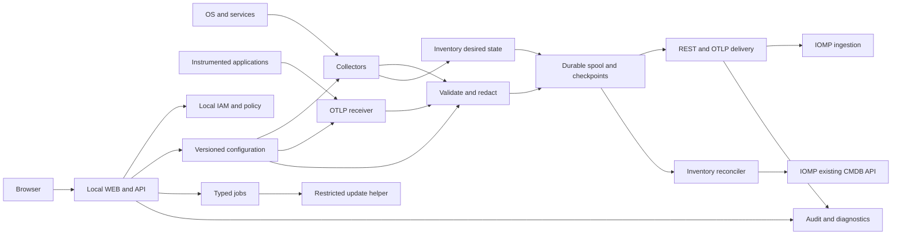
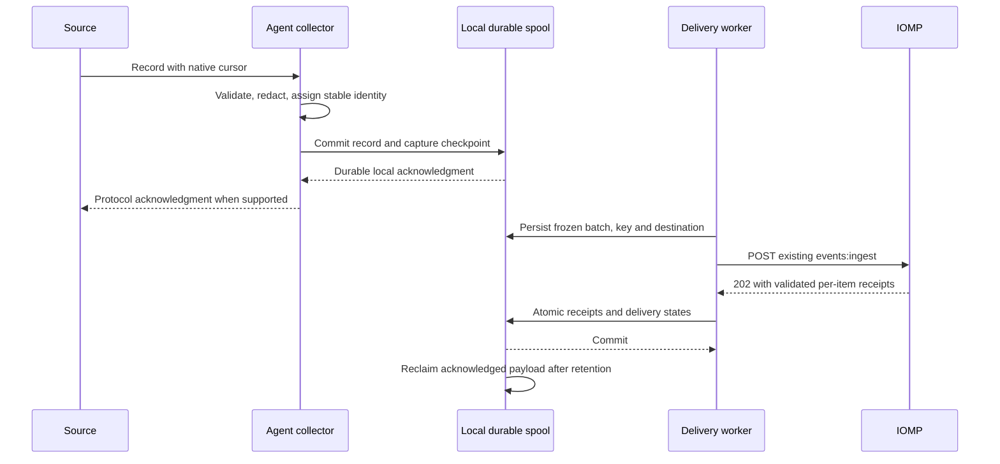

# 1. Загальні відомості

**Найменування:** «Розробка агента збору телеметрії та інвентаризаційних даних серверів і сервісів із web-інтерфейсом керування для платформи IOMP». **Скорочення:** IOMP Agent. **Версія:** 1.0, 24.09.2026. **Статус:** проєкт ТЗ для погодження.

Базовий документ: [ТЗ платформи IOMP, версія 1.0](C:/Users/stoie/Documents/Codex/2026-09-24/files-pasted-by-the-user-c/outputs/technical-specification.md), SHA-256 `4F3E175AA875F946DC09F2F96FE183797C7458B31F0152DBE5A99629E191CE27`. Посилання на його вимоги далі позначаються `PLATFORM:FR-…` або `PLATFORM:NFR-…`. Це ТЗ додає окремий продукт Agent; вихідний документ платформи залишається незмінним. Власний універсальний агент був поза первинним MVP платформи; його розробка є новим погоджуваним обсягом, прямо запитаним замовником.

Призначення агента — збирати metrics, logs, events, traces та inventory із локальної ОС і дозволених сервісів, перевіряти й маскувати дані, зберігати їх у локальній стійкій черзі та передавати до IOMP. Вбудований WEB надає автентифіковане керування конфігурацією, джерелами, станом збору, чергою, сертифікатами, діагностикою та оновленнями самого агента.

Агент не є автономною системою incident management: canonical CI, enrichment, correlation, fingerprint, root cause analysis, incident lifecycle, SLA та notifications належать платформі. Локальна перевірка health-condition формує спостереження opening/recovery; вона не створює incident і не виконує remediation на контрольованому сервері.

**Правила нормативності.** `Must / MVP` — обов'язково для приймання Agent MVP; `Should / Phase 2` — окремо погоджуваний обсяг; `Could / Future` — опція наступного етапу. Вимоги мають ідентифікатори `AG-FR-*`, `AG-NFR-*`; тести — `AG-TEST-*`; критерії — `AG-AC-*`. Усі таблиці контрактів, algorithms та catalog entries, на які посилається вимога, є її частиною. Ліміти платформи успадковуються без зміни; нові непогоджені числові значення позначені `ASSUMPTION-AG-XXX`. Відкриті питання не означають, що деталі вже підтримані реалізацією платформи.

| Сторона | Відповідальність | Результат |
|---|---|---|
| Замовник / Product Owner | Склад collectors, підтримувані ОС, навантаження, rollout scope | Погоджена baseline і UAT |
| Архітектор IOMP | Сумісність upstream API, source binding, CMDB contracts | Compatibility manifest і contract test evidence |
| Команда Agent | Runtime, WEB, local API, packages, spool, collectors | Вихідний код, підписані пакети, тести, документація |
| SRE / експлуатація | Доступи ОС/мережі, розгортання, resources, recovery | Runbooks, пілот, operational handover |
| Власники серверів/сервісів | Read-only permissions, allowlists, telemetry policy | Collector manifests і test targets |
| Security Administrator | IAM, PKI, secrets, data classification, upgrade trust | Threat model, security gates |
| QA | Source fixtures, crash/replay, WEB/RBAC, compatibility | Простежуваний звіт випробувань |

Технічна нормативна база: [OTLP](https://opentelemetry.io/docs/specs/otlp/), [RFC 9457](https://www.rfc-editor.org/rfc/rfc9457.html), [OpenID Connect Core](https://openid.net/specs/openid-connect-core-1_0.html). Windows collection реалізується через підтримувані системні API; окремо від local Event Log reader існує механізм [Windows Event Collector](https://learn.microsoft.com/en-us/windows/win32/wec/windows-event-collector), інтеграція з яким не є обов'язковою для Node profile. Конкретні версії бібліотек/collector components фіксуються перед реалізацією, а не називаються автоматично «останніми».

# 2. Терміни, скорочення та визначення

| Термін | Визначення |
|---|---|
| Node profile | Один агент на одному сервері: локальна ОС, logs, process/service metadata, локальні exporters і probes |
| Gateway profile | Агент у виділеному вузлі збору: приймає телеметрію від дозволених джерел і опитує allowlisted endpoints |
| collector | Модуль читання конкретного джерела, із власним schedule, permissions, state та timeout |
| receiver | Вхідний protocol endpoint агента, наприклад OTLP або Syslog/TLS |
| processor | Локальна перевірка, обмеження cardinality/size, masking і перетворення сигналу |
| exporter / delivery worker | Компонент передавання сигналів до погодженого endpoint IOMP |
| control plane | Локальні WEB/API/configuration/IAM/jobs; не бере участі в кожному telemetry record |
| data plane | Collectors, receivers, processing, spool і delivery workers |
| agent_id | Незмінний ідентифікатор встановленого агента; не тотожний hostname або платформному source_id |
| source_id | Ідентифікатор попередньо зареєстрованого DataSource платформи, дозволений credential binding |
| source_object_id | Стабільний зовнішній ідентифікатор спостережуваного ресурсу в межах DataSource |
| source_event_id | Стабільний ідентифікатор факту/переходу, незмінний під час повторної доставки |
| epoch_id / boot_id | Ідентифікатор локальної інкарнації producer; разом із sequence унеможливлює повторне використання ID після restart |
| spool | Локальне дискове сховище ще не завершених delivery records із журналом commit |
| WAL | Write-ahead log або еквівалентний transactional journal для відновлення незавершених записів |
| capture checkpoint | Позиція читання джерела, для якої запис уже локально durable або явно врахований як policy rejection |
| delivery checkpoint | Позиція/множина записів, для яких отримано валідне upstream acknowledgment |
| receipt | Підтвердження IOMP після durable приймання; не підтверджує побудову incident |
| inflight batch | Незмінні bytes запиту, склад записів, destination identity та Idempotency-Key, збережені до відправлення |
| quarantine | Ізольовані records/operations, які не можна безпечно повторити без зміни конфігурації або рішення оператора |
| terminal rejection | Явна відмова за контрактом/політикою; не успішна доставка |
| backpressure | Призупинення читання або відмова receiver до durable acknowledgment через нестачу місткості |
| provenance | Source, collector/config/schema versions і часовий контекст походження даних |
| local API | Окремий HTTPS API керування агентом під `/agent-api/v1`; не є API платформи |
| platform API | Наявні `/api/v1/...` IOMP та OTLP endpoints, зазначені в базовому ТЗ |
| effective configuration | Валідована активна конфігурація з version/hash і походженням значень |
| staged configuration | Чернетка конфігурації, що не впливає на collection до activate |
| enrollment bundle | Підписаний deployment-пакет binding/CA/endpoints/secret references, доставлений поза API платформи |
| break-glass | Контрольований локальний аварійний доступ із окремою ідентичністю та audit |
| RPO / RTO | Допустима втрата даних у часі / час відновлення в конкретному сценарії відмови |
| RBAC / scope | Рольові дозволи / обмеження на джерела й операції конкретного агента |

# 3. Межі та склад системи

## 3.1. Профілі та етапи

Розподіл `ASSUMPTION-AG-001`. Один binary distribution може містити обидва профілі; права й активні modules визначає validated profile. Gateway не має автоматичного права читати локальні privileged дані свого host.

| Область | Must / MVP | Should / Phase 2 | Could / Future |
|---|---|---|---|
| ОС Node | Ubuntu Server 24.04 LTS x86-64; Windows Server 2022/2025 x86-64 | Debian/RHEL-compatible за окремою support matrix; Linux ARM64 | Додаткові ОС після portability gate |
| Gateway | Linux service: remote HTTPS exporters/probes, OTLP receiver, outbound IOMP | Syslog/TLS, SNMPv3; legacy v2c/UDP лише ізольовано; Windows gateway | Site HA pair після fencing/identity design |
| Host metrics | CPU, memory, filesystem, disk I/O, network, uptime, time offset, process/service aggregate | Hardware sensors/RAID через погоджені adapters | eBPF profiling із privilege review |
| Logs | Linux journald/files; Windows Event Log/files; multiline, rotation, bookmarks, masking | WEC subscription adapter, additional structured parsers | Full security log analytics лишається SIEM |
| Services | HTTP/HTTPS, TCP, DNS, TLS expiry; allowlisted OS service status; Prometheus-compatible exporters | Native constrained DB/queue APIs за manifest | Arbitrary plugin ecosystem лише після sandbox design |
| Metrics/logs/traces transport | OTLP/HTTP Protobuf outbound; OTLP/HTTP receiver; Prometheus scrape→OTLP metrics; REST events | OTLP/gRPC listener/export, regional aggregation | Provider-specific transport plugins |
| Inventory | Local host, OS, CPU/memory/disks/interfaces, allowlisted processes/services, configured remote resources; existing CMDB API | Kubernetes/Docker/cloud discovery adapters | Autonomous deep network discovery |
| Dependencies | Evidence з явно налаштованих service-to-host зв'язків; Proposed edges через existing API | Kubernetes owner references, trace-derived edge proposals | Автоматичне підтвердження graph edges лише окремим platform policy |
| WEB | Вбудований server/UI/local API, auth/RBAC, sources/config/queue/health/audit/update workflows | Site agent inventory console в окремому продукті | Fleet management у IOMP після окремого platform API contract |
| Lifecycle | Silent install, service startup, safe upgrade/rollback, signed offline packages, backup config/state | Controlled update channels із зовнішнім repository | Autonomous cross-agent orchestration |

Колектори SNMP/Syslog/Kubernetes, які є обов'язковими для MVP **платформи**, можуть бути іншими її adapters. Їхня поява в Phase 2 **агента** не вилучає відповідні вимоги з базового ТЗ платформи. Native DB monitoring у MVP виконується через read-only exporters і health probes; поставка власного драйвера для кожної СУБД не приховується під терміном «підтримка БД».

Traces надходять від інструментованих застосунків/SDK або іншого OTLP producer. Збір CPU, мережевих counters і health probes не відновлює distributed traces без source instrumentation. Налаштування exporter у застосунку входить до deployment manifest його власника; модифікація бізнес-коду всіх застосунків не входить до Agent MVP.

## 3.2. Межі відповідальності

| Відповідальність | Агент | Платформа / зовнішня система |
|---|---|---|
| Реєстрація | Приймає готовий enrollment bundle і перевіряє binding | Platform Administrator створює DataSource та scoped Service Account через наявні адміністративні засоби |
| Auth | Перевіряє TLS, використовує mTLS і виданий credential | IOMP перевіряє principal→source/scope; PKI видає/відкликає certificates |
| Facts | Durable local capture, source identity/time, validation/masking | Durable upstream receipt, canonical normalization та зберігання |
| Inventory | Збирає observed attributes і передає permitted changes | Canonical CI IDs, ownership/conflicts, reconciliation та lifecycle policy |
| Health | Формує конкретні opening/recovery observations | Alert grouping, fingerprint, incident/SLA та escalation |
| Dependencies | Надсилає evidence/Proposed edges із provenance | Confirm/reject, topology history, RCA і blast radius |
| Управління | Власний локальний WEB/API, typed jobs, OS package lifecycle | Fleet-management endpoint у поточному baseline відсутній |

Поза MVP агента: shell/terminal через WEB; виконання довільних команд/PowerShell/SQL; remote desktop; зміна стану контрольованих services; remediation; packet capture; читання всіх process command lines/environment variables; передавання повних конфігураційних файлів або registry dumps; реєстрація агента через вигаданий `/api/v1/agents/register`; централізоване push-оновлення від IOMP; зберігання локальної копії всієї CMDB/історії інцидентів.

# 4. Функціональні вимоги

Ролі: `AA` Agent Administrator, `AC` Agent Configurator, `AO` Agent Operator, `AS` Agent Security Administrator, `AV` Agent Viewer, `AU` Agent Auditor, `SYS` локальна service identity. Повна матриця в розділі 9. Всі зміни конфігурації та стану — audited; body secrets не повертаються read APIs. У таблицях кожний FR містить input, processing/result, roles/limits та acceptance. Нові default intervals/limits — `ASSUMPTION-AG-003`, якщо не позначено успадкування IOMP.

## 4.1. Ідентичність, встановлення та робочий стан

| ID / назва | Пріоритет / фаза | Вхід | Обробка → результат | Доступ / обмеження | Критерій приймання |
|---|---|---|---|---|---|
| AG-FR-CORE-001 Встановлення | Must / MVP | Signed package, install profile, OS account | Перевірити signature/prerequisites; створити service, directories/ACL; initial state Unconfigured | AA через OS installer; без background downloads із непогоджених hosts | AG-TEST-001: clean install/unattended install на всіх MVP OS; без default password/public listener |
| AG-FR-CORE-002 Binding | Must / MVP | Enrollment bundle: agent_id, source bindings, endpoints, CA, scopes, credential references | Validate signature/schema/endpoint identity, store local identity; readiness test чинних platform contracts | AS+AA; агент не створює users/keys/DataSources від себе | AG-TEST-002: чужий source_id rejected; повтор того самого bundle не змінює identity/queue |
| AG-FR-CORE-003 Runtime lifecycle | Must / MVP | Service start/stop/restart, checkpoint | Single active writer lock; recover WAL; resume schedules і delivery; states таблиці нижче | SYS; AO collector pause, AA service jobs | AG-TEST-003: другий процес відмовляє без corruption; restart зберігає IDs і pending batches |
| AG-FR-CORE-004 Розділення керування і збору | Must / MVP | WEB/API failure, slow UI requests | Isolate control-plane pools/process; telemetry продовжується за останньою valid config | SYS; no auth dependency на кожний sample | AG-TEST-004: kill WEB component не зупиняє durable collection/delivery |
| AG-FR-CORE-005 Підтримка версій | Must / MVP | Agent/build, collector versions, platform profile | Expose compatibility status і build info; reject unsupported major config/schema | AA/AV read; зміна compatibility manifest audited | AG-TEST-005: unsupported upstream schema не «виправляється» мовчки, compatible version проходить corpus |

Agent runtime states: `Unconfigured`, `Starting`, `Running`, `Degraded`, `Draining`, `Stopped`, `RecoveryRequired`. Причини Degraded — окремі flags `UpstreamUnavailable`, `AuthBlocked`, `CapacityPressure`, `CollectorFailure`, `ClockSkew`, `ConfigMismatch`; доступний WEB сам по собі не означає Running. Collector states: `Disabled`, `Starting`, `Running`, `Paused`, `Backoff`, `Failed`, `PermissionDenied`. Job states: `Queued`, `Running`, `Succeeded`, `Failed`, `Cancelled`; interrupted job після restart переходить у recoverable Running або Failed з reason, а не зникає.

## 4.2. Збір із серверів і сервісів

| ID / назва | Пріоритет / фаза | Вхід | Обробка → результат | Доступ / обмеження | Критерій приймання |
|---|---|---|---|---|---|
| AG-FR-COLLECT-001 Host metrics | Must / MVP | OS counters/API | Interval samples з unit/type/resource attributes; counter reset handling; OTLP metrics | SYS read-only; AA дозволяє collector | AG-TEST-006: values/units збігаються з контрольним OS snapshot у tolerance5.1; unsupported≠zero |
| AG-FR-COLLECT-002 Process/service metrics | Must / MVP | Allowlisted service names/process selectors | Count/status/resource usage за stable selectors; bounded top-N; PID reuse не зливає instances | AC config; SYS minimum OS ACL; command line/env не збираються | AG-TEST-007: process restart дає нову instance, service stop — observation без автоматичного restart сервісу |
| AG-FR-COLLECT-003 Log files | Must / MVP | Allowlisted paths/globs, encoding, parser | Tail із file identity+offset, multiline bounds, rename/truncate handling; durable record | AC config; symlinks/reparse points лише в дозволених roots | AG-TEST-008: rename/create/copytruncate/partial line restart відпрацьовані; gap/possible loss явно враховано |
| AG-FR-COLLECT-004 ОС-журнали | Must / MVP | journald cursor або Windows channel/bookmark | Resume після local durable commit; detect cleared/expired log; preserve provider/channel/record identity | SYS journal/event ACL; Security channel тільки explicit grant | AG-TEST-009: bookmark survives restart; log clear породжує gap record, не удаваний continuity |
| AG-FR-COLLECT-005 Prometheus scrape | Must / MVP | HTTPS/localhost exporter text/OpenMetrics | Parse metric family, normalize unit/type, preserve label set, map to OTLP resource/attributes | AC endpoint allowlist; bounded cardinality; scrape timeout | AG-TEST-010: counter/gauge/histogram fixtures проходять; incompatible/unsupported type quarantined із reason |
| AG-FR-COLLECT-006 OTLP receiver | Must / MVP | OTLP/HTTP Protobuf metrics/logs/traces | Authenticate receiver source; validate/mask; local durable accept; preserve trace IDs та metric temporality | Configured local producers; external bind потребує AS approval | AG-TEST-011: local success лише після fsync; pressure→protocol failure до accept; full/partial semantics8.4 |
| AG-FR-COLLECT-007 Service probes | Must / MVP | HTTP(S)/TCP/DNS/TLS targets, expected conditions | Bounded probe, timeout; three-failure/open і three-success/clear default; record durations/evidence | AC config; network targets only allowlist; без бізнес-мутацій | AG-TEST-012: 3 failures/3 successes → ordered opening/recovery; DNS timeout не позначає host down |
| AG-FR-COLLECT-008 Інвентаризація | Must / MVP | Local hardware/OS/disks/interfaces і configured service metadata | Stable identity, snapshot+changed attributes, successful-cycle completeness; spool desired state | AC/AA; owner/criticality не виводяться з hostname | AG-TEST-013: reboot/rename не створює duplicate host; перенесення state до host із невідповідним binding fingerprint дає RecoveryRequired |
| AG-FR-COLLECT-009 Спостереження змін | Must / MVP | Two comparable complete inventory snapshots, service/package allowlists | Diff із observed_at, old/new hashes/санітизованими values; change event | SYS; source outage/partial snapshot не є deletion | AG-TEST-014: одна factual change→один stable event; failed scan не видаляє ресурси |
| AG-FR-COLLECT-010 Свідчення залежностей | Must / MVP | Explicitly configured service runs_on host mapping | Сформувати Proposed relationship із evidence/config version; platform IDs через binding | AC; runtime scope topology.write; manual confirmation на платформі | AG-TEST-015: нема Confirmed edge від агента; duplicate publish не створює другу active relationship |
| AG-FR-COLLECT-011 Розширені adapters | Should / Phase 2 | Kubernetes/Docker/SNMP/Syslog/native DB manifest | Protocol-specific read-only collection через bounded adapter | AS approves permissions; no Docker privileged socket у WEB | AG-TEST-036: positive/outage/replay/permissions fixture кожного включеного adapter |

**Каталог вимірювань MVP.** Кожний рядок — підвимога `AG-FR-COLLECT-001/002/005/007`; Metric names задає versioned mapping manifest. Упровадження не може підміняти різні фізичні величини однаковим ім'ям.

| Група | Дані / семантика | Тип / одиниця / interval | Обмеження та expected result |
|---|---|---|---|
| CPU | Utilization за core і aggregate; cumulative user/system/idle time | Gauge ratio [0;1]; counter s; 15 s | Linux-only iowait/steal позначені capability; Windows unsupported не повертає0 |
| Memory | Total, available, used; swap/pagefile | Gauge byte; paging counters із unit; 15 s | `used=total-available` лише для явно визначеної OS mapping; cache/buffers окремо |
| Filesystems | Capacity/free/used/inodes, mount metadata | Gauge byte/count/ratio; 60 s | Exclude pseudo/temp mounts за manifest; permission failure як error, не free=0 |
| Disk I/O | Read/write bytes/operations, latency counters | Counter byte/count/s; 15 s | OS-supported fields; rates derived from counter deltas, reset detected |
| Network | RX/TX bytes/packets/errors/drops, interface state/speed | Counters, state gauge, bit/s speed; 15 s | Interface stable identity; timestamps не використовуються як labels |
| System | Uptime, boot identity, OS/build/architecture, clock offset quality | Gauge s, metadata; 60 s | Clock offset тільки від підтвердженого time source; unknown не0 |
| Processes | CPU/memory, count, start time для configured selectors | Gauge ratio/byte/count; 30 s | Max100 selectors, max20 visible process instances/selector; no command-line capture |
| Services | Expected vs observed Running/Stopped/Unknown | Discrete state, uptime; 30 s | Read SCM/systemd-equivalent status; не виконує start/stop цільового сервісу |
| HTTP(S) | Reachable, status code, duration, bounded response assertion | Gauge/count/s; 30 s | GET/HEAD за manifest; body max64 KiB transient, persisted лише redacted result/hash |
| TCP/DNS | Connect success/duration; DNS result/status | Gauge/s; 30 s | DNS query types A/AAAA/CNAME/SRV/TXT лише configured; result count≤50; TTL без assumption про availability |
| TLS | Certificate expiry, chain/hostname validity | Gauge s до expiry; 1 h | Не вимикати verification для «перевірки»; expiry observations без private key |
| Exporters | DB/queue/cache/web/runtime metrics | Types/units із exporter manifest; 30 s | PostgreSQL/MySQL/SQL Server/Redis/queues через сумісні exporters; DB passwords у агента не потрібні для готового exporter |

Numeric defaults цієї таблиці — `ASSUMPTION-AG-003`; 3 failed/3 successful probes та timeout5 s успадковані з `PLATFORM:FR-INGEST-006`. Власник кожної health-condition фіксується в manifest: `agent` або `platform`; одна condition не оцінюється незалежно в обох місцях із різними identifiers. Якщо owner=platform, агент передає samples; якщо owner=agent — ordered state events, а duplicate platform threshold для цієї condition вимкнено конфігурацією.

**OS log details.** File identity — platform-specific file ID/inode+device+generation, не лише path. Multiline: max256 KiB logical input record, flush timeout5 s; після masking результат має вкладатися у wire limits. `copytruncate` має race, який неможливо усунути без координації з writer: агент виявляє зменшення file size й potential gap; безумовна гарантія lossless copytruncate не заявляється. Rename/old handle читається до EOF, новий file має окрему identity. Windows `EventRecordID` сам по собі не унікальний після clear: identity включає channel+log epoch+record ID. journald expired cursor → explicit gap і start policy `from_oldest_available` за замовчуванням. Кожна зміна start policy має preview кількості й audit.

## 4.3. Перевірка, перетворення й захист даних

| ID / назва | Пріоритет / фаза | Вхід | Обробка → результат | Доступ / обмеження | Критерій приймання |
|---|---|---|---|---|---|
| AG-FR-PROCESS-001 Схеми та ліміти | Must / MVP | Collector record/received batch | Type/schema/size validation до spool; separate limits per signal; classify rejection | SYS; AC config не перевищує platform maxima | AG-TEST-016: boundary/off-by-one/oversize/compression cases дають defined error і counters |
| AG-FR-PROCESS-002 Маскування | Must / MVP | Logs/events/attributes/probe evidence | Default secrets denylist + configured bounded masks; redact до WAL/quarantine/audit/debug | AS policy; AC може посилити, не послабити mandatory rules | AG-TEST-017: canary secrets відсутні у всіх disks/API/network payloads після processor |
| AG-FR-PROCESS-003 Час та ідентичність | Must / MVP | Source-native time/ID/sequence | UTC conversion, preserve original time у дозволеному schema; stable event IDs; wall clock для timestamps, monotonic clock для delays | SYS; source metadata не змінює auth binding | AG-TEST-018: DST/clock rollback/reboot/replay не дублює identities і не робить recovery старшим за фактом |
| AG-FR-PROCESS-004 Metrics semantics | Must / MVP | Counters/gauges/histograms, labels | Preserve type/temporality/start time/unit; reset detection; series budget до allocation | SYS; configured label drop policy versioned; no random sample loss inside aggregate | AG-TEST-010/019: independent fixture sums/temporality збережені; cardinality overflow явно rejected |
| AG-FR-PROCESS-005 Sampling/filtering | Must / MVP | Trace/log policies, rates, source class | Deterministic head sampling traces за trace_id; logs filters із counters; no sampling health transitions/inventory/audit | AS mandatory exclusions, AC collection policy | AG-TEST-019: одна trace отримує одне sampling decision; counts входу/retained/rejected сходяться |
| AG-FR-PROCESS-006 Версійовані перетворення | Must / MVP | Active config/mapping/collector version | Stamp provenance local record; freeze wire bytes перед першою спробою | SYS; config update не переписує inflight payload | AG-TEST-020: pending old batch після activation має первинний hash і key |

Raw у цьому агенті означає source content **після обов'язкового masking**. Доцільність зберігання source payload визначає policy; локальний WEB ніколи не надає необмежене читання файлової системи сервера. `Authorization`, cookies, passwords, private keys, connection strings із secrets, environment dumps і process command lines не потрапляють до records. Неоднозначний parser result не «покращується» відключенням redaction: quarantine містить тільки вже санітизований fragment/reason.

## 4.4. Локальна черга та гарантована передача

| ID / назва | Пріоритет / фаза | Вхід | Обробка → результат | Доступ / обмеження | Критерій приймання |
|---|---|---|---|---|---|
| AG-FR-BUFFER-001 Durable capture | Must / MVP | Masked records та source cursor | Atomic record+capture checkpoint commit; fsync перед local receiver success; recoverable WAL | SYS; dedicated data volume; no shared network filesystem для spool | AG-TEST-021: kill/power-loss boundaries не втрачають locally acknowledged records за intact disk |
| AG-FR-BUFFER-002 Scheduler черг | Must / MVP | Pending records, source/signal priorities | Separate quotas і fair scheduling; ordered stream для condition; reserve critical lane | SYS; bulk logs не витісняють existing critical pending | AG-TEST-022: log flood не starvation events; accounting no silent discard |
| AG-FR-BUFFER-003 Backpressure і заповнення | Must / MVP | Disk free, spool quota, intake rate | Watermarks, pause replayable sources, protocol reject before ack; reserved gap counters | AA capacity, AO read; auto delete accepted pending заборонено | AG-TEST-023: hard cap не пошкоджує ОС; full spool показує affected sources/gap і відмовляє new accepts |
| AG-FR-BUFFER-004 Quarantine/replay | Must / MVP | Invalid/permanent rejected/expired pending; operator reason | Isolate masked records, classify delivery certainty, preview replay; preserve IDs/hash | AO preview; AA replay approved data; AS restrictive policy | AG-TEST-024: повтор uncertain batch не змінює body/key; terminal rejection не позначено Delivered |
| AG-FR-DELIVERY-001 REST events | Must / MVP | Frozen batches за8.2 | Existing events:ingest, mTLS+service auth, durable receipts; reconcile per item | SYS events.ingest; source-scoped identity | AG-TEST-025: real platform fixture accepts unchanged contract і returns event IDs |
| AG-FR-DELIVERY-002 Retry/idempotency | Must / MVP | HTTP/transport failure, saved batch | Backoff/jitter/Retry-After; retransmit same bytes+key за unknown outcome; partial subset→new batch key, same event IDs | SYS; limits8.3, no retry storm | AG-TEST-026: timeout-after-commit, restart іpartial202 не створюють duplicate facts |
| AG-FR-DELIVERY-003 OTLP export | Must / MVP | Metrics/logs/spans persisted batch | OTLP/HTTP Protobuf за upstream contract; full/partial/retry semantics8.4 | SYS source-bound transport; no REST event wrapper для every sample | AG-TEST-027: wire fixtures compatible, partial success не породжує повтор цілого request |
| AG-FR-DELIVERY-004 CMDB publishing | Must / MVP | Inventory desired state, CI bindings, edge evidence | Existing CI/create/PATCH і relationship API; ETag, field ownership, reconcile | SYS ci.write/topology.write тільки source-owned scope; no IAM/admin rights | AG-TEST-013/015/028: create/update/restart/concurrent conflict без duplicate CI або overwrite locked owner |
| AG-FR-DELIVERY-005 Upstream binding changes | Must / MVP | Endpoint/credential/CA change, pending queue | Stage/test/activate; route pinned to platform identity/source; no replay to unrelated platform | AS+AA; URL change не змінює queue ownership автоматично | AG-TEST-029: чужий destination не отримує old records; cert rotation не змінює source_event_id |

Record delivery states: `Captured → Ready → InFlight → Acknowledged`; `InFlight → RetryScheduled → InFlight`; `Captured/Ready/InFlight → Quarantined` лише з reason/delivery certainty; `Ready → PolicyRejected` тільки для data policy, яка діє **до** durable acceptance. Для вже прийнятого record ручне видалення — окрема `DiscardedByOperator` операція, з reason/count/range/audit і явним data-loss banner. `Acknowledged`, `Rejected`, `Discarded`, `DeliveryUncertain` не зливаються в один «оброблено» status.

Два checkpoint не підміняють один одного. Capture cursor можна просунути після atomic local durable commit; delivery cursor — лише після відповідного upstream receipt. Якщо local crash стався до capture commit, повторно читається джерело з тією самою source-native identity. Receiver acknowledgment стосується local disk, не IOMP. Source data, які writer видалив до читання, не охоплюються local durability guarantee.

При reboot actor/boot metadata нові, але persisted record IDs, source binding, frozen payload і keys незмінні. Новий producer epoch призначається лише новим records. Golden OS images не містять enrolled agent state/credentials: deployment кожного clone виконує explicit enrollment із новою identity. Локальний binding fingerprint, сформований із погоджених стабільних OS/hardware identifiers, блокує запуск перенесеного state за невідповідності host. Якщо clone відтворює всі identifiers і credentials побітово, без platform ownership lease або non-exportable hardware key агент не може гарантовано виявити другий host; цей сценарій не підтримується MVP. Стару queue не переносить до іншого source мовчки.

## 4.5. Вбудований WEB та локальне керування

WEB постачається в пакеті агента; статичні assets не залежать від CDN, зовнішніх fonts/analytics або доступності IOMP. Браузер звертається до local API того самого origin; secret для platform service account залишається на серверній стороні агента. Відмова IOMP не блокує локальний перегляд черги, config validation, credential rotation або stop/start collectors.

| ID / назва | Пріоритет / фаза | Вхід | Обробка → результат | Доступ / обмеження | Критерій приймання |
|---|---|---|---|---|---|
| AG-FR-WEB-001 Керування через WEB | Must / MVP | Local API projections, operator filters/actions | Всі екрани каталогу нижче, stable URLs, responsive UI | AA/AC/AO/AS/AV/AU за9; no direct OS/filesystem APIs | AG-TEST-030: кожен view/action доступний тільки дозволеним ролям; offline upstream не дає blank screen |
| AG-FR-WEB-002 Авторизація | Must / MVP | Local user/session, optional configured OIDC identity | Authenticate, enforce permissions/source scopes, CSRF/session controls | AS IAM; first-admin bootstrap через локальний OS-protected token | AG-TEST-031: anonymous/CSRF/cross-scope дії відхилено; WEB доступ без default credentials |
| AG-FR-WEB-003 Preview та apply | Must / MVP | Config draft, validation, expected version, reason | Preview diff/impact/restarts/network targets; submit typed job, show per-step status | AC в межах policy; AS для secrets/allowlists/listener; AA update | AG-TEST-020/030: stale draft409/412; browser refresh не виконує action повторно |
| AG-FR-WEB-004 Черга і діагностика | Must / MVP | Queue summary/filter, masked record metadata, diagnostic job | Counters/oldest age/reason/receipt certainty; bounded preview; sanitized support bundle | AO status, AA replay, AU audit; payload preview explicit permission | AG-TEST-024/032: support bundle не містить secret, full WAL або довільних host files |
| AG-FR-WEB-005 Безпечний remote mode | Must / MVP | Explicit bind address, server cert, network policy, authorized role | Disabled-by-default remote listener; validate TLS/SAN/Host/Origin/CIDRs; display effective exposure | AS+AA; порт не відкривається автоматично installer | AG-TEST-031/033: localhost default недоступний з LAN; approved remote mode accepts only allowed auth/network |

Спільний UI-контракт (`ASSUMPTION-AG-007`): український UI, technical identifiers English; desktop1366×768, adaptive768/360 px; locale-independent UTC storage, user timezone display з offset; списки50 rows, maximum200/cursor; sort із ID tie-breaker, bounded search; update interval5 s або SSE із reconnect. Empty — причина й доступна дія; loading — skeleton/aria-busy; error — код, request ID, retry без secret/stack trace; stale — timestamp останнього успіху. Error не відображається як «0 в черзі». Дії, які змінюють collection/delivery, мають preview кількості affected sources/records, reason і server-side version check. Bulk selection обмежена100 objects/job; bulk action не обходить per-object RBAC.

| Екран | Дані / призначення | Доступ / фільтри, пошук | Sort / pagination | Дії / bulk / export |
|---|---|---|---|---|
| Початкове налаштування | Agent identity, bundle verification, binding test | Bootstrap identity/AA+AS; пошук відсутній | Покрокова форма, no paging | Import signed bundle, test, finalize; bulk/export немає |
| Огляд | Runtime/collectors/upstream, throughput, disk, queue age, config/build | Усі signed-in ролі; profile/source/signal | Cards; top sources by lag | Drill-down; export sanitized summary |
| Джерела | Type/target/enabled/interval/errors/permissions | AC/AO/AA/AV; type/status/name | name/last_success, cursor | Add/edit/test/pause/resume; bulk pause/resume; redacted CSV/JSON |
| Метрики host/services | Current values, units, timestamp, source quality | AC/AO/AA/AV; source/metric name | name/time, bounded result | Select configured metric, view recent aggregate; no query of arbitrary process memory; export aggregate |
| Журнали і події | Masked preview, source/time/status/size | AO/AA і explicit payload.read; source/type/text | time, cursor | Inspect reason/lineage; bounded export за permission; full raw download відсутній |
| Inventory | Observed attributes, completeness, canonical CI binding, sync conflicts | AC/AO/AA/AV; type/source/status/name/IP | name/last_observed, cursor | Rescan, inspect diff; AA reconcile; redacted JSON |
| Health checks | Target, condition state, failures/successes, duration, TLS expiry | AC/AO/AA/AV; type/state/name | last_run/status, cursor | Test once, edit schedule, pause; bulk pause; export results |
| Доставка та binding | Platform identity, source IDs, certificate expiry, attempts, response class | AS/AA повна metadata; AO/AV summary | channel/last_success; attempts cursor | AS rotate/stage; AA connection test; no tokens in export |
| Черга та quarantine | Bytes/count/age per lane/source, delivery certainty, reason | AO/AA/AU read; filters signal/status/reason/time | oldest first; cursor | AA preview/retry/discard з reason; export manifest metadata only |
| Конфігурація | Draft/effective version, diff, validation/impact | AC/AA; AS protected fields; version/key search | revision/time, cursor | Validate/activate/rollback/import/export redacted; no secret values |
| Сертифікати і секрети | Fingerprint, subject, issuer, expiry, reference usage | AS/AA metadata; AS writes | expiry/name, cursor | Write-only replace/rotate/revoke; export public cert only |
| Користувачі та ролі | Local/OIDC identities, scope/grants, sessions | AS; AU read | name/status, cursor | Grant/revoke/disable; cannot remove last recovery admin; no credential export |
| Audit | Actor/action/object/result/reason/time/integrity | AU/AS; query by actor/object/request ID | sequence/time, cursor | Verify integrity, scoped export; no delete/edit |
| Діагностика | Component status, masked logs, metrics, build, support jobs | AO/AA/AU scope | component/severity/time | Run predefined diagnostic/support bundle; bulk немає |
| Оновлення | Current/staged version, signature, compatibility, disk/drain preflight | AA; AS trust policy | versions/jobs/time | Stage/test/install/rollback; no arbitrary executable upload; export job report |

MVP не вимагає історичного log explorer, аналогічного платформі: локальний preview обмежений оперативною діагностикою і retention7.1. UI має keyboard navigation, visible focus, graph-free textual state та контраст WCAG2.2 AA для core workflows. Download links повторно перевіряють permission, а не покладаються на секретність URL.

## 4.6. Конфігурація, audit та оновлення

| ID / назва | Пріоритет / фаза | Вхід | Обробка → результат | Доступ / обмеження | Критерій приймання |
|---|---|---|---|---|---|
| AG-FR-CONFIG-001 Versioned configuration | Must / MVP | JSON/YAML import або WEB draft | Schema+semantic validate; immutable revisions, hash, author/reason; atomic activate | AC nonprotected; AS security; AA runtime limits | AG-TEST-020: invalid config не стає active; crash mid-activate відновлює одну повну версію |
| AG-FR-CONFIG-002 Policy precedence | Must / MVP | Package defaults, local policy, enrollment binding, draft | Mandatory policy/binding не перевизначаються lower layer; expose field origin і locked status | AS locks; AC лише permitted values | AG-TEST-020/031: неможливо через import послабити endpoint allowlist/masking |
| AG-FR-CONFIG-003 Collector isolation | Must / MVP | Slow/failing collector, schedule | Bounded concurrency, no overlapping same target run; timeout/cancel/backoff, failure isolation | SYS; AA pool budgets | AG-TEST-034: hung target не блокує інших; no unbounded goroutine/thread/process growth |
| AG-FR-CONFIG-004 Audit | Must / MVP | Auth/config/replay/upgrade/secret metadata/access decisions | Append-only local audit із actor/action/object/result/hash; redacted, integrity verification | AU/AS read; SYS append; config transaction має audit outbox | AG-TEST-035: action coverage, tamper detection; відсутні secrets |
| AG-FR-LIFE-001 Signed upgrade | Must / MVP | Signed staged package/manifest, current state | Verify trusted signer/hash/platform/config/spool compatibility; preflight/drain; typed install job | AA execute; AS trust keys; no automatic arbitrary URL execution | AG-TEST-037: wrong signer/downgrade/insufficient disk rejected; valid upgrade preserves pending records |
| AG-FR-LIFE-002 Rollback і restore | Must / MVP | Previous signed release/config, local backup | Backward-compatible state migration, WAL replay, same bindings; isolated restore check | AA/AS recovery; no restoring old queue into active duplicate writer | AG-TEST-038: N→N−1 rollback і config restore preserve identity/receipts; no replay under new source |
| AG-FR-LIFE-003 Видалення | Must / MVP | Uninstall mode retain/purge, queued-data manifest, reason | Stop/drain; retain state default; purge explicit plan; revoke external credentials окремим owner process | OS admin+AA; purge не є success delivery | AG-TEST-039: reinstall retained state без duplicate IDs; purge records audit/discard totals |

Config activation transaction: persist validated revision+audit intent → switch active pointer atomically → restart only affected collectors → health verification → automatic revert pointer у разі startup failure. Already-captured data використовують попередній mapping/destination metadata. Маскування можна посилити для ще не переданих records лише до створення first-attempt frozen batch; для delivery-uncertain bytes зміна body за тим самим key заборонена. За виявлення секрету в frozen batch передавання блокується, incident-like local security alert та controlled remediation; «сумісність retry» не є підставою повторно надіслати секрет.

# 5. Нефункціональні вимоги

## 5.1. Профілі навантаження й ресурси

Усі `AG-NFR` — Must/MVP, якщо явно не вказано Phase2. Нові target values — `ASSUMPTION-AG-002/003/004/006/007/008`; upstream maxima базового IOMP незмінні. Профілі описують місткість **одного** агента; fleet total має вкладатися в CAP-MVP платформи. Неможливо множити максимальний local profile на кількість агентів без capacity allocation.

| Параметр | CAP-AG-NODE | CAP-AG-GATEWAY |
|---|---|---|
| Test host | 2 vCPU/4 GiB RAM, local SSD; Windows/Linux окремі звіти | 4 vCPU/8 GiB RAM, local SSD, Linux |
| Configured collectors/targets | До20 collectors,100 process selectors | До50 remote targets/source bindings |
| REST events steady / peak | 5/s /10/s, mean2 KiB | 100/s /200/s, mean2 KiB |
| Metrics steady / peak | 500/1 000 samples/s, до10 000 active series | 2 000/4 000 samples/s, до50 000 active series |
| Logs steady / peak | 200/500 KiB/s після masking | 1/2 MiB/s після masking |
| Traces steady / peak | 100/250 KiB/s після configured sampling | 1/2 MiB/s після configured sampling |
| Одночасні WEB sessions | 5 | 10 |
| Spool budget / рекомендований data volume | 12 GiB /≥24 GiB usable | 64 GiB /≥128 GiB usable |
| Backlog guarantee | ≥2 h погодженого aggregate peak signal mix | ≥2 h погодженого aggregate peak signal mix |

Spool sizing: `Q >= peak_encoded_bytes_per_second × 7200 × measured_storage_multiplier / 0.75`. `measured_storage_multiplier` включає WAL/index/encryption/page overhead; початково1.3, компресія не зменшує guaranteed sizing. Прийнято64 B/metric sample для попереднього розрахунку, але benchmark враховує resource/label overhead. Для Node: 20+62.5+500+250=832.5 KiB/s →5.72 GiB за2 h →9.91 GiB з overhead/reserve; 12 GiB достатньо лише після підтвердження фактичного multiplier. Gateway: 400+250+2048+2048=4746 KiB/s →32.59 GiB за2 h →56.49 GiB із overhead/reserve; початковий budget64 GiB. Якщо labels/record sizes збільшують encoded volume, preflight вимагає більшого volume або менших погоджених input limits, а не приховано скорочує buffer duration.

25% spool — резерв critical/control lane, що входить у total quota, а не додатковий безлімітний volume. At70% — Warning; at80% — stop low-priority intake/retention maintenance без purge pending; at95% — відмовляти новому reliable input до durable ack, зберігати existing records та emergency metadata reserve. Конкретний scheduler може спрацювати раніше через per-lane quota; queue report показує global/per-lane причину. Процес не забирає останній вільний простір OS partition; мінімальний host free floor2 GiB поза spool.

| ID / назва | Значення | Метод перевірки | Критерій приймання |
|---|---|---|---|
| AG-NFR-PERF-001 Throughput | Обидва CAP profiles:2 h steady,15 min peak і2 h offline peak buffering | Producer ledger, byte/record counters, AG-TEST-040 | Немає unexplained losses; admitted load не відхилено через undersizing у межах profile |
| AG-NFR-PERF-002 Resource overhead | Node avg CPU≤0.20 vCPU, p95≤0.5, RSS≤384 MiB; Gateway avg≤1 vCPU,p95≤2,RSS≤1 GiB | 1 s samples, separate OS builds, fixed collectors mix | Усі thresholds на steady workload; memory leak після warmup≤5%/24 h у72 h soak |
| AG-NFR-PERF-003 Capture/export latency | Ready event→first send p95≤2 s,p99≤5 s; local OTLP durable response p95≤200 ms,p99≤1 s; fresh metrics/log batching≤5 s | Monotonic instrumented timestamps, AG-TEST-025/027/040 | Значення виконані без backlog; platform receipt/correlation latency вимірюються окремо |
| AG-NFR-PERF-004 WEB/API | Local reads p95≤300 ms,p99≤1 s; initial UI≤3 s на LAN; status freshness≤5 s | 5/10 concurrent sessions з CAP telemetry | UI load не порушує data-plane budgets |
| AG-NFR-PERF-005 Catch-up | Після2 h steady outage backlog зменшується за receive=steady; drain≤4 h за platform allocation≥1.5×steady і достатнього network budget | AG-TEST-040 із explicit upstream quota | Fixed profile backlog повністю доставлено/terminally classified; quota assumption у звіті |
| AG-NFR-PERF-006 Measurement accuracy | CPU ratio абсолютна похибка≤0.02, memory/disk byte counters≤1% від timestamp-aligned OS reference; monotonic counters exact для synthetic fixture | Independent OS API/reference fixture | Unsupported/permission-denied fields explicit; порівняння не змішує різні sampling windows |

## 5.2. Надійність, відновлення та дані

| ID / назва | Значення / правило | Метод перевірки | Критерій приймання |
|---|---|---|---|
| AG-NFR-REL-001 Crash consistency | RPO=0 для locally acknowledged durable records при process/OS restart та intact fsync-honoring volume | Kill/power-loss simulation before/after commit, AG-TEST-021 | Record IDs/cursors/receipts recovered без torn accepted record |
| AG-NFR-REL-002 Restart | Service ready≤60 s після normal restart,≤5 min після recovery maximum supported spool | AG-TEST-003/038 на full spool | No destructive reset; bounded recovery progress у WEB/CLI |
| AG-NFR-REL-003 Відмова upstream | Collection/spool працюють ≥2 h aggregate peak; retry1–60 s+jitter; local WEB доступний без IOMP | AG-TEST-022/026/040 | Correct pressure після budget; no fabricated receipt або CI/service-down через transport loss |
| AG-NFR-REL-004 Collector isolation | One hung collector: timeout≤configured budget; решта пропускають не більше1 schedule interval | AG-TEST-034 | Bounded workers і circuit breaker; status/reason per collector |
| AG-NFR-REL-005 Disk failure boundary | Повна втрата єдиного локального disk не має RPO0; pending data loss дорівнює remaining local backlog | AG-TEST-038 disaster rehearsal | Runbook та UI відрізняють disk loss від process restart; HA spool не заявлена для MVP |
| AG-NFR-DATA-001 Consistency | Atomic capture record/checkpoint, frozen inflight, source-owned CI bindings, audited config activation | Concurrency і replay tests | Жодного cursor advance без durable record або explicit terminal-policy accounting |
| AG-NFR-DATA-002 Retention | Delivered payload purge≤1 h; delivery metadata7 d; quarantine7 d до audited expiry; local telemetry preview≤1 h; audit90 d; configs last50 versions/90 d | Clock-driven lifecycle tests | Retention не видаляє unacknowledged record без explicit terminal expiry/discard entry |
| AG-NFR-DATA-003 Local backup | Daily encrypted config/IAM/binding metadata backup, після кожної security/config activation incremental copy; spool не переноситься через hot file copy | Restore на isolated host, AG-TEST-038 | Consistent snapshot, correct identity/keys; manual replay після restore не запускається автоматично |

За24 h без successful delivery запис переходить з automatic retry до `Quarantined` за policy, узгодженою з IOMP retention; продовжує займати disk quota. Через7 d quarantine expiry потребує audit manifest/count/reason і явного loss accounting. Зберігання7 d не означає безлімітне приймання7 d: intake зупиниться за quota раніше. Найстаріший record, вік якого наближається до platform dedup TTL7 d, не відправляється автоматично як новий; replay після TTL потребує reconciliation decision. Buffer sizing не рахує неможливу «повну гарантію від втрати джерела до прочитання».

## 5.3. Безпека

| ID / назва | Значення / правило | Метод перевірки | Критерій приймання |
|---|---|---|---|
| AG-NFR-SEC-001 Least privilege | Data plane і WEB не root/LocalSystem; окремий мінімальний privileged helper лише для typed install/service operations | OS token/capability/ACL review, AG-TEST-041 | WEB compromise не дає arbitrary privileged command; telemetry має лише погоджені reads |
| AG-NFR-SEC-002 Локальний WEB | HTTPS loopback127.0.0.1/[::1]:9443 default; no wildcard bind/default password; Host/Origin allowlists; remote mode explicit | AG-TEST-031/033, network scan | Unauthorized LAN/browser origins не керують агентом; DNS rebinding/CSRF blocked |
| AG-NFR-SEC-003 Auth/session | Local accounts із MFA для AA/AS; password≥14 chars і memory-hard hash; OIDC optional profile; idle30 min/absolute8 h; grants revoke≤60 s | AG-TEST-031 | No plaintext passwords, no insecure fallback при unavailable IdP, disabled sessions invalidated |
| AG-NFR-SEC-004 Transport | TLS≥1.2, hostname/chain validation; mTLS Agent→IOMP; proxy без downgrade; app credential за pinned profile | AG-TEST-002/029 | Wrong cert/CA/hostname/expired cert відхилені; spool preserved; no insecure_skip_verify setting |
| AG-NFR-SEC-005 Secrets at rest | OS-protected keystore або approved vault; per-service ACL; encrypted spool/support backup; write-only secret forms; redact all telemetry/log/audit | AG-TEST-017/032/041 | Canary відсутні поза designated keystore; secret read API не існує; signing private key не експортується |
| AG-NFR-SEC-006 Outbound і file access | Destination/file-root allowlists, resolved-IP validation, redirects disabled default, reparse/symlink policy, cloud metadata IP blocked | SSRF/rebinding/path traversal tests | Немає доступу до непогоджених hosts/paths навіть через config import/test endpoint |
| AG-NFR-SEC-007 Injection/resource abuse | No arbitrary shell/SQL/script evaluator; bounded parsers/regex; request body caps; CSP, CSRF, XSS escaping, CORS same-origin | AG-TEST-016/031/041 | Negative inputs не виконуються й не обходять quotas/auth |
| AG-NFR-SEC-008 Supply chain | Signed binaries/packages/update manifests, SBOM, pinned dependencies, SAST/SCA/image/package scan; no exploitable Critical/High at release | AG-TEST-037/041 | Unsigned/tampered packages never installed; security report/retest passed |
| AG-NFR-SEC-009 Audit integrity | Append sequence/hash chain, signed daily manifest, optional off-host export; privileged mutations durable audit before success | AG-TEST-035 | Tamper/gap detected; local host root threat acknowledged; off-host anchor survives local deletion |
| AG-NFR-SEC-010 Rate limits | Local API60 read/min/user,20 mutate/min/user, burst20; login5 failed/15 min →15 min lock/delay; receivers per-source quotas | AG-TEST-031/040 | One source/user не позбавляє інших configured quota; 429 має Retry-After |

Привілейована ОС-підтримка: Linux service використовує окремий UID, лише потрібні read groups, захищені data/config directories; systemd sandbox options застосовуються за capability probe. Windows service — virtual service account або dedicated least-privilege identity з ACL на Event Log/files; читання restricted channels явно надає адміністратор ОС. Оновлювач має окремий binary/service та authenticated local IPC, список дозволених operations і перевірку signed staged package; він не приймає command string або довільний executable path від WEB.

## 5.4. Спостережуваність, сумісність та супроводження

| ID / назва | Значення / правило | Метод перевірки | Критерій приймання |
|---|---|---|---|
| AG-NFR-OBS-001 Self metrics | Collection/read/parse/drop/redact counts, bytes, queue depth/age, fsync latency, retry/response class, collector lag, disk, CPU/RAM, cert expiry | AG-TEST-042 fault injection | Кожна помилка/capacity decision має counter/reason; labels не містять event ID/secret |
| AG-NFR-OBS-002 Logs/health | Structured masked logs із agent/source/collector/config/build/request/trace IDs; /livez і /readyz, restricted details | AG-TEST-004/042 | Liveness не залежить від IOMP; readiness report відрізняє capture_ready/delivery_ready/control_ready |
| AG-NFR-OBS-003 Heartbeat | Кожні60 s best-effort heartbeat через existing events:ingest, Info/Unknown; platform mapping profile прив'язує freshness | AG-TEST-043 | Heartbeat не створює incident; при disconnect WEB показує last attempt/last receipt, платформа бачить source stale |
| AG-NFR-COMPAT-001 Wire compatibility | Frozen platform v1 profile; additive-compatible fields; no unregistered endpoints | AG-TEST-005/025/027/028 | Запити accepted real platform OpenAPI/OTLP fixtures; zero breaking contract diff |
| AG-NFR-COMPAT-002 Packaging/UI | Усі OS MVP; Chrome/Edge last2 stable majors і Firefox ESR на release freeze; browser versions у report | Install+E2E matrix | Основні flows/collectors pass на кожній supported combination |
| AG-NFR-UX-001 Accessibility | WCAG2.2 AA core workflows, keyboard/touch,360/768/1366 layouts | AG-TEST-030/044 automated+manual | No blocking contrast/focus/label issues; status завжди текстом, не лише кольором |
| AG-NFR-MAINT-001 Reproducibility | Source/locks/IaC-package definitions/OpenAPI/config schemas/runbooks; clean build+install іншим engineer | AG-TEST-045 | Release відтворюється, docs відповідають effective version |
| AG-NFR-MAINT-002 Upgrade compatibility | Runtime N і N−1 читають спільну spool/config schema під rollback; destructive migration окремо | AG-TEST-037/038 | Rollback не вимагає drop queue або повторного source enrollment |

# 6. Архітектурні вимоги

## 6.1. Компоненти та ізоляція

Це логічний склад, не вимога до кількості processes. Конкретні мова/runtime/storage engine — ADR за memory/CPU, Windows/Linux support, crash semantics, підтримкою WEB та packaging. Повторне використання перевірених OpenTelemetry components допустиме за дотримання license, version pinning, isolation і local durability contract; їхня default in-memory queue не замінює вимоги spool.

| Компонент | Вхід → вихід / відповідальність | Стан / масштабування | Доступ/залежності | Відмова / діагностика |
|---|---|---|---|---|
| Service host/supervisor | OS lifecycle→child components | Persistent identity, single writer lock | OS service account; local state | Restart/backoff; status/build/process metrics |
| Collector scheduler | Config/clock→bounded collection jobs | Persist schedules/cursors; bounded pools | Read config; collectors | Missed deadline без overlap; lag/timeout counters |
| OS/file/service collectors | OS APIs/files/probes→records/checkpoints | Per-source cursor/condition state | Minimal OS/read/network permissions | Isolate failure, gap/PermissionDenied; read/error counters |
| OTLP receiver | Local/external requests→masked durable records | Per-source quotas/session transient | Auth/ACL; processor/spool | Pre-ack reject on pressure; received/rejected/fsync latency |
| Processor pipeline | Records→validated/redacted/mapped records | Immutable config version; bounded buffers | No arbitrary code/network | Quarantine masked reason; parse/redact/cardinality metrics |
| Spool engine | Record+cursor transaction→delivery candidates | Durable WAL/index/inflight manifest | Dedicated encrypted volume; single writer | RecoveryRequired на corruption; disk/fsync/oldest age |
| Delivery workers | Frozen batches→IOMP REST/OTLP | Inflight IDs, retry state, receipts | Source-bound credentials/CA; upstream | Backoff/quarantine; response class/latency/cert status |
| Inventory reconciler | Observed desired state→existing CMDB API | CI bindings/ETags/desired revisions | Source-owned ci/topology permissions | Conflicts deferred; no owner overwrite; sync status |
| Local WEB/API | Browser→typed commands/projections | Session/grants, job records | Auth/RBAC/CSRF; local IPC | Control-plane failure isolated; request metrics |
| Configuration manager | Draft/import→atomic active version | Revisions/hash/audit outbox | Policy locks, AS/AC roles | Last known good version; validation errors |
| Identity/secret manager | Bundle/secret rotation→leased credential handles | Encrypted references and certificate metadata | OS vault/PKI, restricted writes | AuthBlocked, no plaintext fallback; expiry/rotation metrics |
| Audit/diagnostics | Actions/counters→local log/manifests/bundles | Append-only journal, bounded debug log | Redaction; external anchor optional | Privileged action denied if audit cannot commit; integrity errors |
| Update helper | Signed manifest+typed job→package switch | Staged/current/previous version | Separate minimal privileged service/IPC | Restore previous version; signature/preflight/drain audit |

## 6.2. Компонентна схема та потік доставки





За timeout між IOMP commit і response агент не знає результату. Він читає persisted frozen batch і повторює той самий request; відсутність response не означає відсутність запису на платформі. Для OTLP sequence має іншу terminal-response логіку8.4.

## 6.3. Мережеві потоки й межі довіри

| Потік | Порт/протокол | Auth / призначення | Політика |
|---|---|---|---|
| Browser→Agent WEB | HTTPS TCP9443 default | Local/OIDC session, CSRF | Loopback default; explicit remote bind і LAN/VPN allowlist |
| Agent→IOMP events/CMDB | HTTPS TCP443 | mTLS+scoped OAuth token або узгоджений API-key profile | Outbound only, exact platform identity/source binding |
| Agent→IOMP OTLP | HTTPS443 configured route або4318 OTLP/HTTP;4317 gRPC Phase2 | mTLS/source binding | Exact exported base/path у compatibility manifest; не конструювати `/api/v1/metrics` |
| Local app→Agent OTLP | HTTP4318 на loopback або HTTPS4318 у remote mode | Loopback process trust policy; remote auth/mTLS | Plaintext тільки explicitly accepted loopback boundary; remote TLS mandatory |
| Agent→exporters/probes | HTTPS443 або configured per-target TCP ports; DNS53 до approved resolver | Per-target cert/credential reference | No arbitrary port/subnet scan; response/read limits |
| Agent→IdP/PKI/proxy | HTTPS443; proxy port із deployment manifest | OIDC/service rotation за identity | No dependency for every sample; no TLS downgrade через proxy |
| Agent→local OS/keystore | Unix socket/named pipe/OS API | OS ACL/service SID | Update IPC тільки typed operations; no browser-direct pipe bridge |
| Devices→Agent Phase2 | TLS6514 Syslog, UDP161/162 SNMP, explicit legacy514 | mTLS або SNMPv3 authPriv | Ізольований adapter profile; v2c/UDP не включаються автоматично |

Trust boundaries: browser is untrusted навіть на localhost; raw telemetry — untrusted input; local source API/files — read scope, не privileged execution authority; helper — окрема privilege boundary; IOMP endpoint identity не визначається лише DNS-рядком; disk backup — restricted data. Root/Administrator на host може обійти local app controls; обмеження threat model документується, off-host audit/keystore знижують ризик, але не утворюють абсолютної ізоляції від host owner.

# 7. Дані та локальна модель зберігання

## 7.1. Сутності й retention

Усі mutable records мають `version`, `created_at`, `updated_at`; timestamps UTC. `!` required, `?` nullable. Primary keys не залежать від display names. Retention — `ASSUMPTION-AG-004` у межах upstream TTL. Spool store забезпечує equivalent transactional guarantees незалежно від обраного embedded engine.

| Сутність / PK | Ключові поля, зв'язки | Індекси / інваріанти | Зростання / історія |
|---|---|---|---|
| AgentIdentity / agent_id | host_identity_hash!, instance_epoch!, profile!, platform_identity!, enrollment_version! | Single active instance; unique bound identity | Один active; enrollment history90 d |
| SourceBinding / source_id | platform_identity!, principal_ref!, allowed_signals!, scopes!, credential_ref!, quotas! | Unique platform+source; no cross-binding queues | До50 Gateway bindings; versioned |
| CollectorDefinition / collector_id | kind!, target_ref!, schedule!, policy_version!, enabled!, config_hash! | Source+kind+stable selector | До20 Node /50 targets Gateway; config history |
| CollectorCheckpoint / (collector_id,stream_id) | capture_position!, observed_epoch!, committed_record_id!, last_success!, completeness! | Advance only in durable capture transaction | One per stream/file/channel; retained до verified source retirement |
| TelemetryRecord / record_id | source!, signal!, source_event_id?, source_cursor?, captured_at!, masked_payload!, config_version!, lane!, state!, expires_at! | Source/stream/order; state/lane/time; unique native identity | За CAP, bounded by byte quota; delivered purge≤1 h |
| FrozenBatch / batch_id | source!, destination_identity!, protocol!, body_ref!, body_hash!, idempotency_key?, member_ids!, first_attempt!, certainty! | Unique key per principal+method+URI; immutable bytes | Pending/inflight queue; terminal metadata7 d |
| DeliveryAttempt / id | batch_id!, attempt_no!, started_at!, code?, error_class?, retry_after?, duration! | batch/attempt; status/time | Bounded metadata; roll up attempts після100 entries/batch зі збереженням totals |
| DeliveryReceipt / (batch_id,item_id) | receipt_id?, event_id?, protocol_status!, accepted_at!, response_hash! | No ACK без member match; atomic item states | Metadata7 d; no full response secret |
| QuarantineEntry / id | record_or_batch!, reason!, delivery_certainty!, masked_sample?, operator_disposition? | reason/age/source | Occupies same quota, up to7 d; expiry audited |
| InventoryObservation / (resource_identity,revision) | complete!, observed_attributes!, observed_at!, hash!, source_id! | Stable resource identity, changed hash | Latest+diffs7 d; 1000 resources Node/5000 Gateway initial sizing |
| CIBinding / (source_id,source_object_id) | platform_ci_id!, platform_version?, ETag?, last_applied_hash!, pending_revision? | Unique external identity→canonical ID | Current persisted until source retirement; backup required |
| RelationshipBinding / evidence_key | endpoint_binding_ids!, type!, proposed_version!, platform_edge_id?, ETag? | Unique typed evidence key | State for allowed relationships; no manual Confirmed overrides |
| HealthCondition / (source_id,object_id,condition_id) | state!, cycle_id!, sequence!, fail_count!, success_count!, last_event_id? | Ordered per condition; state+new event atomic | Current+completed cycle metadata7 d |
| ConfigurationRevision / version | schema!, hash!, parent_version!, author!, reason!, status!, effective_at? | One Active pointer; immutable snapshots | Last50/90 d, referenced pending versions retained until terminal |
| CredentialReference / id | keystore_ref!, version!, public_metadata!, expires_at!, usage_scope! | No secret values in normal DB | Active+overlap versions rotation policy |
| LocalUser / id | issuer?, subject?, username!, password_hash?, MFA_ref?, status! | Unique local username or issuer+subject | Active lifecycle; audit stable ID retained |
| LocalGrant / id | user/service_id!, permission!, source_scope!, expiry?, granted_by! | No self-elevation beyond issuer authority | Full revision/audit history90 d |
| Session / session_id_hash | user_id!, issued_at!, idle_expiry!, absolute_expiry!, grant_version! | Revocation by user/grant version | Expired purge≤24 h; cookie value not stored plaintext |
| OperationJob / job_id | kind!, requester!, request_hash!, idempotency_key!, plan_hash!, status!, result! | Unique local command key; state/time | 90 d metadata; payload sanitized |
| AuditRecord / sequence | id!, actor!, action!, target!, before_hash?, after_hash?, result!, reason!, prev_hash!, hash! | Append-only sequence; actor/time/object | Bounded90 d primary+export manifests; size forecast separate |
| SupportBundle / id | job_id!, masked_manifest!, object_ref!, checksum!, expiry!, access_scope! | Expiry and requester | 24 h default; download permission recheck |
| ReleaseState / id | current!, previous?, staged?, signer!, hashes!, compatibility!, migration_version! | At most one install writer | Last2 executable versions+release metadata90 d |

Local data classification: config metadata/inventory — Confidential; telemetry/payload/queue/audit/support bundle — Restricted by default; public certificates/build versions — Internal; private keys/passwords/tokens — Secrets. Secret values живуть тільки в approved keystore. Retention purge видаляє records, indexes, temporary files та cached previews; encrypted-volume key rotation забезпечує захист залишкових block contents за policy, але не видається за гарантоване фізичне стирання SSD.

Не робити hot copy відкритого spool database та WAL як «резервну копію»: потрібен engine-consistent snapshot/checkpoint. Restore spool зі старого snapshot може повторно містити вже прийняті IOMP events; до live replay перевіряється source binding, dedup age і delivery ledger. Після7 d platform dedup TTL автоматичний replay такого backup заборонений. Source files/log retention належить host owner, агент не видаляє їх після читання.

## 7.2. Приклад локальної конфігурації

Нижче — **local agent configuration**, а не payload нового endpoint IOMP. UUID/targets — fixtures, secrets — references. Поля захищеного policy визначає AS; приклад не містить готових credentials.

```json
{
  "config_schema_version": "1.0",
  "profile": "node",
  "agent_id": "8e2e9aa3-2e99-4809-86bd-60cdbde54001",
  "platform_binding_ref": "binding-primary",
  "web": {
    "listen_addresses": ["127.0.0.1", "::1"],
    "port": 9443,
    "tls_certificate_ref": "keystore://agent-web-cert",
    "auth_mode": "local",
    "remote_access_enabled": false
  },
  "spool": {
    "max_bytes": 12884901888,
    "critical_reserve_ratio": 0.25,
    "data_key_ref": "keystore://spool-data-key"
  },
  "collectors": [
    {"id":"host-core","kind":"host_metrics","interval_seconds":15,"enabled":true},
    {"id":"os-events","kind":"os_event_log","channel_policy_ref":"policy-os-default","enabled":true},
    {"id":"orders-health","kind":"https_probe","target_ref":"target-orders-ready","condition_id":"orders-readiness","interval_seconds":30,"timeout_seconds":5,"failures_to_open":3,"successes_to_clear":3,"enabled":true}
  ],
  "redaction_policy_ref": "policy-mandatory-redaction-v1",
  "compatibility_manifest_ref": "iomp-v1-profile-001"
}
```

# 8. API та сумісність із платформою

## 8.1. Незмінний upstream контракт

Це ключовий нормативний розділ: `AG-FR-DELIVERY-001…005`, `AG-NFR-COMPAT-001`. Наявність опису API у ТЗ не підтверджує, що існує його запущена реалізація. Compatibility baseline — наведений SHA-256 документа IOMP плюс погоджені machine-readable schemas/fixtures. Агент не вимагає нового platform endpoint для реєстрації, heartbeat, конфігурації, remote commands, package download або acknowledgment polling.

| Контракт | Незмінна вимога IOMP | Поведінка агента |
|---|---|---|
| Events ingress | `POST /api/v1/events:ingest`; JSON UTF-8 | Єдиний upstream REST route для event facts, health transitions, agent heartbeat і sanctioned infrastructure change events |
| Envelope | `schema_version`, `source_id`, `events[]` | `schema_version="1.0"`, один source_id на batch; source binding виданий адміністратором платформи |
| Event fields | Source event ID/time/type/severity/status/condition/source object/title/message/labels як у IOMP example | Agent надсилає input event, не normalized server projection; server-only fields не вигадує |
| Server IDs | event_id/receipt_id/ingestion_timestamp формує IOMP | Зберігає з response, не надсилає замість source_event_id власний server event_id |
| Dedup | source_id+source_event_id+source_revision або revision у source_event_id; TTL≥7 d | За відсутності окремого source_revision поля включає transition/epoch/sequence в source_event_id; стабільно при retry |
| Idempotency-Key | 16–128 ASCII; scope principal+method+URI, TTL7 d; інше body→409 | Persist key до request; однакові bytes при повторі; новий subset/body→новий request key |
| Input maxima | Event≤256 KiB; batch≤500 items і≤5 MiB decoded; labels≤64,key≤128,value≤1024; title≤512,message≤32 KiB; ratio≤20:1 | Agent defaults batch≤200 або≤1 MiB; верхня межа immutable; wire-size check після JSON serialization |
| Час | RFC3339/UTC; future>5 min→quarantine; age>24 h historical/no auto reopen | Clock quality UI/local metadata; не переписує old timestamp на now для обходу policy |
| Durability | HTTP202 лише після platform durable broker accept | Valid receipt означає upstream acceptance; correlation/search completion окремі |
| Partial REST |202 із per-item receipt/rejection; retry only unconfirmed | Validate membership/counts і apply receipts atomically; не mark whole batch Delivered за самими HTTP202 |
| Errors | RFC9457 plus code/request_id/errors; 4xx permanent крім408/429 та спеціальних state errors | Статус+semantic code визначають retry; preserve masked diagnostics |
| Metrics/logs/traces | OTLP, protocol-specific semantics | Не вводить `/api/v1/metrics`, `/logs`, `/traces`; exact OTLP routes у manifest |
| Inventory | Existing POST/PATCH CI, existing relationships, ETag and source ownership | Окремий bounded reconciler; no automatic write business owner/criticality/Confirmed edges |
| Auth | TLS/mTLS, scoped API/service identity, credential binding | Зберігає configured issuer/audience/CA/platform identity; local WEB session не є platform credential |

Maximum labels/lengths — platform **контракт**, а batch defaults200/1 MiB — `ASSUMPTION-AG-003`. Значення message не використовується як довільний вкладений transport великих inventory snapshots, який обходить CI schema. Fingerprint/correlation_key, canonical ci_reference, normalized mapping_version і lifecycle/ack state встановлює платформа. Агент може зберігати локальні `record_id`/`config_version` без додавання непогоджених top-level wire fields.

**Ідентичність health-condition.** Fingerprint базового IOMP включає `event_type` і `condition_id`; тому opening та recovery одного condition мають **однакові** `source_id`, `source_object_id`, `event_type`, `condition_id` і stable condition labels. Змінюються `source_event_id`, timestamp, status, title/message. Для сумісності з уже наданим прикладом `event_type="health_check.failed"` може позначати тип умови навіть для `status="Cleared"`; перейменування recovery у `health_check.recovered` створило б інший fingerprint і тут заборонено. Перехід на іншу семантику event_type потребує окремої versioned platform mapping migration, не односторонньої зміни агента.

## 8.2. Формати REST-подій і приклади

| Поле input event | Required | Джерело / правило |
|---|---|---|
| source_event_id | Так | Native identity або persisted `agent_id:epoch:stream:sequence`; у probe містить cycle+transition+sequence |
| timestamp | Так | Час факту UTC; для джерела без часу — capture time, quality передається лише погодженим mapping field/labels |
| event_type | Так | Registered type із adapter manifest; stable для opening/clear однієї condition |
| severity | Так | Critical/High/Medium/Low/Info/Unknown, як IOMP; clear не перетворюється на довільний severity enum |
| status | Так | Active/Cleared/Unknown; logs без condition і heartbeat — Unknown |
| source_object_id | Так для прив'язаного ресурсу | Stable external resource ID, не динамічна IP-адреса без scope |
| condition_id | Так для health-condition | Stable policy ID; material policy change створює нову condition лише через controlled retirement старої |
| title, message, labels | Так | Sanitized strings, labels object; label budget включає source labels та agent additions |
| Додаткові поля | За exact schema | Лише якщо platform OpenAPI/mapping дозволяють; no blind extensions або unknown top-level metadata |

HTTP metadata: `Content-Type: application/json`, `Idempotency-Key: ag-batch-<persisted UUID>`, `X-Correlation-ID: <UUID>`. Для OAuth profile — стандартний `Authorization: Bearer <access_token>`; для API-key profile exact header/format постачає platform manifest. Це ТЗ не припускає, що `X-API-Key` або Bearer API-key підтримані, доки це не підтверджено. mTLS client certificate використовується незалежно від application credential.

**Opening event**, точні назви полів відповідають input example IOMP:

```json
{
  "schema_version": "1.0",
  "source_id": "6a79fd19-cdb1-4e2e-ae99-a9e8477d5001",
  "events": [{
    "source_event_id": "orders-health:cycle-41:opened:1",
    "timestamp": "2026-09-24T09:15:00Z",
    "event_type": "health_check.failed",
    "severity": "High",
    "status": "Active",
    "source_object_id": "orders-prod-01",
    "condition_id": "orders-readiness",
    "title": "Сервіс не пройшов перевірку доступності",
    "message": "Три послідовні HTTPS-перевірки завершилися timeout",
    "labels": {"environment": "production", "service": "orders"}
  }]
}
```

**Recovery event**: окремий новий request key; той самий condition fingerprint input:

```json
{
  "schema_version": "1.0",
  "source_id": "6a79fd19-cdb1-4e2e-ae99-a9e8477d5001",
  "events": [{
    "source_event_id": "orders-health:cycle-41:cleared:2",
    "timestamp": "2026-09-24T09:18:00Z",
    "event_type": "health_check.failed",
    "severity": "High",
    "status": "Cleared",
    "source_object_id": "orders-prod-01",
    "condition_id": "orders-readiness",
    "title": "Доступність сервісу відновлено",
    "message": "Три послідовні HTTPS-перевірки успішні",
    "labels": {"environment": "production", "service": "orders"}
  }]
}
```

**Успішний platform receipt**, як у baseline:

```json
{
  "receipt_id": "31f00c59-03f6-4d94-b2ba-b49894f56900",
  "accepted_count": 1,
  "rejected_count": 0,
  "items": [{
    "source_event_id": "orders-health:cycle-41:opened:1",
    "event_id": "1a823350-7986-4345-a6ac-c05bedcd9600",
    "status": "Accepted"
  }],
  "ingestion_timestamp": "2026-09-24T09:15:00.214Z"
}
```

Receipt validation: item належить frozen batch; source_event_id не повторюється; event_id/receipt_id мають заявлений type; accepted/rejected totals не суперечать items. Duplicate/unknown item, missing accepted event_id, incomplete body або invalid JSON → `DeliveryUncertain`, жоден невалідуваний item не reclaim. Частково валідний response застосовується лише за погодженою partial-response schema, а не heuristics. Агент не викликає неіснуючий receipt polling endpoint; підтвердження business processing може переглядати оператор платформи через чинний events API.

Heartbeat використовує той самий envelope та `event_type=agent.heartbeat`, severityInfo,statusUnknown, source_object_id=stable host identity, дозволені labels і короткий masked message. Тип та mapping реєструються як source configuration існуючого ingestion pipeline; platform не зобов'язана розпізнавати новий type без цієї конфігурації. У heartbeat не передаються secrets, список усіх users або повний config.

## 8.3. Повтори, порядок і помилки

| Результат | Дія агента | Стан даних / ключ |
|---|---|---|
| Valid202, усі items accepted | Atomic persist receipts; advance delivery checkpoints; reclaim за retention | Acknowledged; no повтор |
| Valid202 partial, definite rejected items | Accepted terminal; permanent rejects quarantine; transient/unconfirmed — новий subset batch | Ті самі source_event_id/bytes records; **новий** request key для зміненого batch |
| Timeout/reset/DNS unavailable/408/502/503/504 | Backoff exponential1–60 s із full jitter, retry той самий frozen batch | DeliveryUncertain/RetryScheduled; body hash та key не змінюються |
| HTTP429 | Honor Retry-After як delta-seconds або HTTP-date, не повторювати раніше; reduce source concurrency | Same key/body; per-source backpressure |
| HTTP401 | Pause цього binding; refresh OAuth lease або await credential replacement; test identity | AuthBlocked; no refresh loop; data retained |
| HTTP403 | Pause source binding, show permission/source mismatch | Не підставляти інший source або більш privileged credential |
| HTTP409 idempotency conflict | Quarantine request, expose local/upstream request IDs і hashes | Не retry з новим key навмання: можливий semantic duplicate |
| HTTP413 | Якщо confirmed no acceptance — split oversized batch до limits; oversized single record quarantine | New keys для sub-batches, same event identities; masking/body transformation після uncertain acceptance не допускається |
| HTTP400/415/422 | Permanent contract/schema failure; quarantine masked record/request, notify local operator | Немає нескінченного retry; corrected source input — explicit new fact/reconciliation |
| HTTP404 на configured ingest route | Configuration/compatibility error | Не пробувати вгадувати альтернативні paths |
| HTTP3xx | Redirect disabled; AS може налаштувати exact same-platform migration після verification | Не пересилати Authorization/client data до неперевіреного host |
| HTTP200/201/204 для events:ingest | Неочікувана відповідь поточного IOMP event contract | DeliveryUncertain, no silent ack; compatibility failure |
| Інший HTTP5xx або protocol error | Bounded retry лише за declared profile; counter+quarantine після deadline | No guessed success |

Вікно automatic retry24 h, local quarantine7 d, platform dedup7 d успадковують baseline semantics. Строгий порядок забезпечується для одного health condition/stream: відкриття ставиться в queue раніше recovery; failed opening не дозволяє перескочити recovery без classified disposition. Між незалежними streams total order не потрібний. Underlying OTLP samples не впорядковуються глобально разом із REST transitions.

Token/certificate rotation під тим самим principal/source допускає replay. Зміна service principal змінює scope Idempotency-Key на платформі; перед replay невизначених batches під новим principal потрібне reconciliation джерельних event IDs. Endpoint URL може змінитися для HA тієї самої IOMP instance, якщо підтверджено shared dedup domain. Alternate unrelated platform не є автоматичним fallback destination.

## 8.4. OTLP без зміни протоколу

Agent MVP exporter використовує OTLP/HTTP Protobuf і protocol-native `ExportMetricsServiceRequest`, `ExportLogsServiceRequest`, `ExportTraceServiceRequest`. Стандартні signal paths `/v1/metrics`, `/v1/logs`, `/v1/traces` застосовуються відносно **погодженого OTLP base URL**, а не механічно додаються до REST `/api/v1`. Reverse proxy prefix і signal URLs фіксуються в manifest. Якщо IOMP доступний лише через gRPC, exporter profile Phase2 або погоджений сумісний OTel bridge потрібний до приймання; URL не вгадується.

OTLP не має REST per-event receipt та платформного `Idempotency-Key` контракту. Agent зберігає stable trace/span IDs, resource attributes, metric timestamps/start time/temporality. Після транспортної невизначеності повтор OTLP може створити дубль у backend; гарантія exactly-once для logs/metrics/traces **не вводиться** цим ТЗ. Особливо для delta metrics повтор може вплинути на aggregates; local host counters експортуються cumulative з коректним start time, а opaque received delta metrics зберігають вихідну temporality. Якщо замовник потребує backend dedup усіх OTLP сигналів, це окреме розширення platform contract і `OPEN-QUESTION-AG-004`.

При OTLP full success batch стає terminal. При partial success агент фіксує reported rejected counts/reason і `TerminalPartial`; автоматично повторювати цілий request заборонено. Часто response не містить IDs відхилених елементів, тому агент не вигадує їх і не робить selective replay. Ці правила відповідають [специфікації OTLP](https://opentelemetry.io/docs/specs/otlp/). Детальний порядок retryable status codes береться з зафіксованої protocol version; custom REST retry table не переноситься на OTLP без перевірки.

Local OTLP receiver MVP обирає простішу admission policy: повна validation/masking/size/quota preflight, потім durable batch commit; success лише за повного commit. До commit invalid batch відхиляється protocol-correct failure. Це не означає rollback даних, уже acknowledged самим джерелом до агента. Local receipt не перекладається в assertion «прийнято платформою».

Receiver source identity визначається server-side credential binding, не довільними resource attributes payload. Listener disabled, доки не налаштовано producer binding. Для loopback profile потрібний scoped producer bearer credential або mTLS; localhost сам по собі не дає права підставити source_id іншого producer. Remote mode потребує TLS і authenticated producer; source_id з повідомлення не перевизначає binding. Цей локальний receiver auth contract не вводить нового header requirement для upstream IOMP.

## 8.5. Inventory і topology через існуючі API

| Method / IOMP URI | Payload / призначення | Auth / consistency | Реакція на конфлікт |
|---|---|---|---|
| GET `/api/v1/cis` | Scoped inventory query; pagination і allowlisted filters за baseline | data.read у source-owned scope; no broad fleet export | Якщо exact identity/ETag не представлені response schema — `NeedsReconciliation`, не guessed match |
| POST `/api/v1/cis` | Writable CI fields4.2 IOMP: type,name,lifecycle_status,data_source_id,source_object_id,technical_attributes, дозволені IP/DNS/tags | ci.write; stable create key; default lifecycleProposed до complete ownership |409 →reconcile original identity, не random renamed duplicate |
| PATCH `/api/v1/cis/{id}` | Тільки agent-owned observed attributes і sync metadata, які дозволяє platform schema | If-Match actual ETag; no synthesized version header |412 →read supported current projection/ETag або wait operator reconciliation; no unconditional overwrite |
| POST `/api/v1/topology/relationships` | from_ci_id,to_ci_id,type,direction,evidence,confidence згідно existing schema | topology.write source-owned scope, IK; discovery result має бути Proposed за platform policy |409 →existing edge reconciliation; не створювати інший ID для того самого факту |
| PATCH `/api/v1/topology/relationships/{id}` | Дозволені observed evidence changes за existing schema | If-Match, field ownership |Confirmed/Rejected user decision не скасовується agent refresh |

Agent не використовує `POST /api/v1/cis/imports` у MVP, бо baseline задає object_ref, але не визначає agent upload route/доступ до object storage. Inventory передається bounded CRUD/reconciliation через наявні methods. Platform user-write quota SAc120/min застосовується окремо від events ingress; initial discovery rate≤1 CI mutation/s default, healthy unchanged snapshot не викликає PATCH для кожного CI. Changes coalesce **до** dispatch latest desired state, historical change events не видаляються.

Observed resources можуть мати неповні owner/environment/location; агент не робить їх Active зі сфабрикованими business metadata. Platform current schema вирішує mandatory defaults для Proposed. Retired/deletion не виконується лише через недоступний collector/host або partial scan; агент передає completeness/evidence і залишає platform reconciliation policy вирішувати lifecycle. Manual locks і authoritative source precedence базового ТЗ зберігаються.

## 8.6. Реєстр невизначених деталей upstream

Це **прогалини деталізації базового ТЗ**, а не запит на мовчазне розширення API. Перед real integration acceptance вони фіксуються в machine-readable compatibility manifest. Збір/spool/WEB можна реалізувати та перевіряти незалежно; жоден stub не є доказом приймання IOMP contract.

| ID | Що задано / чого бракує | Прийнята поведінка без зміни API | Gate / питання |
|---|---|---|---|
| GAP-AG-001 | Base описує service auth, але не exact API-key header, token audience/scope та cert-to-source provisioning | Out-of-band enrollment; use підтверджений OAuth або API-key profile; не винаходити register/token API | AG-TEST-002/025; OPEN-QUESTION-AG-002 |
| GAP-AG-002 | REST full success example є; exact partial rejection item schema/retry classification не наведені | Freeze actual response schema; invalid/ambiguous receipt→DeliveryUncertain; no guessed subset acknowledgment | AG-TEST-026; OPEN-QUESTION-AG-003 |
| GAP-AG-003 | CI schemas/ETag і lookup semantics описані загально; `GET /cis/{id}` не входить у мінімальний перелік | Use existing GET list лише за confirmed fields/filters; persist POST/PATCH ETags; conflict→NeedsReconciliation до valid binding update; new endpoint не вимагається | AG-TEST-028; OPEN-QUESTION-AG-005 |
| GAP-AG-004 | OTLP підтримується, але deployment route, auth binding і retry version не зафіксовані | Exact signal URLs та receiver capabilities у profile; no proprietary OTLP envelope | AG-TEST-027; OPEN-QUESTION-AG-004 |
| GAP-AG-005 | Source heartbeat є вимогою, але окремий heartbeat endpoint/payload не задано | Existing events ingress із registered agent.heartbeat mapping; non-alert observation | AG-TEST-043; OPEN-QUESTION-AG-006 |
| GAP-AG-006 | Fingerprint включає event_type, condition mapping може різнитися | Stable type/condition для open/clear, golden fixture доводить один alert cycle | AG-TEST-012/025; OPEN-QUESTION-AG-006 |
| GAP-AG-007 | Default статус edge при POST не наведено у endpoint table | Source discovery policy забезпечує Proposed; якщо API робить інше — block automatic edge publish до supported configuration | AG-TEST-015; OPEN-QUESTION-AG-005 |
| GAP-AG-008 | Fleet-control API відсутній | Local WEB/API і offline signed update/enrollment; fleet management винесено у Future | Scope3.1; OPEN-QUESTION-AG-007 |

## 8.7. Локальний API керування агентом

Окремий origin агента, namespace `/agent-api/v1`. OpenAPI3.1 і JSON schemas постачаються з агентом. Загальні правила: JSON UTF-8; server-side RBAC/source scopes; lists `limit`1–200(default50), opaque cursor, allowlisted sort/filter; PATCH/DELETE потребують If-Match; commands POST потребують Idempotency-Key з local TTL7 d. Помилки RFC9457:400/401/403/404/409/412/413/415/422/428/429/503. Async202 містить local job ID/location, **не** platform receipt. Local command header/URL не відправляється upstream замість IOMP contract.

| Method / local URI | Input | Output / специфічні коди | Permission / idempotency |
|---|---|---|---|
| POST `/agent-api/v1/bootstrap` | One-use OS-protected token, initial admin credentials/MFA setup, signed bundle reference | Bootstrap job202;409 already initialized | Bootstrap context лише loopback, token expires10 min; no replay after consume |
| POST `/agent-api/v1/auth/sessions` | username,password,mfa_code для local mode | Session cookie, sanitized user200;401/429 | Auth initiation; credentials never logged |
| GET `/agent-api/v1/auth/oidc/login` | allowlisted return_path, OIDC profile enabled | Redirect302;400 invalid path;404 profile disabled | Authorization Code+PKCE, state/nonce; no local grant before callback |
| GET `/agent-api/v1/auth/oidc/callback` | code,state за registered redirect URI | Session cookie+303;401 invalid flow | issuer/audience/signature/nonce/state validation; code одноразовий |
| DELETE `/agent-api/v1/auth/session` | Session cookie |204 | auth.self; idempotent logout |
| GET `/agent-api/v1/auth/me` | Без body | Roles/scopes/capabilities200 | auth.self |
| GET `/agent-api/v1/status` | details=summary | Health/profile/queue/freshness/build/config200 | status.read |
| GET `/agent-api/v1/collectors` | Cursor/type/status/name | Collector list200 | sources.read |
| POST `/agent-api/v1/collectors` | kind,target_ref,schedule,policy_ref,enabled | Draft collector201 | config.write; IK; allowlist enforced |
| PATCH `/agent-api/v1/collectors/{id}` | Allowed draft fields | Draft/version200;412/428 | config.write; If-Match |
| POST `/agent-api/v1/collectors/{id}/actions` | action=pause/resume/test_once,reason | Job202;409 | collection.operate; IK; test не приймає new arbitrary URL |
| GET `/agent-api/v1/configuration` | version=active або existing version | Redacted config/hash/field origins200 | config.read |
| POST `/agent-api/v1/configuration/drafts` | config/patch,base_version,reason | Draft/version201;409 | config.write; IK |
| POST `/agent-api/v1/configuration/drafts/{id}/validation` | profile,dry_run | Validation/impact job202 | config.write; IK; no capture side effects |
| POST `/agent-api/v1/configuration/activations` | draft_id,validated_hash,reason | Activation job202;409/412 | config.activate або security.configure для protected fields; IK+If-Match |
| POST `/agent-api/v1/configuration/rollbacks` | target_version,reason | Job202;409 | config.activate; IK+If-Match |
| GET `/agent-api/v1/inventory` | source,type,sync_status,cursor | Observations/binding/conflicts200 | inventory.read |
| POST `/agent-api/v1/inventory/reconciliations` | source_ids,mode=preview/apply,reason,approved_binding_refs? | Job202 | inventory.reconcile; IK; no broad platform data lookup |
| GET `/agent-api/v1/queue` | source,signal,state,age,cursor | Counts/metadata/delivery certainty200 | queue.read; payload.read separate |
| POST `/agent-api/v1/queue/replays` | selection_manifest_hash,mode,reason | Preview/operation job202;409 unsafe replay | queue.replay; IK; uncertain/expired TTL guard |
| POST `/agent-api/v1/queue/discards` | preview_job_id,manifest_hash,reason,confirmation_count | Job202;409 | queue.discard; IK; explicit audited loss, never GET |
| GET `/agent-api/v1/bindings` | Source filter | Platform/source/certificate public metadata200 | binding.read |
| POST `/agent-api/v1/bindings/tests` | existing_binding_version | Test job202 | binding.test; IK; no user-provided endpoint override |
| POST `/agent-api/v1/secrets` | name,usage_scope,value або approved vault reference | Metadata/reference201 | secrets.write; IK; body write-only, no secret GET |
| POST `/agent-api/v1/certificates/rotations` | signed certificate ref,key_ref,binding_id,overlap plan | Job202 | security.configure; IK; old queue identities preserved |
| GET `/agent-api/v1/users` | Cursor/status/role | User summaries200 | iam.read |
| POST `/agent-api/v1/users/{id}/grants` | permission,source_scope,expiry,reason | Grant/version201 | iam.write; IK; no self-escalation beyond issuer authority |
| DELETE `/agent-api/v1/users/{id}/sessions` | reason |204 | iam.write; idempotent revoke |
| GET `/agent-api/v1/audit` | actor/action/time/request_id/cursor | Audit entries/integrity status200 | audit.read |
| POST `/agent-api/v1/diagnostics/bundles` | predefined_profile,time_range,reason | Job202 | diagnostics.export; IK; no arbitrary path |
| GET `/agent-api/v1/diagnostics/bundles/{id}/download` | Existing bundle ID | Attachment stream200;410 expired | diagnostics.export, permission recheck, audited |
| POST `/agent-api/v1/updates/staging` | Signed package upload/ref,manifest | Validation job202;413/422 | update.stage; IK; input data only, no execution before verification |
| POST `/agent-api/v1/updates/installations` | staged_id,manifest_hash,preflight_id,reason | Job202;409 | update.execute; IK; typed privileged helper |
| POST `/agent-api/v1/updates/rollbacks` | Previous version,reason | Job202;409 incompatible state | update.execute; IK |
| GET `/agent-api/v1/jobs/{id}` | Job ID | status/progress/result/error200 | job.read, requester/scope check |
| GET `/livez`, GET `/readyz` | Internal probe | Minimal status200/503 | Loopback/probe allowlist; no config/identity secrets |

Локальні size defaults (`ASSUMPTION-AG-003`): JSON/config request≤1 MiB; staged package upload≤256 MiB; support bundle≤100 MiB. Package archive має declared unpacked total≤1 GiB і≤20 000 entries, перевіряється streaming до extraction; absolute paths, `..`, escaping symlinks/hardlinks/reparse points заборонені. Staging reference означає ID завантаженого й перевіреного артефакту або запис approved repository manifest, а не довільний filesystem path/URL. Extraction виконується в окремий staging root і не змінює active executable directory до verified install job.

Приклад відповіді local API агента:

```json
{
  "job_id": "a4527bb3-4302-4324-8a76-4b6a2c6b3100",
  "operation": "configuration.activate",
  "status": "Queued",
  "accepted_config_version": 12,
  "status_url": "/agent-api/v1/jobs/a4527bb3-4302-4324-8a76-4b6a2c6b3100"
}
```

```json
{
  "type": "urn:iomp-agent:problem:unsafe-replay",
  "title": "Потрібне узгодження повторної доставки",
  "status": 409,
  "detail": "Вік batch перевищує підтверджене вікно ідемпотентності платформи",
  "instance": "/agent-api/v1/queue/replays",
  "code": "REPLAY_REQUIRES_RECONCILIATION",
  "request_id": "4aa104ac-e05f-423e-98c0-c38d5a2c3200"
}
```

# 9. Ролі та модель доступу

Ролі агента незалежні від ролей IOMP. Права platform Service Account з enrollment bundle не передаються browser user. AA не читає plaintext secrets, AC не може додати довільний external destination, AO не виконує shell і не встановлює packages. OS Administrator, який володіє host, знаходиться поза повним application RBAC контролем — це враховано threat model.

| Роль | Основна відповідальність | Мінімальні permissions |
|---|---|---|
| AA — Agent Administrator | Runtime/config activation, queue recovery, package lifecycle | config.activate,collection.operate,queue.replay/discard,update.*,inventory.reconcile |
| AC — Agent Configurator | Налаштування approved collectors/probes/log policies | config.read/write,source config in allowlist,validation; protected policy без доступу |
| AO — Agent Operator | Спостереження, pause/resume/test configured sources | status.read,sources.read,collection.operate,queue.read,diagnostics.run |
| AS — Agent Security Administrator | IAM, certs/secrets/allowlists/masking/listener policy | iam.*,secrets.write,security.configure,audit.read; не отримує arbitrary host command |
| AV — Agent Viewer | Operational summaries у виданому scope | status.read,sources.read,inventory.read,queue summaries |
| AU — Agent Auditor | Конфігураційна історія/audit/approved evidence | audit.read/export,config.read,diagnostics metadata |
| SYS — Agent Service Identity | Capture/processing/delivery та local append jobs | Scoped OS reads,spool write,upstream identity; no interactive WEB login |

| Операція | AA | AC | AO | AS | AV | AU | SYS |
|---|---|---|---|---|---|---|---|
| Status/health/config public metadata | Так | Так | Так | Так | Так | Так | Service access |
| Collector draft у approved target scope | Так | Так | Ні | Read | Ні | Read | Apply active only |
| Active nonsecurity config | Так | Explicit activate grant | Ні | Security review | Ні | Read | Internal atomic apply |
| Pause/resume/test configured collector | Так | Так | Так | Ні | Ні | Ні | Scheduler |
| Inventory reconciliation | Так | Preview | Preview | Ні | Read | Read | Source-owned writes |
| Queue metadata | Так | Так | Так | Так | Summary | Так | Internal |
| Masked payload preview/export | Explicit grant | Ні | Explicit grant | Explicit grant | Ні | Explicit grant | Processing only |
| Replay/discard data | Так, preview+reason | Ні | Preview | Approve security disposition | Ні | Audit | Policy engine only |
| Secret write/rotate; private value read | Ні / ніколи | Ні / ніколи | Ні / ніколи | Так / ніколи | Ні | Metadata | Keystore leased use |
| Endpoint/file-root allowlists, remote WEB | Apply approved plan | Ні | Ні | Define/approve | Ні | Read policy | Enforce |
| Local users/roles/MFA | Ні за замовчуванням | Ні | Ні | Так | Ні | Read grants | No self-grants |
| Audit read/export / deletion | Read /ні | Own changes /ні | Own actions /ні | Так /ні | Ні | Так /ні | Append/lifecycle only |
| Stage/install/rollback package | Так | Ні | Ні | Signer policy | Ні | Read job | Helper only typed action |
| Support bundle | Так sanitized | Ні | Explicit grant | Так sanitized | Ні | Explicit grant | Build bounded profile |

Локальні grants мають source scope, expiry для elevated access, grant author і reason. Revoke застосовується до REST/SSE/download/jobs. При auth-provider outage чинні локальні emergency credentials працюють за тією самою RBAC; SSO не підміняється автоматичним anonymous/admin access. Перший administrative account створюється тільки після одноразового bootstrap token proof через HTTPS loopback; token генерується installer, зберігається OS ACL-protected, expires10 min і не друкується в звичайні logs. Після bootstrap endpoint переходить у permanently initialized state; reset потребує OS-admin recovery procedure із audit.

# 10. Розгортання, оновлення та експлуатація

## 10.1. Пакети й середовища

| Середовище / пакет | Обов'язкова поведінка | Критерій готовності |
|---|---|---|
| Linux Node/Gateway | Signed OS-native package для MVP distro, system service unit, separate config/data/log directories, dedicated UID | Silent install/start/stop/uninstall без interactive dependencies; explicit permissions і localhost WEB |
| Windows Node | Signed MSI або еквівалентний native installer, Windows Service, service SID/ACL, Event Log permissions manifest | Silent install/upgrade із exit codes; non-LocalSystem main process; runtime/data paths окремі |
| Development | Synthetic sources, mock IOMP, local WEB, deterministic clock/failure harness | Source→spool→fixture receipt запускається за documented steps |
| Integration test | Real IOMP contract sandbox, OTLP receiver, CI API, signed test PKI | Exact OpenAPI/profile version та test ledger pinned |
| Staging | Representative Windows/Linux hosts, full resource load, failure injection | No production secrets; clean install/upgrade/recovery matrix |
| Production pilot | Погоджені servers/services, on-call, rollback пакети | Source owners, quota allocations, disk/PKI policies, dashboards і support path |

Шляхи — installer configurable, defaults (`ASSUMPTION-AG-008`): Linux config `/etc/iomp-agent`, state `/var/lib/iomp-agent`, logs `/var/log/iomp-agent`; Windows binaries `%ProgramFiles%\IOMP\Agent`, state/config `%ProgramData%\IOMP\Agent`. Це цільові шляхи майбутнього агента, не вимога змінювати поточний workspace. ACL визначається per-directory: ordinary users не читають spool/config secrets, executable directory не writable service account. Spool volume не розміщується в temporary directory або share із неперевіреною fsync semantics.

WEB certificate: перед production доступом встановлюється trusted cert із правильним SAN для дозволених names. Для первинного loopback self-managed certificate fingerprint/trust bootstrap виконує OS administrator; browser/operator не отримує рекомендацію відключити TLS verification. Remote WEB використовується через management VLAN/VPN або контрольований reverse proxy; proxy headers довірені лише від explicit proxy CIDR, Host/Origin binding перевіряються після нормалізації.

## 10.2. CI/CD і безпечне оновлення

Release pipeline: code review → lint/schema/OpenAPI validation → unit/state-machine tests → Linux/Windows build → integration/contract tests → SAST/SCA/secrets scan → signed packages/SBOM/provenance → clean install+upgrade/rollback tests → staging soak → release manifest. Unresolved exploitable Critical/High і regression platform contract блокують release. Dependency/runtime versions pinned; bundled OTel module version входить до compatibility matrix.

Upgrade stages: stage package без виконання → verify trusted signer/hash/expiry/allowed version → перевірити OS/profile/platform/config/spool compatibility та disk budget → consistent state backup → pause affected intake і drain inflight до60 s → service switch через helper → WAL recovery/smoke → resume → report. Pause джерела не видаляє source data; receiver повертає explicit failure до accept під час unavailable interval. Після deadline немає удаваного drain: pending queue лишається для successor process.

Default fleet rollout policy (`ASSUMPTION-AG-008`): один test host кожної OS, потім5% і25% по24 h спостереження, далі remaining fleet. Це процедура зовнішнього deployment tooling, а не невизначений API IOMP. На host з failing collectors, spool corruption, incompatible migration або недостатнім disk upgrade блокується. Automatic rollback до previous signed binary дозволений за failed startup/critical smoke≤5 min і backward-compatible state; no unverified downgrade. Після destructive migration previous binary не запускається — така міграція не проходить MVP rollback gate.

## 10.3. Runbooks

| Сценарій | Дії | Критерій завершення |
|---|---|---|
| IOMP unavailable | Перевірити DNS/TLS/network/binding; зберігати spool; не змінювати source IDs; відстежити quota/oldest age; після відновлення honor upstream limits | Receipts відновлено, backlog drained або всі залишки classified |
| Auth/cert failure | Перевірити clock/cert issuer/expiry/principal; rotate через keystore; тест existing binding; same-principal replay | Немає AuthBlocked, secret не потрапив у support bundle |
| Spool pressure/full | Знизити approved intake або додати validated volume; pause replayable streams; перевірити quarantine; no automatic pending purge | Free space вище warning, loss/rejection counts відомі, ОС має reserve |
| Corrupt local state | Stop writer, preserve encrypted evidence, engine integrity check, recover із valid journal/snapshot у isolation | Reconciled ledger; unclear batches quarantine, no reset identity |
| Cleared/rotated source log | Перевірити cursor/generation/source retention, register gap, resume oldest available за policy | Gap range у report; немає вигаданої delivery continuity |
| Service/collector permissions | Перевірити declared OS ACL і exact source; не підвищувати весь agent до admin | Лише required reads надано; negative privilege test pass |
| Compromised agent | Відкликати source credentials, ізолювати host, зберегти audit anchor, перевстановити signed release, explicit reenrollment | SEC approves binding/keys; old queue replay тільки після review |
| Uninstall | Export state/queue disposition; stop intake/drain; retain state default; purge лише за explicit plan | Packages/services removed, retained state ACL correct, queued data fate audited |

Operational ownership: AA відповідає за runtime/disk, AS — identity/PKI, AC — collectors, platform owner — quotas/mappings. Агент не надсилає пароль адміністратору через logs. Support bundle включає redacted effective config, versions, metrics snapshot, limited logs, queue manifest без payload та public cert metadata; no private keys, passwords, raw WAL, full host inventory secrets.

# 11. Тестування та приймальні сценарії

## 11.1. Стратегія

Unit tests охоплюють parsers, identity, counter semantics, state machines, time/DST, retry/classification, config precedence, grants. Integration tests використовують transactional spool, реальні OS APIs і protocol servers. Contract tests — проти frozen platform OpenAPI/profile та реального IOMP test deployment; mock-only pass не підтверджує сумісність. Crash tests ін'єктують failpoints перед/після write/fsync/checkpoint/send/receipt/ack transaction. Performance tests одночасно запускають collectors, receivers, spool, delivery і WEB. Security tests охоплюють local/remote browser boundary, SSRF, traversal, privilege separation, parser bombs, package trust, credential masking.

Покриття (`ASSUMPTION-AG-009`): всі переходи delivery/config/upgrade state machines та negative outcomes; branch coverage≥90% для durability/retry/RBAC/identity modules,≥80% решти domain code. Кількість coverage не замінює externally calculated expected result. Soak72 h; production pilot≥30 d; clean build/install/recovery виконує engineer, який не писав відповідну інструкцію. P0 — release-blocking, P1 — обов'язково до фінального приймання.

## 11.2. Матриця тестів

| ID | Передумови / вхід | Кроки | Очікуваний результат | Бінарний критерій | Пріоритет / тип |
|---|---|---|---|---|---|
| AG-TEST-001 | Чисті MVP OS; valid/invalid signed packages | Silent install, inspect service/ACL/listeners, reboot | Correct service identity, Unconfigured, loopback WEB | Усі OS cases passed; unsigned install rejected; no default password | P0 / packaging,security |
| AG-TEST-002 | Existing IOMP DataSource/service identity, correct і foreign bundles | Enroll, repeat, spoof source, wrong CA/audience | Stable local identity; permitted source only | Valid path accepted real IOMP; negative403/auth rejection; queue не переприв'язана | P0 / contract,security |
| AG-TEST-003 | Pending spool, frozen batch, source cursors | Restart і launch second process | WAL recover, same keys, one writer | Ready≤budgets5.2; no new IDs for old facts; lock enforced | P0 / reliability |
| AG-TEST-004 | CAP telemetry + WEB sessions | Kill/hang WEB, restart control component | Data plane продовжується | No capture/delivery loss або prolonged interval miss through WEB failure | P0 / isolation,E2E |
| AG-TEST-005 | Frozen platform/profile version, additive/breaking schemas | Run wire fixtures, invalid major | Compatible accepted; incompatible explicit error | No unregistered endpoint і no silent fallback schema | P0 / contract |
| AG-TEST-006 | OS reference counters, synthetic CPU/memory/I/O load | Capture aligned intervals, compare | Correct metric types/units/values | Accuracy5.1 і unsupported markers pass | P1 / collector,integration |
| AG-TEST-007 | Allowlisted processes/services, PID reuse fixture | Start/stop/restart target externally, collect | New process instance, correct service state | No command line/env leak; агент не змінює target service state | P0 / integration,security |
| AG-TEST-008 | Test log files, rename/copytruncate/symlink cases | Write, rotate, restart midline, oversize multiline | Native identities, bounded parse, explicit gaps | Expected records/offsets; no path escape; possible copytruncate loss позначена | P0 / file,crash |
| AG-TEST-009 | journald/Windows channels, bookmark, clear/retention fixture | Read/commit/restart, clear source log | Resume або gap із new epoch | No duplicate stable records, no false continuity; permission-denied visible | P0 / OS integration |
| AG-TEST-010 | Prometheus family fixtures, OTLP reference decoder | Scrape/map counters/gauges/histograms, reset source | Units/start time/temporality/labels correct | Independent decoded expected values/types match; unsupported types rejected | P0 / contract,unit |
| AG-TEST-011 | OTLP producer, local receiver, controlled WAL failure | Send valid/invalid batches, kill before/after fsync | Local success only durable; invalid no accept | Producer ACK ledger subset of recovered spool; no fabricated IOMP receipt | P0 / protocol,crash |
| AG-TEST-012 | Probe server success/failure sequence і platform mapping | 3 failures→3 successes, restart між переходами | Ordered Active/Cleared з same condition/type | На IOMP один alert cycle відкрито й закрито; new IDs лише для new transition | P0 / E2E |
| AG-TEST-013 | Inventory fixture, source-owned CI scope, host rename/reboot і чужий binding fingerprint | Collect/create/update/restart; окремо перенести state до mismatched host | One canonical CI per external identity; mismatched host→RecoveryRequired | No duplicates across rename/reboot; missing owner→Proposed; чужий host не експортує стару queue | P0 / CMDB integration |
| AG-TEST-014 | Complete/partial snapshots і one actual change | Compare snapshots, simulate failure/absence | Correct change event, no deletion on partial | Exactly one new factual change ID; failed scan not lifecycle retirement | P0 / unit,integration |
| AG-TEST-015 | Existing CI bindings і relationship policy | Propose edge, retry, manually Reject on IOMP, rescan | Proposed initially, manual decision preserved | No Confirmed writes or second edge, ETag conflicts classified | P0 / contract |
| AG-TEST-016 | Boundary payloads/schemas/labels/decompression bombs | Receive/process/send each fixture | Correct reject/quarantine counters | Limits exact; no excessive allocation/no corrupted spool | P0 / negative,security |
| AG-TEST-017 | Canary secrets у events/logs/labels/probe response | Capture, force error, inspect spool/bundle/UI/audit/export | Mandatory masks до persistence/transport | Canary absent everywhere outside designated keystore | P0 / security |
| AG-TEST-018 | DST ambiguity, future/old clocks, wall-clock rollback | Emit/retry/reboot, compare UTC/sequence | No changing original times/IDs; correct late/future disposition | Delay monotonic; old recovery не закриває newer condition | P0 / time,unit |
| AG-TEST-019 | Known trace IDs, cardinality flood, log filters | Sample/filter/aggregate, compare counters | Trace-consistent sampling, bounded series | input=retained+explicit rejects; no sampled health transitions; count fixtures match | P1 / signal semantics |
| AG-TEST-020 | Two config versions, invalid draft, pending batch | Validate/activate/restart/rollback, kill mid-activation | One effective config, frozen bytes untouched | Old pending hash/key unchanged; no partial config або policy bypass | P0 / transaction,UI |
| AG-TEST-021 | Source ledger, fsync-honoring volume, failpoints | Crash around every record/checkpoint commit boundary | Recover all local accepted records | Zero unexplained lost ACK IDs; no cursor beyond durable input | P0 / crash consistency |
| AG-TEST-022 | Low-priority log flood + critical events | Saturate low lane, emit health/heartbeat, disconnect | Fair scheduling/reserved capacity | Critical lane meets applicable latency; no silent old-record purge | P0 / load |
| AG-TEST-023 | Near-full quota і host free-space floor | Increase intake, fill quota, free capacity | Backpressure before accept, source pause/gap counters | No filesystem exhaustion/corruption; exact admitted/rejected counts | P0 / disk pressure |
| AG-TEST-024 | Permanent rejects, uncertain batch, expired TTL | Preview/replay/discard with roles/reasons | Safe classifications, stable replay or blocked | No success status for rejected/discarded; audit/count manifests correct | P0 / queue,RBAC |
| AG-TEST-025 | Real IOMP events endpoint і golden opening/clear corpus | Send literal envelope, inspect receipts/events/alert | Existing contract accepted без new routes | Required fields/limits/auth match; canonical IDs returned; one alert cycle | P0 / contract,E2E |
| AG-TEST-026 | Platform fixture202partial/429/401/409, timeout-after-commit | Retry/restart/subset re-batch/change principal | Same bytes/key for uncertain; new key only changed batch | One fact/source event within TTL; no duplicate or lost accepted item | P0 / retry,contract |
| AG-TEST-027 | Real OTLP endpoint + full/partial/transient responses | Export each signal, timeout/retry, partial reject | Protocol-native response handling, TerminalPartial accounting | No retry full partial-success request; unchanged IDs/times; duplicate risk labeled | P0 / OTLP contract |
| AG-TEST-028 | CI ETags and locks, deliberately incomplete lookup schema | Create/PATCH, concurrent external update, reconcile | Conditional writes, NeedsReconciliation if no valid ETag/read | No guessed ETag, no unauthorized field overwrite або duplicate CI | P0 / API contract |
| AG-TEST-029 | Correct/expired/foreign cert і destination, queued data | Rotate cert, change URL/platform identity/principal | Same-platform safe rotation; cross-domain replay blocked | Old records never sent to unrelated destination; no new source IDs | P0 / identity,security |
| AG-TEST-030 | Всі WEB screens, data/empty/error/loading/stale fixtures | Role journeys, refresh, bulk, export, upstream offline | UI state contract4.5 | All screen checklists pass; bulk per-item permissions; no blank false healthy state | P1 / UI,E2E |
| AG-TEST-031 | Local users/scopes/MFA, malicious origins, expired sessions | CSRF/IDOR/XSS/session replay/lockout/self-grant attempts | Deny-by-default/local revocation | No unauthorized read/action; revoke≤60 s; MFA privileged access | P0 / web security |
| AG-TEST-032 | Support job with secrets and unrelated host files | Generate/download with allowed/denied roles, expire link | Bounded sanitized package | No raw WAL/secret/unlisted path; access recheck і expiry pass | P0 / diagnostic security |
| AG-TEST-033 | Loopback default і approved remote WEB policy | LAN scan, wrong Host/Origin, DNS rebinding, valid remote client | Default unreachable from LAN; approved TLS/auth only | No wildcard exposure or foreign-origin control; cert verification mandatory | P0 / network security |
| AG-TEST-034 | One hanging collector, healthy other targets | Timeout/backoff/cancel/pool saturation | Isolated failed collector | Others miss≤1 interval; threads/memory bounded; no privileged rescue command | P0 / isolation |
| AG-TEST-035 | All mutation/auth/export classes, audit chain | Execute, tamper/reorder/delete audit, fill audit disk | Complete logs і integrity alerts | Every required action recorded; tamper detected; protected mutation no unaudited success | P0 / audit |
| AG-TEST-036 | Enabled Phase2 manifests/sandboxes | Per-adapter success/outage/auth/replay/schema tests | Declared support only | Кожен включений Phase2 adapter passes; absent adapters позначені outside MVP | P1 / future contract |
| AG-TEST-037 | Signed N/N+1 packages, wrong signer, full disk | Stage/preflight/drain/install/fail startup | Only trusted compatible code; safe version switch | Pending data intact; invalid package never executed; audit/provenance present | P0 / upgrade/security |
| AG-TEST-038 | N−1 binary, consistent backup, stale spool і current platform | Rollback, isolated restore, disk-loss drill | Same identity, safe replay guards, explicit disk-loss boundary | RTO budgets pass; no replay after TTL без reconciliation; no duplicate live writer | P0 / recovery |
| AG-TEST-039 | Nonempty queue і retained data | Uninstall default, reinstall; separately explicit purge | Retain default, no falsely Delivered purge | Identity/pending restore correct; purge losses counted/audited | P0 / lifecycle |
| AG-TEST-040 | Full CAP profiles, user mix, allocated upstream quota | Steady/peak,2 h outage, catch-up, stress,72 h soak | Performance/resource/buffering budgets | All applicable AG-NFR-PERF thresholds pass; ledger/counts reconcile | P0 / performance,soak |
| AG-TEST-041 | Unprivileged WEB/data plane, update helper, adversarial payloads | Attempt shell/path/SSRF/IPC injection, scan packages, penetration test | No privilege escape/exfiltration | Zero unresolved exploitable Critical/High; exact OS rights і helper allowlist verified | P0 / security,pentest |
| AG-TEST-042 | Faults each component/cert/disk/queue/collector | Inject, inspect logs/metrics/health/WEB | Source-specific statuses і counters | Every fault visible with reason/config/build IDs; no high-cardinality secret labels | P1 / observability |
| AG-TEST-043 | Registered heartbeat mapping, platform freshness config | Send heartbeat, stop delivery, restore | Info/Unknown no incident; source stale on absence | Last receipt/time correct; no mass host-down cascade from agent disconnect | P0 / platform E2E |
| AG-TEST-044 | Browser/viewport/keyboard/screen-reader matrix | Core flows at360/768/1366, zoom200%, keyboard only | Accessible states/actions | WCAG core AA checklist without blocking failures | P1 / accessibility,compatibility |
| AG-TEST-045 | Clean build/install host і handed-over docs | Second engineer builds/deploys/rotates/tests/restores | Reproducible working release | No undocumented steps/secrets; guide/API/config schema match release | P0 / handover,reproducibility |

AG-TEST-036 має статус Not applicable у Agent MVP для невключених Phase2 adapters; це не пропуск іншої Must вимоги. Verification reports містять source/agent/platform versions, OS/build, dataset hash, hardware, clocks, pass/fail, artifact links та defect IDs. Для OTLP окремо обліковуються accepted/rejected/uncertain/duplicate-possible; саме повтор payload без protocol-level dedup не називається дефектом REST idempotency.

# 12. Критерії приймання

Всі `AG-AC` — Must/MVP. Показники вважаються затвердженими лише після погодження assumptions; pass/fail не підміняється описом можливостей implementation.

| ID / категорія | Бінарна умова | Доказ |
|---|---|---|
| AG-AC-001 Функціональні | Усі Agent Must FR мають passed tests; кожний заявлений collector/WEB workflow реалізований | FR→test traceability, AG-TEST-001…045 у MVP scope |
| AG-AC-002 Сумісність IOMP | Events/OTLP/CMDB/heartbeat пройшли real frozen platform profile; немає нових upstream endpoints/зміни enums/limits/receipt semantics | Contract report, baseline hash, GAP dispositions, wire fixtures |
| AG-AC-003 Надійність | Crash/timeout/restart/full-spool/retry tests не втрачають acknowledged local records у визначеній failure model | Producer/spool/platform ledgers, explicit terminal rejection/loss accounting |
| AG-AC-004 Ресурси | CAP-AG-NODE/GATEWAY throughput/CPU/RAM/disk/2 h spool/latency/catch-up виконані | AG-TEST-040 performance report і measured encoded overhead |
| AG-AC-005 Безпека | No exploitable Critical/High; WEB isolated/RBAC, source binding, masking, signed updates, helper permissions пройдені | Pentest/retest, SBOM/signatures, AG-TEST-017/031/033/041 |
| AG-AC-006 Експлуатація | Clean install/upgrade/rollback/uninstall/restore працюють на всіх supported OS;30 d pilot без unexplained accepted-data loss | Package matrix, runbook execution, pilot report |
| AG-AC-007 Документація | Всі AG-DOC deliverables13 complete/versioned/reviewed; local OpenAPI і upstream profile відповідають release | Artifact manifest і AG-TEST-045 |
| AG-AC-008 Передача | AA/AO/AS виконали collection, credential rotation, queue recovery і update journeys без автора | Signed handover, training checklist, named owners |

Відкриті Blocker/Critical функціональні дефекти, spoofed-source acceptance, secret leak, unverified package execution, false delivery acknowledgment, порушення IOMP contract або unexplained durable data loss блокують приймання. Major з workaround допускаються лише за окремим рішенням замовника без підміни failed Must acceptance.

# 13. Документація та результати робіт

| ID | Обов'язковий артефакт | Зміст / перевірка |
|---|---|---|
| AG-DOC-001 | ТЗ агента / Markdown | Цей versioned baseline, assumptions, scope, критерії |
| AG-DOC-002 | Архітектура, trust boundaries, ADR | Components, privilege split, failure models, data paths, alternatives |
| AG-DOC-003 | Platform compatibility manifest | Baseline hash, exact schemas/auth/OTLP routes/quotas/mappings, GAP resolutions; no secrets |
| AG-DOC-004 | Local OpenAPI і config schemas | `/agent-api/v1`, commands/errors/permissions, schema evolution, example configs |
| AG-DOC-005 | Collector catalog/permission matrix | OS/source versions, fields/units/temporality, intervals/limits, cursors, native permissions |
| AG-DOC-006 | Data/spool format і recovery design | State machines, atomic boundaries, indexes, encryption, retention, backup/replay |
| AG-DOC-007 | Threat model/security architecture | Browser/SSRF/files/OS privilege/helper/updates/secrets, mitigation і residual risks |
| AG-DOC-008 | Install/deployment/upgrade guides | Linux/Windows unattended packages, ACL, TLS/bootstrap, canary, rollback/uninstall |
| AG-DOC-009 | WEB/операторський посібник | Screens/states, collector actions, queues, diagnostic/replay risks, roles |
| AG-DOC-010 | Admin/security handbook | Users/MFA/bundles/PKI/secrets/remote WEB/policies, emergency recovery |
| AG-DOC-011 | Runbooks і backup/restore guide | Сценарії10.3, owner, commands як bounded tooling, verification evidence |
| AG-DOC-012 | Test plan/fixtures/traceability/report | Всi Must tests, failure injection points, independent expected values, defects |
| AG-DOC-013 | Performance/capacity report | OS/hardware, CAP mix, bytes/overhead, CPU/RAM, catch-up/soak, fleet allocations |
| AG-DOC-014 | Security/pentest/retest reports | Evidence без secrets, severity і fixed/regressed status |
| AG-DOC-015 | Source code/build/package definitions | Reproducible sources/locks/tests/signing pipeline templates, licence notices |
| AG-DOC-016 | Signed release artifacts/SBOM/provenance | Native packages, public verification keys, manifests, dependency versions/hashes |
| AG-DOC-017 | Changelog/release notes/support matrix | API/config/state changes, supported OS/platform profiles, upgrade caveats |
| AG-DOC-018 | Pilot/training/handover package | Journey evidence, owners, access custody, operational support boundaries |

Формати: пояснювальні документи Markdown; schemas/OpenAPI JSON/YAML; machine manifests JSON; діаграми з редагованим source; signed packages native OS format. Усі результати мають version/build/hash, owner, review state. Права на source/licences і гарантійна підтримка — договірне питання `OPEN-QUESTION-AG-012`; технічна вимога передачі зазначених артефактів зберігається.

# 14. План реалізації

## 14.1. Оцінка і залежності

`ASSUMPTION-AG-009`: команда7 FTE — architect/lead1, systems/backend2, frontend1, QA automation1, DevOps/SRE1, security0.5, PO/BA0.5. Попередній план24 календарні тижні включно з30 d pilot; effort envelope168 person-weeks за сталої зайнятості. Не включає розробку самого IOMP, придбання PKI/IdP/hardware і Phase2 collectors. Вартість = погоджені person-weeks×ставки + infrastructure/licences/security testing; без наданих ставок грошовий кошторис не вигадується.

Критичний шлях: upstream profile та OS permission spike → durable spool/identity → collectors/delivery → WEB/security/update → real IOMP E2E/fault tests → pilot → acceptance. UI може розроблятися паралельно з data plane за зафіксованим local OpenAPI. Відсутній platform sandbox переносить compatibility gate, але не зупиняє незалежні OS/spool/WEB tests.

| Етап / тижні | Мета / вхідні умови | Результат / залежності | Ризик | Критерій завершення | Документи / відповідальні |
|---|---|---|---|---|---|
| AG-STAGE-01 /W1–2 | Уточнити Node/Gateway/OS/sources і existing IOMP baseline | Scope, owners, quotas, signed decisions | RISK-AG-001/002 | Blocking OQ мають owner/date/temporary decision | AG-DOC-001/003; PO/BA, architect |
| AG-STAGE-02 /W2–4 | Архітектура, system APIs і privilege feasibility | OS spikes, storage/runtime/helper ADR; залежить01 | RISK-AG-003/006 | Selected design виконує core OS/permission/crash fixture | AG-DOC-002/005/007; lead/SRE/SEC |
| AG-STAGE-03 /W3–5 | Platform profile і local API/data schemas | Golden wire fixtures, source IDs/receipts, config/WAL schemas;01/02 | RISK-AG-001/004 | No guessed endpoints; profile validates golden fixtures | AG-DOC-003/004/006; backend/QA/architect |
| AG-STAGE-04 /W4–8 | Service identity, scheduler, configuration, secrets | Running Windows/Linux host, one-writer, atomic config;02/03 | RISK-AG-003/006 | AG-TEST-001…004/020 baseline pass | AG-DOC-008/010; systems/SRE |
| AG-STAGE-05 /W5–10 | Durable spool і transport | WAL/checkpoints/frozen batches/retry/backpressure;03/04 | RISK-AG-004/005 | Crash/partial/timeout/full-spool tests pass | AG-DOC-006/012; systems/QA |
| AG-STAGE-06 /W7–13 | Host/log/service/OTLP/Prometheus collectors | MVP collector matrix, units/cursors/masking;04/05 | RISK-AG-003/005/006 | AG-TEST-006…019 пройдені на supported OS | AG-DOC-005/012; systems/QA/source owners |
| AG-STAGE-07 /W9–14 | Inventory/changes/health/dependency publishing | Source-owned bindings і ETag flow;03/06 | RISK-AG-001/007 | Real CI/probe/edge tests passed, locks preserved | AG-DOC-003/005; backend/platform owner |
| AG-STAGE-08 /W6–15 | WEB/IAM/local API/diagnostics | Всі screens, protected policies, typed jobs, offline UI;03/04 | RISK-AG-006/008 | AG-TEST-030…035/044 passed | AG-DOC-004/009/010; frontend/backend/SEC |
| AG-STAGE-09 /W11–16 | Signed packaging/update/recovery | Native packages, helper, stage/rollback/uninstall;04/05/08 | RISK-AG-003/009 | Upgrade/rollback/state-retain tests passed | AG-DOC-008/011/015/016; SRE/systems |
| AG-STAGE-10 /W14–18 | Full integration/performance/security | Real IOMP corpus, stress/soak/pentest/retest, sizing;05…09 | RISK-AG-001/005/006 | AG-AC-002…005 pre-pilot gates pass | AG-DOC-012/013/014; QA/SRE/independent SEC |
| AG-STAGE-11 /W19–23 | Controlled production pilot≥30 d | Multiple supported OS hosts, feedback, operational readiness;10 | RISK-AG-007/010 | No unexplained accepted-data loss; roles/runbooks performed; defects closed | AG-DOC-018; PO/AA/AS/QA |
| AG-STAGE-12 /W24 | Final acceptance і handover | Signed release/artifacts/training;11 | RISK-AG-010 | AG-AC-001…008 pass | All AG-DOC; PO/QA/SRE/SEC |

## 14.2. Backlog для декомпозиції

| Epic | Features / приклад User Story | Технічні задачі та критерій |
|---|---|---|
| AG-EPIC-RUNTIME | «Як AA, встановлюю агент без interactive steps і отримую захищений local WEB» | Native packages, service account/ACL, bootstrap, lifecycle; AG-TEST-001/003 |
| AG-EPIC-COLLECT | «Як AC, підключаю exporter/log channel і бачу source-specific errors» | Adapters, unit mappings, cursors, limits, safe probes; AG-TEST-006…019 |
| AG-EPIC-DURABLE | «Як SRE, переживаю2 h offline без втрати прийнятих агентом даних» | Spool/WAL, atomic cursors, capacity, scheduler, receipts; AG-TEST-021…027/040 |
| AG-EPIC-PLATFORM | «Як platform owner, отримую дані через незмінні IOMP v1 endpoints» | Source binding, wire profile, golden requests, CMDB ETags, heartbeat; AG-TEST-002/025/028/043 |
| AG-EPIC-WEB | «Як AO, через WEB бачу причину backlog і можу pause configured source» | Local API, auth/RBAC, screens/error states, jobs, sanitized diagnostics; AG-TEST-030…035/044 |
| AG-EPIC-LIFECYCLE | «Як AA, оновлюю і відкочую agent зі збереженням queue» | Signature verification/helper/state migration/canary/runbooks; AG-TEST-037…039/045 |

User Story ready: linked FR/NFR, Given/When/Then, source fixture, permissions/ACL, UI/API/state schema, failure scenarios, audit/metrics, rollout/rollback. Definition of Done: implemented behavior+negative tests+docs+real contract evidence для upstream-dependent features; зміна UI без серверних guard не закриває security requirement. Phase2 має окрему оцінку після затвердження adapters/OS/versions; fleet management потребує нового platform-side contract і не включається до цих24 weeks.

# 15. Ризики, обмеження та відкриті питання

## 15.1. Ризики

Шкала планування (`ASSUMPTION-AG-009`): probability1–3, impact1–3; level=P×I;1–2 Low,3–4 Medium,6–9 High. Probability — експертна оцінка до пілота, не статистичний прогноз.

| ID | Опис | P/I/рівень | Індикатори | Зниження | Резервний план | Власник |
|---|---|---|---|---|---|---|
| RISK-AG-001 | Неповний або відсутній реальний upstream API/profile |3/3/High | Немає OpenAPI/partial fixtures/ETags/auth manifest | Early contract spike/GAP register, baseline hash | Незалежна реалізація collectors/WEB; compatibility gate залишається blocked до real evidence | Architect IOMP/QA |
| RISK-AG-002 | Scope росте до universal collector/fleet manager |3/2/High | Нові ОС/protocols/remote execution requests без estimates | Explicit Node/Gateway/phase matrix | Formal scope change і перенесення Phase2, збереження APIv1 | PO/lead |
| RISK-AG-003 | OS permissions/packaging різняться, agent потребує зайвих прав |2/3/High | PermissionDenied, root-only workaround, MSI upgrade failure | Early OS spikes, least-privilege matrix, helper isolation | Вимкнути конкретний unsupported collector; не піднімати права всього WEB | Systems lead/SRE |
| RISK-AG-004 | Duplicate/lost events через crash/retry/partial receipt |2/3/High | Cursor ahead of WAL, changed key/body, invalid item totals | Atomic journal, frozen batch, golden failure tests | Quarantine uncertain data, replay after verified reconciliation | Backend/QA |
| RISK-AG-005 | Volume/cardinality перевищує disk/CPU і platform quota |3/3/High | Spool fills раніше2 h, RSS росте,429 storm | Measured encoded sizing, pre-admission limits, priority reserve | Add volume/adjust approved collection; pause before accept, явний gap report | SRE/AC |
| RISK-AG-006 | WEB/diagnostics/update стає шляхом до host secrets/root |2/3/High | Arbitrary target/path/job input, canary leak, unsigned package | Loopback default, RBAC, AS allowlists, masking, typed helper, pentest | Isolate/revoke/reinstall, off-host audit recovery | AS/SEC |
| RISK-AG-007 | CI identity/health mapping помилкові |2/3/High | Duplicate hosts, recovery створює новий fingerprint, heartbeat incidents | Stable native IDs, same condition type, source ownership, mapping fixtures | Stop affected publisher; preserve telemetry; manual binding reconciliation | ME/IO/Agent lead |
| RISK-AG-008 | Offline WEB auth або browser origin policy блокує operations/дає bypass |2/2/Medium | IdP outage lockout, CORS/Host errors, localhost CSRF | Local emergency account, explicit origin/SAN policy, offline tests | OS-admin recovery procedure, audited bootstrap reset | AS/AA |
| RISK-AG-009 | Upgrade/rollback пошкоджує state або довіру до signer |2/3/High | Incompatible WAL schema, stale signer keys, insufficient disk | Signed manifests, N/N−1 state compatibility, stage preflight | Keep previous signed package, stop failed rollout, isolated recovery | Release owner/SRE |
| RISK-AG-010 | Відсутні resources/owners/pilot time |2/3/High | Sandboxes/hosts/PKI late, невиконаний30 d pilot | Named owners/gates, staffing baseline | Перепланування приймання без false pass; independent tasks continue | PO |

## 15.2. Технічні й організаційні обмеження

| ID | Обмеження | Наслідок / контроль |
|---|---|---|
| AG-LIMIT-001 | Єдиний local disk не HA | RPO0 тільки intact-disk restart; full disk-loss втрачає pending backlog |
| AG-LIMIT-002 | Source writer може truncate/delete до читання | Log gap/rotation evidence; no universal lossless file tail claim |
| AG-LIMIT-003 | OTLP не має REST per-item idempotency receipts | Possible duplicate after uncertain transport; partial rejection terminal accounting |
| AG-LIMIT-004 | Platform v1 не містить fleet command/enroll/update API | Out-of-band enrollment і local WEB/API; future fleet scope окремо |
| AG-LIMIT-005 | User/root на host може читати/змінювати local state поза app | Keystore/ACL/off-host audit/host hardening; не заявляти абсолютний захист від host administrator |
| AG-LIMIT-006 | Fleet throughput лімітується aggregate IOMP capacity і квотами | Local CAP не є дозволом на сумарне навантаження всіх агентів |
| AG-LIMIT-007 | API credentials/OS read rights/source owners надає замовник | Не просити plaintext credentials у ТЗ/logs; secure provisioning path |
| AG-LIMIT-008 | User/business metadata не визначається hardware discovery | Proposed CI; owner/support group задаються authoritative platform policy |

## 15.3. Архітектурні альтернативи

| ADR | Тимчасове рішення | Альтернатива | Критерій вибору |
|---|---|---|---|
| AG-ADR-001 | Own supervisor/config/WEB + reusable supported telemetry libraries | Monolithic custom collectors або controlled embedded OTel distribution | Windows/Linux packaging, measured resources, durable ack customization, licence/support; не переписувати protocol stack без доказу потреби |
| AG-ADR-002 | Transactional embedded spool із WAL і immutable batch storage | Append-only segment log+separate checkpoint index | Crash test matrix, encoded overhead, encryption, compaction under load, state migration, Windows fsync support |
| AG-ADR-003 | Separate WEB privileges/pools і мінімальний update helper | One process із rigorously isolated command boundary | Pentest/OS-token evidence; ніщо не дозволяє довільні privileged commands |
| AG-ADR-004 | OTLP/HTTP MVP | OTLP/gRPC export/listener | Actual IOMP support, proxy compatibility, CPU/network benchmarks, response semantics |
| AG-ADR-005 | Existing CMDB CRUD із conditional updates | Dedicated inventory ingest/import contract у future platform version | Current schema/ETags/quotas sufficient; новий API потребує окремого запиту зміни, не цього ТЗ |
| AG-ADR-006 | Local WEB і external deployment tooling | Centralized IOMP fleet control | Explicit remote-control API, identity/approval/fencing, audit/rollback model; future scope |

## 15.4. Допущення

| ID | Невизначеність | Тимчасове рішення | Вплив | Питання |
|---|---|---|---|---|
| ASSUMPTION-AG-001 | ОС, профілі, collectors і phases не задані | Node Windows/Linux, Linux Gateway, scope3.1; Ukrainian deliverable як baseline | Portable runtime/packaging/QA effort | OPEN-QUESTION-AG-001 |
| ASSUMPTION-AG-002 | Реальні local/fleet volumes невідомі | CAP5.1, byte multipliers, CI counts7.1 | CPU/RAM/disk/network/platform quotas; required buffer size | OPEN-QUESTION-AG-008 |
| ASSUMPTION-AG-003 | Нові agent-side intervals/concurrency/defaults не надані | Schedules4.2, batching200/1 MiB, local timeout/UI/jobs limits; IOMP maxima незмінні | Freshness, host load, catch-up, collector cost | OPEN-QUESTION-AG-008/009 |
| ASSUMPTION-AG-004 | Local data/backup/expiry policy не задана | Retention5.2/7.1; preserve pending до classified terminal state, limited preview, audit90 d | Disk/security/evidence and recovery; upstream TTL respected | OPEN-QUESTION-AG-010 |
| ASSUMPTION-AG-005 | OS privilege/keystore/PKI infrastructure невідома | Non-root/non-LocalSystem main runtime, typed helper, OS-protected keystore, exact source ACLs | Deployment preparation, secret lifecycle, unsupported sources | OPEN-QUESTION-AG-002/009 |
| ASSUMPTION-AG-006 | Local auth/security thresholds не задані | MFA AA/AS, session/lock/rate defaults5.3; source binding mandatory | Recovery/IdP policy, auth UX, security tests | OPEN-QUESTION-AG-007/009 |
| ASSUMPTION-AG-007 | WEB locale/remote/browser requirements не задані | Ukrainian UI, loopbackHTTPS9443, configured remote mode, responsive/accessibility4.5 | UI/trust bootstrap/support effort | OPEN-QUESTION-AG-007 |
| ASSUMPTION-AG-008 | Packaging/update/network/catch-up environment невідоме | Native packages, signed offline staging, paths10.1, rollout10.2, explicit OTLP routes and quota headroom | Ops/tooling/procurement, rollout duration | OPEN-QUESTION-AG-004/008/011 |
| ASSUMPTION-AG-009 | Команда/бюджет/календар/QA targets не задані |7 FTE/24 weeks,30 d pilot, coverage/soak/risk rubric | Estimate uncertainty, acceptance schedule, cost | OPEN-QUESTION-AG-012 |

Непогоджені деталі upstream фіксуються як GAP, а не як одностороннє «припущення, що сервер прийме». Власні default limits агента не можуть збільшити максимум платформи або змінити її response/auth semantics.

## 15.5. Відкриті питання та зовнішні залежності

| ID | Питання для погодження | Власник / deadline gate | Залежність |
|---|---|---|---|
| OPEN-QUESTION-AG-001 | Які OS/architectures, Node/Gateway profiles і collectors потрібні в першому release; скільки host instances? | PO/SRE; AG-STAGE-01 | Scope, runtime, test matrix |
| OPEN-QUESTION-AG-002 | Які точні IOMP auth headers/audience/scopes, cert-to-source bindings і out-of-band enrollment/PKI procedures доступні? | IOMP architect/AS; AG-STAGE-03 | GAP-AG-001, source auth/replay identity |
| OPEN-QUESTION-AG-003 | Де actual OpenAPI і corpus partial202/rejections/idempotency responses платформи? | IOMP backend/QA; AG-STAGE-03 | GAP-AG-002, safe ack/retry |
| OPEN-QUESTION-AG-004 | Які OTLP transport/base URLs/source auth/versions/size limits реально ввімкнені; яка backend policy щодо duplicates/delta metrics? | IOMP/SRE; AG-STAGE-03 | GAP-AG-004, protocol fidelity |
| OPEN-QUESTION-AG-005 | Які writable CI/edge fields, exact identity filters/read projections/ETags і Proposed defaults надає current platform API? | IOMP CMDB owner; AG-STAGE-03 | GAP-AG-003/007, inventory reconciliation |
| OPEN-QUESTION-AG-006 | Який adapter mapping для agent.heartbeat/infrastructure changes/health recovery та хто володіє кожною condition evaluation? | ME/IOMP owner; до AG-STAGE-07 | GAP-AG-005/006, no duplicate conditions |
| OPEN-QUESTION-AG-007 | WEB лише local чи remote; яка management network/OIDC/local recovery/MFA policy; чи окремо планується fleet management? | PO/AS/AA; AG-STAGE-02 | Listener/IAM/UX; GAP-AG-008 |
| OPEN-QUESTION-AG-008 | Які per-agent/fleet signal rates/sizes/cardinality, дозволений CPU/RAM/disk overhead, platform quotas і catch-up bandwidth? | SRE/PO; до AG-STAGE-05, verify10 | Sizing, admission, performance acceptance |
| OPEN-QUESTION-AG-009 | Які service/log/file paths/exporters/read permissions і sensitive data/redaction rules дозволені? | Source owners/AS; до AG-STAGE-06 | Collector feasibility, data safety |
| OPEN-QUESTION-AG-010 | Які local retention/backup/expiry/residency та допустима втрата при source deletion/full local disk loss? | AS/SRE/PO; AG-STAGE-03 | Evidence/backup/recovery limits |
| OPEN-QUESTION-AG-011 | Які signing keys/trust authority/update repository/deployment tooling/rollback calendar і support escalation? | Release owner/AS/SRE; до AG-STAGE-09 | Supply chain, offline upgrade, operations |
| OPEN-QUESTION-AG-012 | Які команда/ставки/договірні строки/пілотні hosts/UAT roles, передача source/licences і гарантія підтримки? | PO/договірні сторони; baseline approval | Plan/budget/acceptance/handover |

| Зовнішній ресурс | Що потрібно | Перевірка готовності |
|---|---|---|
| IOMP integration environment | Existing v1 REST/OTLP/CMDB, schemas, source scopes, golden responses | AG-TEST-002/025…028/043 у real sandbox |
| Test servers/services | Supported OS builds, source logs/counters/exporters, failure injection permissions | OS/source matrix і independent fixtures |
| PKI/IdP/secret provisioning | Agent client/server certificates, trusted roots, credential rotation/revoke, emergency custody | Auth/expiry/rotation/offline recovery tests |
| Build/sign infrastructure | Protected signer, reproducible runners для Windows/Linux, artifact storage | Tamper rejection і clean package verification |
| Pilot operations | Named AA/AO/AS, host owners, quota allocations, disk/alerts, rollback access | Pilot readiness checklist і completed operational journeys |

Документ готовий до архітектурного проєктування й оцінювання. Затвердження виробничого обсягу потребує погодження Agent assumptions, закриття критичних GAP через підтверджений existing IOMP profile та визначення сторін приймання. Зміна platform API не вважається прихованою частиною розробки агента.
